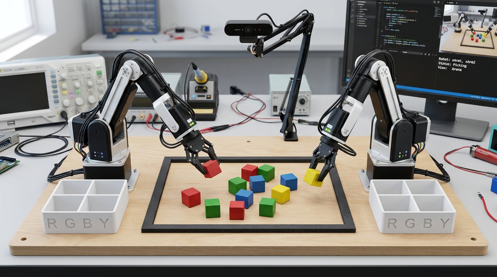
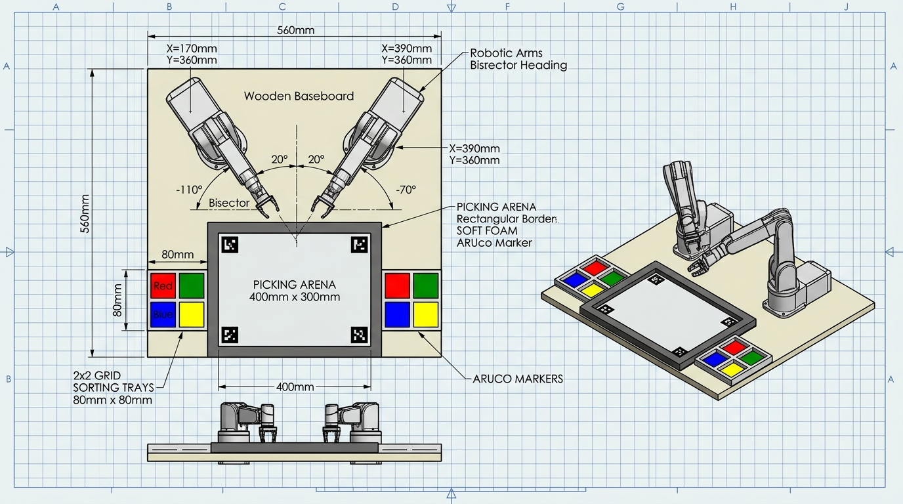
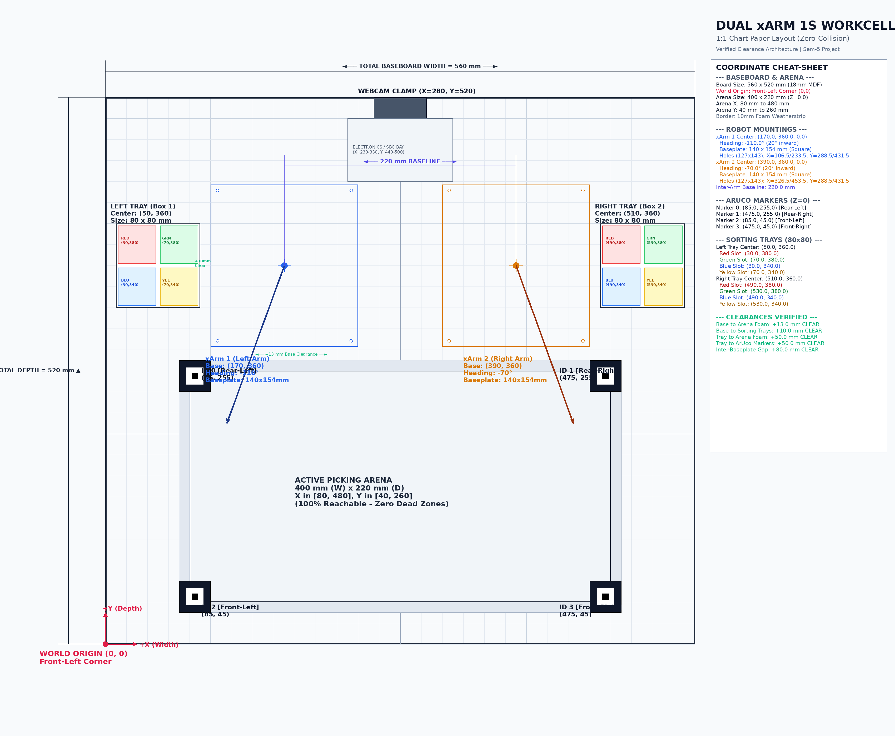
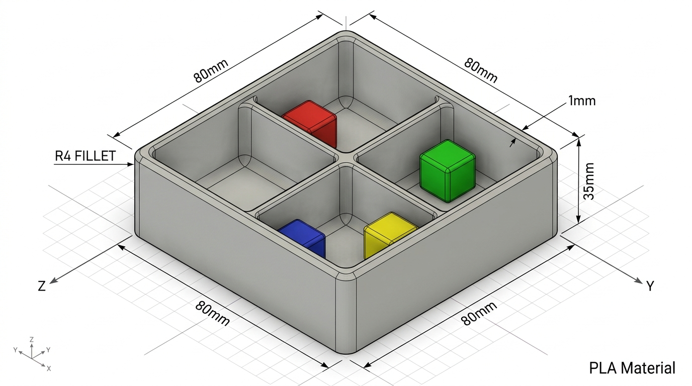

# 🤖 Dual xArm 1s Color-Sorting Robot

An autonomous dual-arm robotic sorting system powered by **ROS 2 Humble**, **OpenCV**, and two **xArm 1s** articulated bus-servo manipulators. The system detects randomly scattered colored wooden craft blocks on a flat rectangular arena, coordinates multi-arm task scheduling with zero collision contention, and sorts objects into dedicated color-coded flank sorting trays.

---

## 📸 System Architecture & Visual Renders









---

## 📌 Project Overview

This project automates color-based object sorting using computer vision, inverse kinematics, and multi-robot coordination under real-world physical and mechanical constraints:

1. **Inward-Angled V-Configuration Manipulator Mounting**:
   - Two xArm 1s arms spaced at $220.0\text{ mm}$ center-to-center, angled **$\pm 35.0^\circ$ inward** toward the arena.
   - Eliminates blind spots and creates a central shared overlap zone ($X \in [220, 340\text{ mm}]$) for cooperative picking and dynamic hand-offs.
2. **Zero-Carpentry Flat Baseboard ($560.0\text{ mm} \times 520.0\text{ mm} \times 18.0\text{ mm}$)**:
   - Single store-cut MDF or shelving board with zero woodworking cuts required.
   - High mass ($\approx 4\text{ kg}$) prevents table slipping, eliminates joint flex, and absorbs servo vibrations.
3. **Flat Rectangular Arena ($Z = 0.0\text{ mm}$, $400\times 220\text{ mm}$)**:
   - Sits directly flat on the baseboard at $Z = 0.0\text{ mm}$, eliminating 3D-printing massive puzzle tiles or jigsawing deck risers.
   - Self-adhesive foam weatherstripping tape ($8\text{--}10\text{ mm}$ tall) forms a compliant retaining perimeter that retains $25\text{ mm}$ cubes without jamming the claw.
   - *Clearance Verified*: $Y \in [40, 260\text{ mm}]$ leaves a safe $+13\text{ mm}$ buffer before reaching the robot metal baseplates ($Y = 283\text{ mm}$), ensuring 100% reachability with zero dead zones.
4. **Immediate Flank 2×2 Sorting Trays (Short ~70° Swing)**:
   - Dedicated 3D-printed 2×2 quadrant sorting trays ($80\times 80\times 35\text{ mm}$) located on the immediate lateral flanks of each arm at $(50, 360)$ and $(510, 360)$.
   - Drastically cuts drop motion swing from $125^\circ$ to $\approx 70.0^\circ$, halving drop cycle time and eliminating servo stall at the $240^\circ$ ROM limit.
5. **Table-Coplanar ArUco Markers ($Z = 0.0\text{ mm}$)**:
   - 4 matte vinyl ArUco stickers applied directly flat to the wooden board at the four corners of the arena ($Y = 255\text{ mm}$ and $Y = 45\text{ mm}$).
   - Because markers are strictly coplanar with the arena floor and cube bases, planar homography produces zero elevation perspective distortion.
6. **Minimal 3D Printing (< 85 g Total Filament)**:
   - Only two small $2\times 2$ quadrant sorting trays are 3D-printed; overhead camera uses a standard clamp-on desktop boom arm ($H \approx 700\text{ mm}$).

---

## 📐 Workspace Field Layout

```text
┌────────────────────────────────────────────────────────────────────────────────────────┐
│                                                                                        │
│                              ◄─── REAR OF WORKSPACE ───►                               │
│                                                                                        │
│                           [Clamp-On Overhead Camera Boom Arm]                          │
│                     ┌────────────────────────────────────────────┐                     │
│                     │       REAR ELECTRONICS BAY (Y=440..500)    │                     │
│                     │      (Jetson Orin / RPi 5 + Buck Hub)      │                     │
│                     └─────────────┬────────────────┬─────────────┘                     │
│                                   │                │                                   │
│   ┌─────────────────┐             ▼                ▼             ┌─────────────────┐   │
│   │  Tray 1 (2x2)   │          xArm 1            xArm 2          │  Tray 2 (2x2)   │   │
│   │  (Left Flank)   │      (X=170, Y=360)    (X=390, Y=360)      │  (Right Flank)  │   │
│   │  (Y=320..400)   │      [Base 140x154]    [Base 140x154]      │  (Y=320..400)   │   │
│   └─────────────────┘             │  +13mm Buffer  │             └─────────────────┘   │
│        ▲             ═════════════╪════════════════╪═════════════             ▲        │
│  +50mm │  ◤ ArUco #0              │                │               ArUco #1 ◥ │ +50mm  │
│        ▼  (85, 255)                \  RECTANGULAR  /               (475, 255) ▼        │
│                                     │ PICKING ARENA│                                   │
│                                     │ (400 x 220)  │ (Flat Z = 0.0 mm)                 │
│                                     │ (Foam Border)│                                   │
│                                     /              \                                   │
│                                    /                \                                  │
│           ◣ ArUco #2 ─────────────┴──────────────────┴───────────── ArUco #3 ◢         │
│           (85, 45)                                                 (475, 45)           │
│                                                                                        │
│                             ◄─── FRONT OF WORKSPACE ───►                               │
│                                          ▲                                             │
│                                 (Operator Position)                                    │
└────────────────────────────────────────────────────────────────────────────────────────┘

  Base Topology:   Single store-cut flat wooden board (560 x 520 x 18 mm MDF)
  Vision Focus:    100% of camera pixels warped onto the 400x220 mm picking arena
  Drop Travel:     Quick ~70° outward swing to lateral 2x2 sorting trays (r = 120 mm)
```

---

## 🛠 Hardware Specifications

| Component           | Specification                                                                                                   |
| ------------------- | --------------------------------------------------------------------------------------------------------------- |
| **Manipulators**    | 2× xArm 1s in V-Configuration ($-110.0^\circ$ & $-70.0^\circ$ bisector headings, $S = 220\text{ mm}$ spacing)    |
| **Link Lengths**    | Base-to-Shoulder ($d_1$): $65\text{ mm}$ · Upper Arm ($L_1$): $101\text{ mm}$ · Forearm ($L_2$): $95\text{ mm}$ · Tool ($L_3$): $150\text{--}168\text{ mm}$ |
| **Gripper**         | 2-finger parallel claw ($55\text{ mm}$ opening, Motor 2 axial roll, Motor 1 clamp)                              |
| **Compute**         | NVIDIA Jetson Orin Nano / Orin NX (or Raspberry Pi 5) (Ubuntu 22.04 LTS, rear electronics bay)                  |
| **Camera**          | Overhead USB webcam (Logitech C270 / C920) on clamp-on desktop scissor boom @ $65\text{--}70\text{ cm}$ nadir   |
| **Baseboard**       | Single store-cut MDF board ($560\text{ mm} \times 520\text{ mm} \times 18\text{ mm}$, zero woodworking cuts)   |
| **Picking Arena**   | Flat rectangular surface ($Z = 0.0\text{ mm}$, $400\times 220\text{ mm}$) with $8\text{--}10\text{ mm}$ foam tape border|
| **Collection Bins** | 2× 3D-printed 2×2 sorting trays ($80\times 80\times 35\text{ mm}$) on flanks at $(50, 360)$ and $(510, 360)$   |
| **Electronics Area**| Rear section of board ($Y \approx 440\text{ mm}$), short runs ($< 18\text{ cm}$) with surface wire clips         |
| **Fiducials**       | 4× matte vinyl ArUco stickers (`DICT_4X4_50`) coplanar with arena floor at $Z = 0.0\text{ mm}$                  |
| **Objects**         | 1-inch ($25.4\text{ mm}$) wooden craft cubes ($14\text{--}16\text{ g}$) in ultra-matte Red, Green, Blue, Yellow  |
| **Power Supply**    | Dual independent 7.4V / 5A buck regulators with common star ground                                              |
| **Communication**   | Direct USB HID / USB-UART serial buses (`/dev/ttyUSB0`, `/dev/ttyUSB1`) @ 115200 / 9600 baud                     |

> [!NOTE]
> **Joint Naming vs. Hiwonder Hardware IDs**:
> In mathematical kinematics ($\theta_1\text{--}\theta_6$), joints are indexed from base to claw ($\theta_1 = \text{Base Yaw}, \theta_2 = \text{Shoulder}, \theta_3 = \text{Elbow}, \theta_4 = \text{Wrist Pitch}, \theta_5 = \text{Wrist Roll}, \theta_6 = \text{Claw Clamp}$).
> On the physical Hiwonder xArm 1s bus servo daisy chain, hardware IDs are addressed tip-to-base: **ID 1 = Claw Gripper**, **ID 2 = Wrist Roll**, **ID 3 = Wrist Pitch**, **ID 4 = Elbow Pitch**, **ID 5 = Shoulder Pitch**, **ID 6 = Base Yaw**. All code and configuration files explicitly maintain this mapping.

---

## 💻 Software Stack & Architecture

- **Operating System**: Linux (Ubuntu 22.04 LTS)
- **Middleware**: ROS 2 Humble Hawksbill
- **Computer Vision**: OpenCV (ArUco planar homography, HSV color masking, contour moments)
- **Kinematics**: Analytical closed-form Inverse Kinematics + Distance-to-Pitch LUT
- **Web Dashboard**: HTML5, CSS3, JavaScript, Rosbridge WebSocket

### ROS 2 Graph & Node Roles

```text
[ Overhead Camera ]
       │
       ▼
 [ camera_node ] ───► /camera/image_raw
                           │
                           ▼
                    [ vision_node ] (ArUco Homography + HSV Color Detection)
                           │
                           ▼ /detected_objects
                  [ scheduler_node ] (Midline Split + arena_mutex Manager)
                    │             │
       /arm_1/tasks │             │ /arm_2/tasks
                    ▼             ▼
               [ arm_node ]   [ arm_node ]
                 (xArm 1)       (xArm 2)
                    │             │
                    ▼             ▼
              [ Serial 0 ]   [ Serial 1 ]
```

| Node             | Responsibility                                                                                                                  |
| ---------------- | ------------------------------------------------------------------------------------------------------------------------------- |
| `camera_node`    | Streams raw video frames from overhead boom camera to `/camera/image_raw`                                                       |
| `vision_node`    | Detects 4 arena ArUco markers, rectifies elevated arena to mm coordinates, runs HSV thresholding, publishes `/detected_objects` |
| `scheduler_node` | Assigns cubes to Arm 1 (Back) or Arm 2 (Front) via $Y=300\text{ mm}$ midline; serializes pick requests via `arena_mutex`        |
| `arm_node` (x2)  | Computes closed-form IK, executes 5-phase radial pick trajectory, rotates $205^\circ$ to NW/SW box, drops in dedicated bin      |
| `dashboard_node` | Serves real-time web interface via `rosbridge_server` displaying annotated camera feed and arm queue states                     |

---

## 📚 Technical Documentation Index

The project documentation is organized into modular **Stepping-Stone Engineering Specifications** and system integration guides in the [`docs/`](docs/) directory:

### Stepping-Stone Specifications

- 📄 **Stepping Stone 0**: [`docs/00_docker_and_ros2_development_guide.md`](docs/00_docker_and_ros2_development_guide.md) — Docker containerization, hybrid host/container development workflow, Intel GPU acceleration, USB hardware mapping, and ROS 2 Humble package build standards.
- 📄 **Stepping Stone 1**: [`docs/01_arena_and_layout.md`](docs/01_arena_and_layout.md) — 4-tile modular 3D-printable base, V-configuration dual xArm mounting, chamfered hexagonal arena (+25 mm), flank drop wells, Central Rear Wedge Bay, perimeter curb, and raised ArUco fiducials.
- 📄 **Stepping Stone 2**: [`docs/02_kinematics_and_grasp_planning.md`](docs/02_kinematics_and_grasp_planning.md) — Complete mathematical derivations, DH parameters, analytical IK formulas ($\theta_1\text{--}\theta_5$), top-down reach limit proof ($158.7\text{ mm}$), dual-regime wrist roll control, 5-phase trajectory waypoint profiling, torque/friction physics, and reference Python IK solver.
- 📄 **Stepping Stone 3**: [`docs/03_computer_vision_and_calibration.md`](docs/03_computer_vision_and_calibration.md) — Camera mounting optics, 4-point ArUco planar homography ($2.0\text{ px/mm}$), hardware exposure/WB locks, HSV color segmentation, spatial moments centroiding, and Python perception pipeline.
- 📄 **Stepping Stone 4**: [`docs/04_ros2_architecture_and_scheduling.md`](docs/04_ros2_architecture_and_scheduling.md) — Distributed ROS 2 Humble node graph, custom interface definitions, dynamic load balancing with hysteresis across $Y = 300\text{ mm}$ midline, spatial crossover mutex state machine, and production Python nodes.
- 📄 **Stepping Stone 5**: [`docs/05_hardware_bringup_and_firmware_control.md`](docs/05_hardware_bringup_and_firmware_control.md) — Low-level serial packet protocol (binary/ASCII), Arduino Uno R4 WiFi test bench, servo deviation zeroing, and tick-to-angle conversion.
- 📄 **Stepping Stone 6**: [`docs/06_system_testing_diagnostics_and_verification.md`](docs/06_system_testing_diagnostics_and_verification.md) — Nearest-First corridor collision avoidance, Motor 6 grip verification, empirical Z-sag compensation, and lens undistortion pipeline.
- 📄 **Stepping Stone 7**: [`docs/07_fusion360_cad_modeling_guide.md`](docs/07_fusion360_cad_modeling_guide.md) — Physical workcell fabrication guide, wood/MDF layered build, 3D renders, cut list, camera mast & non-glare painting.

### System Integration & Planning

- 📖 [**`docs/MANUAL.md`**](docs/MANUAL.md): **Comprehensive Operator Manual & Debugging Guide** (Python venv testing, Web Config Server, ROS 2 Docker workflow, and fault troubleshooting).
- 📄 [`docs/implementation_plan.md`](docs/implementation_plan.md): High-level System Architecture Blueprint, coordinate transformations, custom ROS 2 message definitions (`DetectedObject.msg`, `ArmTask.msg`, `ArmStatus.msg`), and pipelined execution rules.
- 📄 [`docs/roadmap.md`](docs/roadmap.md): Milestone-driven Phase-Gate Verification Checklist (Gate 0 to Gate 4) replacing rigid weekly schedules.
- 📄 [`docs/risks.md`](docs/risks.md): Failure Mode and Effects Analysis (FMEA) covering risks R-01 through R-11 (including $240^\circ$ base servo ROM deadzone mitigation), optical coplanarity rules, and pre-flight checklist.

### Technical Drawings & Schematics

- 🖼️ [`docs/assets/design.png`](docs/assets/design.png): High-resolution architectural diagram showing 4-tile modular base, V-configuration dual arms, flank drop wells, Central Rear Wedge Bay, and chamfered hexagonal arena.
- 🖼️ [`docs/assets/pcb module.webp`](docs/assets/pcb%20module.webp): Physical xArm controller board secondary UART pinout and electrical interfacing diagram.
- 🖼️ [`docs/assets/xArm demensions.png`](docs/assets/xArm%20demensions.png): Factory link measurements and motor layout drawing for the xArm 1s.

---

## 📂 Project Directory Structure

```text
Sem-5-mini-project/
│
├── arduino/                        # Microcontroller Test & Calibration Firmware
│   ├── xarm_direct_test/           # Breadboard-free teleoperation, reach & pick-and-place testing
│   │   └── xarm_direct_test.ino
│   └── xarm_zero_calibration/      # Interactive servo zeroing & deviation calibration
│       └── xarm_zero_calibration.ino
│
├── config/                         # Configuration YAMLs
│   ├── camera_calibration.yaml     # Overhead camera intrinsics & ArUco corner coordinates
│   ├── dual_xarm_hardware.yaml     # Immutable link lengths, mounting origins, joint limits & 4 color compartments
│   └── servo_calibration.yaml      # Measured zero-point deviation trims per joint
│
├── docker/                         # Docker & Hardware Pass-Through Scripts
│   ├── Dockerfile                  # ROS 2 Humble base image with OpenCV, serial & GUI support
│   ├── build.sh                    # Container build script
│   └── run.sh                      # Hardware passthrough container runner
│
├── docs/                           # Stepping-Stone & System Documentation
│   ├── README.md                   # Documentation Index & Architecture Map
│   ├── MANUAL.md                   # 📖 End-to-End Operator Manual & Debugging Guide
│   ├── 00_docker_and_ros2_development_guide.md # Stepping Stone 0: Docker & ROS 2 Workflow
│   ├── 01_arena_and_layout.md      # Stepping Stone 1: Arena & Component Placement
│   ├── 02_kinematics_and_grasp_planning.md # Stepping Stone 2: Kinematics & Grasp Planning
│   ├── 03_computer_vision_and_calibration.md # Stepping Stone 3: Vision & Calibration Pipeline
│   ├── 04_ros2_architecture_and_scheduling.md # Stepping Stone 4: ROS 2 & Mutex Scheduling
│   ├── 05_hardware_bringup_and_firmware_control.md # Stepping Stone 5: Low-Level Protocols & Bringup
│   ├── 06_system_testing_diagnostics_and_verification.md # Stepping Stone 6: Testing & Diagnostics
│   ├── 07_fusion360_cad_modeling_guide.md # Stepping Stone 7: Flat Board & 3D Printed Tray Rapid Fabrication
│   ├── assets/                     # CAD Renders, Blueprints, Photos & Layout Diagrams
│   ├── implementation_plan.md      # System architecture & integration blueprint
│   ├── risks.md                    # Risk matrix & failure mode analysis (R-01 to R-11)
│   └── roadmap.md                  # Milestone-based Phase-Gate Checklist (Gate 0 to Gate 4)
│
├── ros2_ws/                        # ROS 2 Humble Workspace (RUN EXCLUSIVELY IN DOCKER)
│   └── src/
│       └── sorting_arm/            # Hardware driver node, analytical polar IK, trajectory & coordinator
│           ├── launch/
│           │   ├── xarm_driver.launch.py
│           │   └── dual_xarm.launch.py
│           ├── sorting_arm/
│           │   ├── direct_test.py      # Standalone USB HID/serial driver test
│           │   ├── driver_node.py      # ROS 2 hardware driver node with E-Stop
│           │   ├── dual_arm_coordinator_node.py # Dual-arm coordinator with spatial corridor mutex
│           │   ├── kinematics.py       # Closed-form analytical polar IK solver
│           │   ├── polar_teleop_node.py# Keyboard polar coordinate teleop
│           │   ├── trajectory.py       # Quintic polynomial minimum-jerk trajectory generator
│           │   └── xarm_protocol.py    # Multi-interface serial/HID communication protocol
│           ├── test/
│           │   ├── run_tests.py        # Standalone offline simulation test suite
│           │   └── test_calibration_and_features.py # 18 verification unit tests
│           ├── package.xml
│           ├── setup.cfg
│           └── setup.py
│
├── tools/                          # Utility & Calibration Tools (RUN IN VENV OR DOCKER)
│   ├── pick_and_place_test.py      # Trajectory test with closed-loop verification
│   ├── telemetry_logger.py         # Sub-millimeter drift analysis & repeatability logger
│   └── web_config/                 # Real-time Web Configuration & Calibration Tool
│       ├── server.py               # Dynamic port auto-detect HTTP & REST API server (:8000)
│       └── index.html              # Interactive browser dashboard
│
├── .devcontainer/                 # VS Code Dev Container configuration
├── requirements.txt                # Python host virtual environment dependencies
└── setup_venv.sh                   # One-click host Python virtual environment setup
│   └── devcontainer.json           # 1-click isolated ROS 2 environment
│
├── docker/                         # Project-Level Docker Environment
│   ├── Dockerfile                  # Multi-arch (x86_64 / arm64) ROS 2 Humble image
│   ├── build.sh                    # Host UID/GID matching build script
│   ├── run.sh                      # Launch script with Intel GPU, GUI, & hardware pass-through
│   └── entrypoint.sh               # Environment overlay auto-source entrypoint
│
├── DOCKER_GUIDE.md                 # Complete Docker & ROS 2 Humble user manual
├── README.md                       # Project landing page & documentation
└── requirements.txt                # Python dependencies
```

---

## 🚀 Getting Started

You can run this project using the **Project-Isolated Docker Environment** (recommended for Ubuntu 24.04/26.04 hosts and cross-platform Jetson deployment) or **Native Ubuntu 22.04**.

---

### Option A: Project-Isolated Docker (Recommended)

Keeps your host operating system clean, avoids global ROS package conflicts, and runs seamlessly on both **Intel GPU laptops** and **NVIDIA Jetson (ARM64)** boards.

> 📖 **Full Guide**: See [**`DOCKER_GUIDE.md`**](DOCKER_GUIDE.md) for the complete manual, multi-terminal workflow, hardware configuration, and troubleshooting.

#### 1. Prerequisites
- Docker Engine installed (`docker run hello-world` runs without `sudo`)
- USB Webcam (Logitech C270 or C920)
- 2× xArm 1s Robotic Arms connected via USB-UART

#### 2. Build the Project Container
From the repository root:
```bash
./docker/build.sh
```

#### 3. Launch the Container Shell
```bash
./docker/run.sh
```
*(This automatically configures Intel GPU acceleration `/dev/dri`, X11 GUI forwarding for RViz2/OpenCV, and passes through USB serial and video devices).*

#### 4. Build Workspace & Run Nodes (Inside Container)
```bash
# 1. Build ROS 2 workspace
cd /workspace/ros2_ws
colcon build --symlink-install
source install/setup.bash

# 2. Run automated analytical kinematics tests
pytest src/sorting_arm/test/test_kinematics.py

# 3. Launch xArm 1s hardware driver node (auto-detects USB HID / serial)
ros2 launch sorting_arm xarm_driver.launch.py

# 4. Or run interactive polar teleoperation node
ros2 run sorting_arm polar_teleop_node

# (Future Full Pipeline — Phase 3+):
# ros2 launch sorting_vision vision.launch.py
# ros2 launch sorting_scheduler system.launch.py
```

---

### Option B: Host Python Virtual Environment (Standalone Python Tools Only)

For running standalone Python scripts (Web Configuration Dashboard, servo calibration, telemetry analysis, direct tests) without spinning up Docker:

> [!WARNING]
> **ROS 2 Execution Policy**: All ROS 2 nodes, launches, and coordination services must run **strictly inside the Docker container** (`./docker/run.sh`). Python commands on the host must be run exclusively inside the dedicated Python virtual environment (`.venv`).

#### 1. Setup Host Virtual Environment
```bash
# Run one-click setup script (creates .venv and installs dependencies)
./setup_venv.sh

# Or activate manually
source .venv/bin/activate
```

#### 2. Run Web Configuration & Calibration Tool
```bash
# Launch dynamic auto-detecting web server on port 8000
python3 tools/web_config/server.py
# Open http://localhost:8000 in your browser
```

#### 3. Run Standalone Tests & Telemetry
```bash
# Run 18 offline simulation unit tests
PYTHONPATH=ros2_ws/src/sorting_arm:. python3 ros2_ws/src/sorting_arm/test/run_tests.py

# Run sub-millimeter telemetry drift logger
python3 tools/telemetry_logger.py --scan
```

For the comprehensive guide, see 📖 [**`docs/MANUAL.md`**](docs/MANUAL.md).

---

## 👨‍💻 Project Team

- **Dhruv Arora**
- **Shubham Jain**
- **Karan Pal**

---

## 📅 Project Status

- [x] Stepping Stone 0: Docker & ROS 2 Development Environment (`docs/00_docker_and_ros2_development_guide.md`)
- [x] Stepping Stone 1: Arena & Physical Component Placement (`docs/01_arena_and_layout.md`)
- [x] Stepping Stone 2: Kinematics & Grasp Planning (`docs/02_kinematics_and_grasp_planning.md`)
- [x] Stepping Stone 3: Computer Vision & Calibration (`docs/03_computer_vision_and_calibration.md`)
- [x] Stepping Stone 4: ROS 2 Architecture & Mutex Scheduling (`docs/04_ros2_architecture_and_scheduling.md`)
- [x] Stepping Stone 5: Hardware Bringup & Firmware Control (`docs/05_hardware_bringup_and_firmware_control.md`)
- [x] Stepping Stone 6: Testing, Diagnostics & Reach Verification (`docs/06_system_testing_diagnostics_and_verification.md`)
- [x] Stepping Stone 7: Flat Board & 3D Printed Tray Rapid Fabrication (`docs/07_fusion360_cad_modeling_guide.md`)
- [x] End-to-End Operator Manual & Debugging Guide (`docs/MANUAL.md`)
- [x] Zero-Carpentry Flat Board + 2x2 Flank Tray Architecture (`docs/assets/workcell_flat_overview.png`, `docs/assets/wood_platform_blueprint.png`, `docs/assets/tray_3d_print_cad.png`)
- [x] Technical Schematic Design (`docs/assets/design.png` & `docs/assets/pcb module.webp`)
- [x] Risk Matrix & $240^\circ$ ROM Mitigation (`docs/risks.md`)
- [x] Phase 0: Arduino Hardware Bringup, Calibration & Reach Testing (`arduino/`)
- [x] Phase 1 Core: ROS 2 Hardware Driver, Closed-Form Polar IK, & Teleop (`ros2_ws/src/sorting_arm/`)
- [ ] Physical Assembly & Arena Mounting _(Week 1)_
- [ ] OpenCV Dedicated Arena Homography & HSV Tuning _(Week 2)_
- [ ] ROS 2 Graph & Mutex Scheduler _(Week 3)_
- [ ] Single Arm Pick & Pitch LUT Calibration _(Weeks 4–6)_
- [ ] Dual Arm Pipelined Integration _(Weeks 7–8)_
- [ ] Live Web Dashboard & Robustness Polish _(Weeks 9–10)_
- [ ] Final Presentation & Demo Video _(Week 11)_

