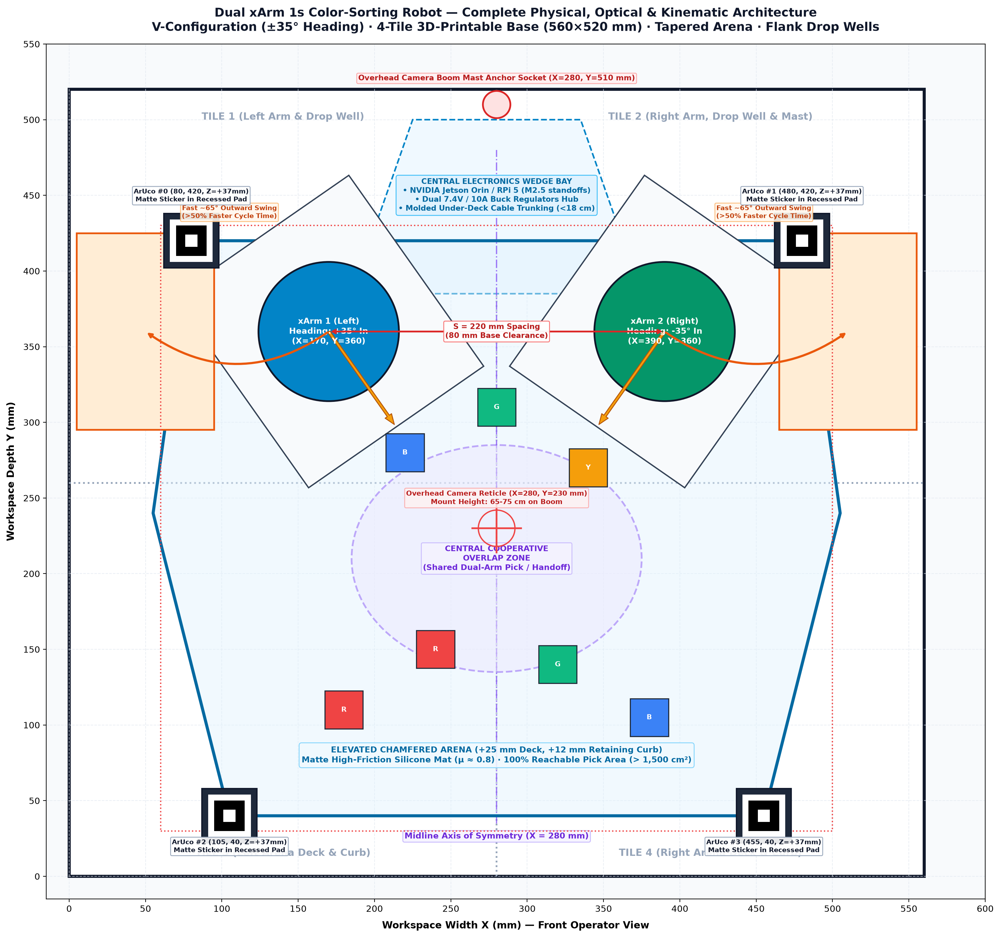

# 🤖 Dual xArm 1s Color-Sorting Robot

An autonomous dual-arm robotic sorting system powered by **ROS 2 Humble**, **OpenCV**, and two **xArm 1s** articulated bus-servo manipulators. The system detects randomly scattered colored wooden cubes on an elevated continuous stadium arena, coordinates multi-arm task scheduling with zero collision contention, and sorts objects into dedicated color-coded bins.

---

## 📸 System Architecture Schematic



---

## 📌 Project Overview

This project automates color-based object sorting using computer vision, inverse kinematics, and multi-robot coordination under real-world physical and mechanical constraints:

1. **Inward-Angled V-Configuration Manipulator Mounting**:
   - Two xArm 1s arms spaced at $220\text{ mm}$ center-to-center, angled **$\pm 35.0^\circ$ inward** toward the arena.
   - Eliminates blind spots and creates a central shared overlap zone ($\approx 200\text{ mm} \times 160\text{ mm}$) for cooperative picking and dynamic hand-offs.
2. **Chamfered Hexagonal / Tapered Arena (+25 mm)**:
   - Replaces the narrow rectangular strip with a tapered geometry ($450\text{ mm}$ wide at rear tapering to $350\text{ mm}$ at front, $380\text{ mm}$ depth).
   - Elevated platform ($+25\text{ mm}$) with a high-friction silicone mat and a $12\text{ mm}$ perimeter retaining curb to prevent cubes from rolling off.
3. **Immediate Flank Drop Pockets (Short ~65°-75° Swing)**:
   - Nested drop wells located immediately beside each arm's outer flank.
   - Drastically cuts drop motion swing from $125^\circ$ to $\approx 65^\circ\text{--}75^\circ$, halving drop cycle time and eliminating servo stall at the $240^\circ$ ROM limit.
4. **Central Rear Wedge Electronics & Under-Deck Trunking**:
   - The triangular wedge behind the arm bases houses the NVIDIA Jetson / Raspberry Pi 5 and dual 7.4V / 10A power hub.
   - Shortens USB and power runs to $< 18\text{ cm}$ with molded under-deck cable conduits.
5. **Raised ArUco Perimeter Pads (Hybrid Pocket Method)**:
   - 4 fiducial pads molded directly into the elevated curb vertices with $0.8\text{ mm}$ recessed pockets.
   - Matte vinyl stickers press-fit into pockets eliminate specular glare while providing CAD-ground-truth coordinates.
6. **4-Tile Modular 3D-Printable Base**:
   - Sized for standard consumer 3D printers ($\le 250\text{ mm} \times 250\text{ mm}$ bed size), joined with precision dovetails, M4 under-deck clamping, and brass heat-set inserts.

---

## 📐 Workspace Field Layout

```text
┌────────────────────────────────────────────────────────────────────────────────────────┐
│                                                                                        │
│                              ◄─── REAR OF WORKSPACE ───►                               │
│                                                                                        │
│                           [Overhead Camera Boom Mast Anchor]                           │
│                     ┌────────────────────────────────────────────┐                     │
│                     │         CENTRAL ELECTRONICS WEDGE          │                     │
│                     │      (Jetson Orin / RPi 5 + Buck Hub)      │                     │
│                     └─────────────┬────────────────┬─────────────┘                     │
│                                   │                │                                   │
│   ┌─────────────────┐             ▼                ▼             ┌─────────────────┐   │
│   │  Box 1 Nest     │          xArm 1            xArm 2          │  Box 2 Nest     │   │
│   │  (Left Flank)   │       (Angled +35°)     (Angled -35°)      │  (Right Flank)  │   │
│   └─────────────────┘      \                      /              └─────────────────┘   │
│       ◤ ArUco #0            \                    /                     ArUco #1 ◥      │
│                              \    CHAMFERED     /                                      │
│                               │   HEXAGONAL    │                                       │
│                               │     ARENA      │ (Elevated +25 mm)                     │
│                               │   (Overlap)    │                                       │
│                               /                \                                       │
│                              /                  \                                      │
│       ◣ ArUco #2 ───────────┴────────────────────┴─────────── ArUco #3 ◢               │
│                                                                                        │
│                             ◄─── FRONT OF WORKSPACE ───►                               │
│                                          ▲                                             │
│                                 (Operator Position)                                    │
└────────────────────────────────────────────────────────────────────────────────────────┘

  Base Topology:   4-Tile modular 3D-printed interlocking base (<= 250x250 mm tiles)
  Vision Focus:    100% of camera pixels warped onto the chamfered picking arena
  Drop Travel:     Quick ~65°-75° outward swing to lateral nested collection wells
```

---

## 🛠 Hardware Specifications

| Component           | Specification                                                                                                   |
| ------------------- | --------------------------------------------------------------------------------------------------------------- |
| **Manipulators**    | 2× xArm 1s (5/6-DOF bus servo arms, Motor 5 shoulder axis @ $65\text{ mm}$) in V-Configuration ($\pm 35^\circ$)  |
| **Link Lengths**    | Base-to-Shoulder ($d_1$): $65\text{ mm}$ · Upper Arm ($L_1$): $101\text{ mm}$ · Forearm ($L_2$): $95\text{ mm}$ · Tool ($L_3$): $150\text{--}168\text{ mm}$ |
| **Gripper**         | 2-finger parallel claw ($55\text{ mm}$ opening, Motor 2 axial roll, Motor 1 clamp)                              |
| **Compute**         | NVIDIA Jetson Orin Nano / Orin NX (or Raspberry Pi 5) (Ubuntu 22.04 LTS, Central Rear Wedge Bay)                |
| **Camera**          | Overhead USB webcam (Logitech C270 / C920) on rear boom stand @ $65\text{--}75\text{ cm}$                       |
| **Modular Base**    | 4-tile interlocking 3D-printed base ($560\text{ mm} \times 520\text{ mm}$, fits $\le 250\text{ mm}$ print beds) |
| **Picking Arena**   | Elevated tapered hexagonal deck ($+25\text{ mm}$) with $12\text{ mm}$ curb & matte silicone mat ($\mu \approx 0.8$) |
| **Collection Bins** | 2× dedicated flank drop pockets (Box 1 West @ $-70^\circ$, Box 2 East @ $+70^\circ$, $Z = 0\text{ mm}$)         |
| **Electronics Bay** | Central Rear Wedge ($X \in [180, 380\text{ mm}], Y \in [380, 510\text{ mm}]$), short runs ($< 18\text{ cm}$)   |
| **Fiducials**       | 4× raised ArUco pads molded into curb with $0.8\text{ mm}$ recessed pockets for matte stickers                  |
| **Objects**         | $25\text{ mm}$ wooden cubes spray-painted in 4 high-contrast matte colors                                       |
| **Power Supply**    | Dedicated 7.4V / 5A power supply per arm with common ground                                                     |
| **Communication**   | Direct USB HID / USB-UART serial buses (`/dev/ttyUSB0`, `/dev/ttyUSB1`) @ 115200 / 9600 baud                     |

> [!NOTE]
> **Joint Naming vs. Hiwonder Hardware IDs**:
> In mathematical kinematics ($\theta_1\text{--}\theta_6$), joints are indexed from base to claw ($\theta_1 = \text{Base Yaw}, \theta_2 = \text{Shoulder}, \theta_3 = \text{Elbow}, \theta_4 = \text{Wrist Pitch}, \theta_5 = \text{Wrist Roll}, \theta_6 = \text{Claw Clamp}$).
> On the physical Hiwonder xArm 1s bus servo daisy chain, hardware IDs are addressed tip-to-base: **ID 1 = Claw Gripper**, **ID 2 = Wrist Roll**, **ID 3 = Wrist Pitch**, **ID 4 = Elbow Pitch**, **ID 5 = Shoulder Pitch**, **ID 6 = Base Yaw**. All code and configuration files explicitly maintain this mapping.

---

## 💻 Software Stack & Architecture

- **Operating System**: Linux (Ubuntu 22.04 LTS)
- **Middleware**: ROS 2 Humble Hawksbill
- **Computer Vision**: OpenCV (ArUco planar homography, HSV color masking, contour moments)
- **Kinematics**: Analytical closed-form Inverse Kinematics + Distance-to-Pitch LUT
- **Web Dashboard**: HTML5, CSS3, JavaScript, Rosbridge WebSocket

### ROS 2 Graph & Node Roles

```text
[ Overhead Camera ]
       │
       ▼
 [ camera_node ] ───► /camera/image_raw
                           │
                           ▼
                    [ vision_node ] (ArUco Homography + HSV Color Detection)
                           │
                           ▼ /detected_objects
                  [ scheduler_node ] (Midline Split + arena_mutex Manager)
                    │             │
       /arm_1/tasks │             │ /arm_2/tasks
                    ▼             ▼
               [ arm_node ]   [ arm_node ]
                 (xArm 1)       (xArm 2)
                    │             │
                    ▼             ▼
              [ Serial 0 ]   [ Serial 1 ]
```

| Node             | Responsibility                                                                                                                  |
| ---------------- | ------------------------------------------------------------------------------------------------------------------------------- |
| `camera_node`    | Streams raw video frames from overhead boom camera to `/camera/image_raw`                                                       |
| `vision_node`    | Detects 4 arena ArUco markers, rectifies elevated arena to mm coordinates, runs HSV thresholding, publishes `/detected_objects` |
| `scheduler_node` | Assigns cubes to Arm 1 (Back) or Arm 2 (Front) via $Y=300\text{ mm}$ midline; serializes pick requests via `arena_mutex`        |
| `arm_node` (x2)  | Computes closed-form IK, executes 5-phase radial pick trajectory, rotates $205^\circ$ to NW/SW box, drops in dedicated bin      |
| `dashboard_node` | Serves real-time web interface via `rosbridge_server` displaying annotated camera feed and arm queue states                     |

---

## 📚 Technical Documentation Index

The project documentation is organized into modular **Stepping-Stone Engineering Specifications** and system integration guides in the [`docs/`](docs/) directory:

### Stepping-Stone Specifications

- 📄 **Stepping Stone 0**: [`docs/00_docker_and_ros2_development_guide.md`](docs/00_docker_and_ros2_development_guide.md) — Docker containerization, hybrid host/container development workflow, Intel GPU acceleration, USB hardware mapping, and ROS 2 Humble package build standards.
- 📄 **Stepping Stone 1**: [`docs/01_arena_and_layout.md`](docs/01_arena_and_layout.md) — 4-tile modular 3D-printable base, V-configuration dual xArm mounting, chamfered hexagonal arena (+25 mm), flank drop wells, Central Rear Wedge Bay, perimeter curb, and raised ArUco fiducials.
- 📄 **Stepping Stone 2**: [`docs/02_kinematics_and_grasp_planning.md`](docs/02_kinematics_and_grasp_planning.md) — Complete mathematical derivations, DH parameters, analytical IK formulas ($\theta_1\text{--}\theta_5$), top-down reach limit proof ($158.7\text{ mm}$), dual-regime wrist roll control, 5-phase trajectory waypoint profiling, torque/friction physics, and reference Python IK solver.
- 📄 **Stepping Stone 3**: [`docs/03_computer_vision_and_calibration.md`](docs/03_computer_vision_and_calibration.md) — Camera mounting optics, 4-point ArUco planar homography ($2.0\text{ px/mm}$), hardware exposure/WB locks, HSV color segmentation, spatial moments centroiding, and Python perception pipeline.
- 📄 **Stepping Stone 4**: [`docs/04_ros2_architecture_and_scheduling.md`](docs/04_ros2_architecture_and_scheduling.md) — Distributed ROS 2 Humble node graph, custom interface definitions, dynamic load balancing with hysteresis across $Y = 300\text{ mm}$ midline, spatial crossover mutex state machine, and production Python nodes.
- 📄 **Stepping Stone 5**: [`docs/05_hardware_bringup_and_firmware_control.md`](docs/05_hardware_bringup_and_firmware_control.md) — Low-level serial packet protocol (binary/ASCII), Arduino Uno R4 WiFi test bench, servo deviation zeroing, and tick-to-angle conversion.
- 📄 **Stepping Stone 6**: [`docs/06_system_testing_diagnostics_and_verification.md`](docs/06_system_testing_diagnostics_and_verification.md) — Nearest-First corridor collision avoidance, Motor 6 grip verification, empirical Z-sag compensation, and lens undistortion pipeline.

### System Integration & Planning

- 📄 [`docs/implementation_plan.md`](docs/implementation_plan.md): High-level System Architecture Blueprint, coordinate transformations, custom ROS 2 message definitions (`DetectedObject.msg`, `ArmTask.msg`, `ArmStatus.msg`), and pipelined execution rules.
- 📄 [`docs/roadmap.md`](docs/roadmap.md): Milestone-driven Phase-Gate Verification Checklist (Gate 0 to Gate 4) replacing rigid weekly schedules.
- 📄 [`docs/risks.md`](docs/risks.md): Failure Mode and Effects Analysis (FMEA) covering risks R-01 through R-11 (including $240^\circ$ base servo ROM deadzone mitigation), optical coplanarity rules, and pre-flight checklist.

### Technical Drawings & Schematics

- 🖼️ [`docs/design.png`](docs/design.png): High-resolution architectural diagram showing 4-tile modular base, V-configuration dual arms, flank drop wells, Central Rear Wedge Bay, and chamfered hexagonal arena.
- 🖼️ [`docs/pcb module.webp`](docs/pcb%20module.webp): Physical xArm controller board secondary UART pinout and electrical interfacing diagram.
- 🖼️ [`docs/xArm demensions.png`](docs/xArm%20demensions.png): Factory link measurements and motor layout drawing for the xArm 1s.

---

## 📂 Project Directory Structure

```text
Sem-5-mini-project/
│
├── arduino/                        # Microcontroller Test & Calibration Firmware
│   ├── xarm_direct_test/           # Breadboard-free teleoperation, reach & pick-and-place testing
│   │   └── xarm_direct_test.ino
│   └── xarm_zero_calibration/      # Interactive servo zeroing & deviation calibration
│       └── xarm_zero_calibration.ino
│
├── config/                         # Configuration YAMLs
│   ├── dual_xarm_hardware.yaml     # Immutable link lengths, mounting origins, joint limits & 4 color compartments
│   └── servo_calibration.yaml      # Measured zero-point deviation trims per joint
│
├── docs/                           # Stepping-Stone & System Documentation
│   ├── README.md                   # Documentation Index & Architecture Map
│   ├── 00_docker_and_ros2_development_guide.md # Stepping Stone 0: Docker & ROS 2 Workflow
│   ├── 01_arena_and_layout.md      # Stepping Stone 1: Arena & Component Placement
│   ├── 02_kinematics_and_grasp_planning.md # Stepping Stone 2: Kinematics & Grasp Planning
│   ├── 03_computer_vision_and_calibration.md # Stepping Stone 3: Vision & Calibration Pipeline
│   ├── 04_ros2_architecture_and_scheduling.md # Stepping Stone 4: ROS 2 & Mutex Scheduling
│   ├── 05_hardware_bringup_and_firmware_control.md # Stepping Stone 5: Low-Level Protocols & Bringup
│   ├── 06_system_testing_diagnostics_and_verification.md # Stepping Stone 6: Testing & Diagnostics
│   ├── design.png                  # High-resolution architectural schematic
│   ├── implementation_plan.md      # System architecture & integration blueprint
│   ├── pcb module.webp             # Controller board pinout diagram
│   ├── risks.md                    # Risk matrix & failure mode analysis (R-01 to R-11)
│   ├── roadmap.md                  # Milestone-based Phase-Gate Checklist (Gate 0 to Gate 4)
│   └── xArm demensions.png         # Physical robot dimension schematic
│
├── ros2_ws/                        # ROS 2 Humble Workspace
│   └── src/
│       └── sorting_arm/            # Hardware driver node, analytical polar IK, & teleop
│           ├── launch/
│           │   └── xarm_driver.launch.py
│           ├── sorting_arm/
│           │   ├── direct_test.py      # Standalone USB HID/serial driver test
│           │   ├── driver_node.py      # ROS 2 hardware driver node with E-Stop
│           │   ├── kinematics.py       # Closed-form analytical polar IK solver
│           │   ├── polar_teleop_node.py# Keyboard polar coordinate teleop
│           │   └── xarm_protocol.py    # Multi-interface serial/HID communication protocol
│           ├── test/
│           │   ├── test_copyright.py
│           │   ├── test_flake8.py
│           │   ├── test_kinematics.py  # Analytical IK and reachability unit tests
│           │   └── test_pep257.py
│           ├── package.xml
│           ├── setup.cfg
│           └── setup.py
│       # (Planned future packages: sorting_interfaces, sorting_vision, sorting_scheduler)
│
├── .devcontainer/                 # VS Code Dev Container configuration
│   └── devcontainer.json           # 1-click isolated ROS 2 environment
│
├── docker/                         # Project-Level Docker Environment
│   ├── Dockerfile                  # Multi-arch (x86_64 / arm64) ROS 2 Humble image
│   ├── build.sh                    # Host UID/GID matching build script
│   ├── run.sh                      # Launch script with Intel GPU, GUI, & hardware pass-through
│   └── entrypoint.sh               # Environment overlay auto-source entrypoint
│
├── DOCKER_GUIDE.md                 # Complete Docker & ROS 2 Humble user manual
├── README.md                       # Project landing page & documentation
└── requirements.txt                # Python dependencies
```

---

## 🚀 Getting Started

You can run this project using the **Project-Isolated Docker Environment** (recommended for Ubuntu 24.04/26.04 hosts and cross-platform Jetson deployment) or **Native Ubuntu 22.04**.

---

### Option A: Project-Isolated Docker (Recommended)

Keeps your host operating system clean, avoids global ROS package conflicts, and runs seamlessly on both **Intel GPU laptops** and **NVIDIA Jetson (ARM64)** boards.

> 📖 **Full Guide**: See [**`DOCKER_GUIDE.md`**](DOCKER_GUIDE.md) for the complete manual, multi-terminal workflow, hardware configuration, and troubleshooting.

#### 1. Prerequisites
- Docker Engine installed (`docker run hello-world` runs without `sudo`)
- USB Webcam (Logitech C270 or C920)
- 2× xArm 1s Robotic Arms connected via USB-UART

#### 2. Build the Project Container
From the repository root:
```bash
./docker/build.sh
```

#### 3. Launch the Container Shell
```bash
./docker/run.sh
```
*(This automatically configures Intel GPU acceleration `/dev/dri`, X11 GUI forwarding for RViz2/OpenCV, and passes through USB serial and video devices).*

#### 4. Build Workspace & Run Nodes (Inside Container)
```bash
# 1. Build ROS 2 workspace
cd /workspace/ros2_ws
colcon build --symlink-install
source install/setup.bash

# 2. Run automated analytical kinematics tests
pytest src/sorting_arm/test/test_kinematics.py

# 3. Launch xArm 1s hardware driver node (auto-detects USB HID / serial)
ros2 launch sorting_arm xarm_driver.launch.py

# 4. Or run interactive polar teleoperation node
ros2 run sorting_arm polar_teleop_node

# (Future Full Pipeline — Phase 3+):
# ros2 launch sorting_vision vision.launch.py
# ros2 launch sorting_scheduler system.launch.py
```

---

### Option B: Native Installation (Ubuntu 22.04 LTS Only)

#### 1. Prerequisites
- Ubuntu 22.04 LTS with [ROS 2 Humble Desktop](https://docs.ros.org/en/humble/Installation.html)
- Python 3.10+
- USB Webcam (Logitech C270 or C920)
- 2× xArm 1s Robotic Arms connected via USB-UART

#### 2. Installation & Build
```bash
# Install Python dependencies
pip install -r requirements.txt

# Build the ROS 2 workspace
cd ros2_ws
colcon build --symlink-install
source install/setup.bash
```

#### 3. Launching the System
```bash
# Run automated kinematics tests
pytest src/sorting_arm/test/test_kinematics.py

# Launch xArm 1s hardware driver node
ros2 launch sorting_arm xarm_driver.launch.py

# Or run polar teleoperation node
ros2 run sorting_arm polar_teleop_node

# (Future Full Pipeline — Phase 3+):
# ros2 launch sorting_vision vision.launch.py
# ros2 launch sorting_scheduler system.launch.py
```

---

## 👨‍💻 Project Team

- **Dhruv Arora**
- **Shubham Jain**
- **Karan Pal**

---

## 📅 Project Status

- [x] Stepping Stone 0: Docker & ROS 2 Development Environment (`docs/00_docker_and_ros2_development_guide.md`)
- [x] Stepping Stone 1: Arena & Physical Component Placement (`docs/01_arena_and_layout.md`)
- [x] Stepping Stone 2: Kinematics & Grasp Planning (`docs/02_kinematics_and_grasp_planning.md`)
- [x] Stepping Stone 5: Hardware Bringup & Firmware Control (`docs/05_hardware_bringup_and_firmware_control.md`)
- [x] Technical Schematic Design (`docs/design.png` & `docs/pcb module.webp`)
- [x] Risk Matrix & $240^\circ$ ROM Mitigation (`docs/risks.md`)
- [x] Phase 0: Arduino Hardware Bringup, Calibration & Reach Testing (`arduino/`)
- [x] Phase 1 Core: ROS 2 Hardware Driver, Closed-Form Polar IK, & Teleop (`ros2_ws/src/sorting_arm/`)
- [ ] Physical Assembly & Arena Mounting _(Week 1)_
- [ ] OpenCV Dedicated Arena Homography & HSV Tuning _(Week 2)_
- [ ] ROS 2 Graph & Mutex Scheduler _(Week 3)_
- [ ] Single Arm Pick & Pitch LUT Calibration _(Weeks 4–6)_
- [ ] Dual Arm Pipelined Integration _(Weeks 7–8)_
- [ ] Live Web Dashboard & Robustness Polish _(Weeks 9–10)_
- [ ] Final Presentation & Demo Video _(Week 11)_
