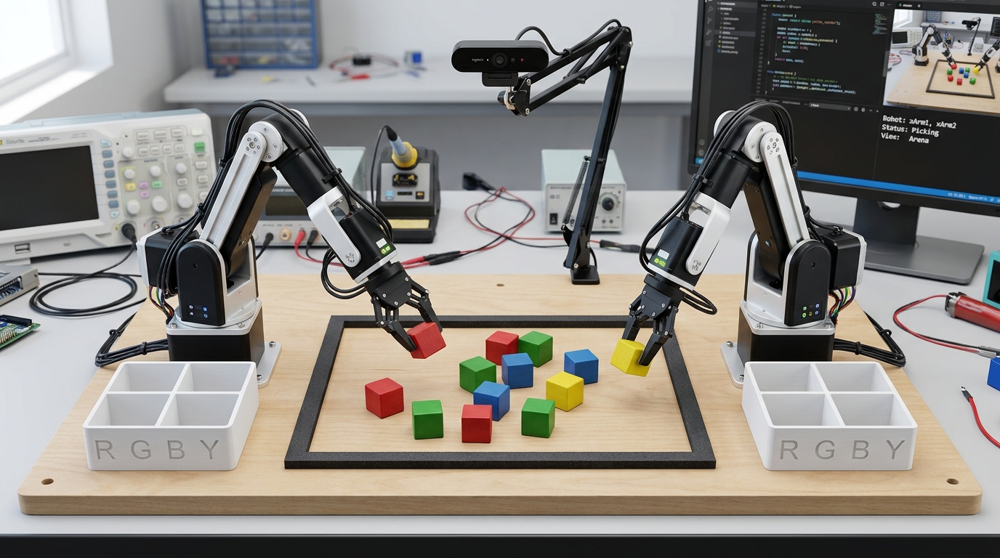
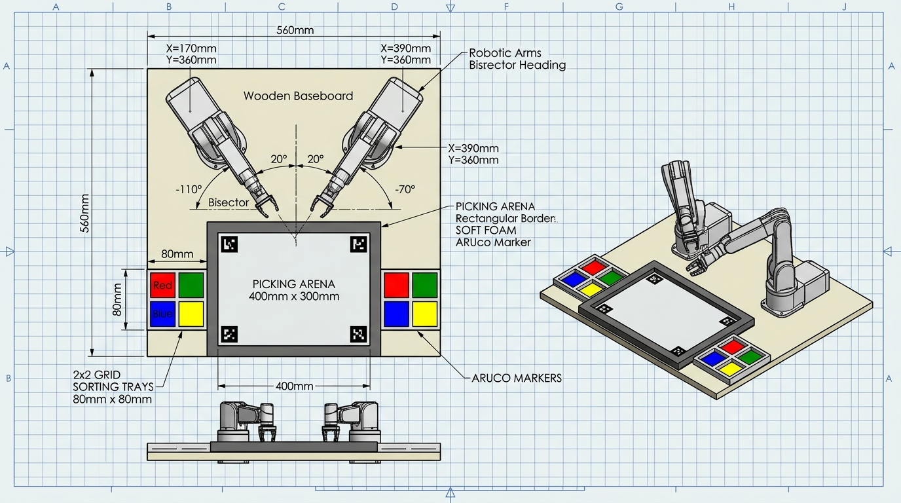
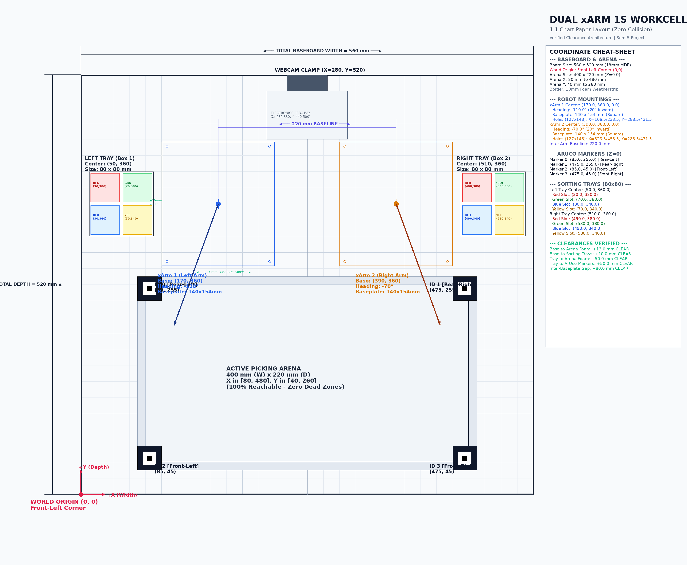
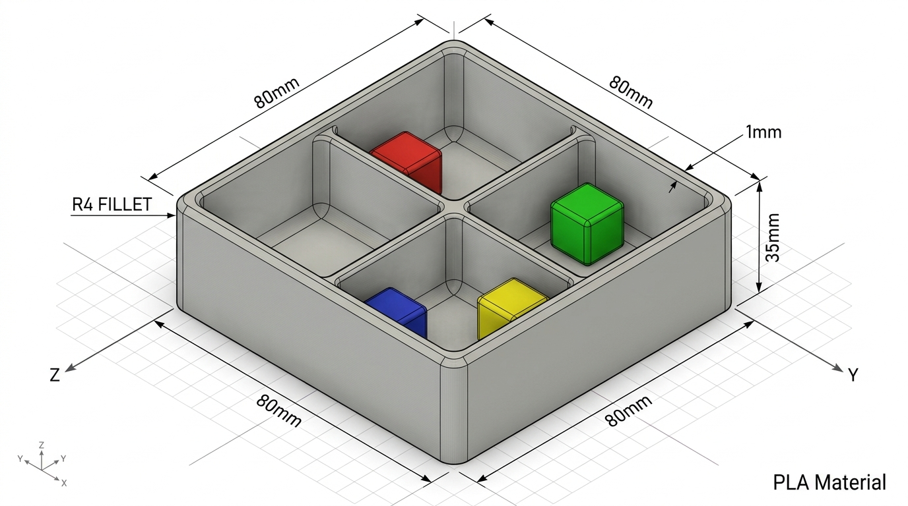

# Stepping Stone 1: Arena & Physical Component Placement (Single xArm 1S Setup)

This document details the complete mechanical construction, spatial dimensions, component placements, physical barriers, optical fiducials, wiring layout, and minimal 3D-printing architecture for the single xArm 1S color-sorting robotic workcell.

---

## 1. Workcell Dimensions & Global Coordinate System

The entire workcell is organized on a single, continuous, store-cut **flat wooden baseboard** ($18\text{ mm}$ or $12\text{ mm}$ MDF / shelving board) with a compact footprint of **$400.0\text{ mm} \text{ (Width)} \times 400.0\text{ mm} \text{ (Depth)}$**:







```text
  Y (Depth: 400 mm)
   ^
   │  ┌────────────────────────────────────────────────────────────┐
   │  │ REAR OF WORKSPACE (Y = 400 mm)                             │
   │  │             [Clamp-On Overhead Camera Boom Arm]            │
   │  │                                                            │
   │  │          ┌──────────────────────────────────────┐          │
   │  │          │    REAR ELECTRONICS BAY (Y=350..400) │          │
   │  │          │   (Jetson Orin / RPi 5 + Buck Hub)   │          │
   │  │          └──────────────────┬───────────────────┘          │
   │  │                             │                              │
   │  │   [Tray 1 2x2]           xArm 1S                           │
   │  │   (Left Flank)        (X=200, Y=280)                       │
   │  │   (X=50, Y=280)           [Base]                           │
   │  │        ▲                    │ +23mm Clearance              │
   │  │  90°   │ ═══════════════════╪═════════════════════════════ │
   │  │  Swing │ [ArUco #0]         │                   [ArUco #1] │
   │  │        ▼   (70, 180)        │                   (330, 180) │
   │  │          ┌──────────────────┴────────────────────┐         │
   │  │          │                                       │         │
   │  │          │         ACTIVE PICKING ARENA          │         │
   │  │          │        260 mm (W) x 140 mm (D)        │         │
   │  │          │     X ∈ [70, 330], Y ∈ [40, 180]      │         │
   │  │          │       (Flat Tabletop Z = 0.0 mm)      │         │
   │  │          │                                       │         │
   │  │          │ [ArUco #2]                 [ArUco #3] │         │
   │  │          │ (70, 40)                   (330, 40)  │         │
   │  │          └───────────────────────────────────────┘         │
   │  │                                                            │
   │  │ FRONT OF WORKSPACE (Operator Position @ Y = 0 mm)          │
   │  └────────────────────────────────────────────────────────────┘
   └───────────────────────────────────────────────────────────────────> X (Width: 400 mm)
```

- **Origin $(0, 0)$**: Front-Left corner of the wooden baseboard.
- **$+X$**: Extends to the right across the workcell ($0\text{ to }400\text{ mm}$). Workcell center is at $X = 200.0\text{ mm}$.
- **$+Y$**: Extends from front to rear ($0\text{ to }400\text{ mm}$).
- **$+Z$**: Extends vertically upward from baseboard top face ($Z = 0.0\text{ mm}$).
- **Table Underside**: $Z = -18.0\text{ mm}$ (for an $18\text{ mm}$ MDF sheet).
- **Operator Position**: Located at the FRONT ($Y = 0\text{ mm}$), looking toward $+Y$.

---

## 2. Central Manipulator Placement

The single xArm 1S manipulator is mounted squarely in the rear-center of the baseboard, facing directly toward the picking arena:


| Manipulator | Base Center $(X, Y)$ | Mounting Elevation | Nominal Heading ($\theta_{\text{nom}}$) | Operating Role |
| :--- | :---: | :---: | :---: | :--- |
| **xArm 1S (Central)** | $(200.0\text{ mm}, 280.0\text{ mm})$ | $Z = 0.0\text{ mm}$ (Direct Flat Mount) | **$-90.0^\circ$** (South, facing $-Y$) | Sorts all objects in the active arena into the Left Flank 2×2 tray |

### 2.1 Kinematic Dimensions & Reach Verification
- **Base Center Position**: $(X = 200.0\text{ mm}, Y = 280.0\text{ mm})$.
- **Baseplate Dimensions**: $140.0\text{ mm} \text{ (Width)} \times 154.0\text{ mm} \text{ (Length)}$ ([`docs/assets/images/xArm demensions.png`](assets/images/xArm%20demensions.png)).
- **Clearance to Arena**: With arm center at $Y = 280.0\text{ mm}$, front of baseplate is at $Y = 203.0\text{ mm}$. With the arena rear boundary at $Y = 180.0\text{ mm}$, there is a clear $+23.0\text{ mm}$ physical buffer between base metal and foam border.
- **Radial Reach Envelope**:
  - Minimum Inner Radius ($R_{\min}$): **$130.0\text{ mm}$** (prevents claw collision with base screws and link brackets).
  - Maximum Safe Radius ($R_{\max}$): **$280.0\text{ mm}$** (leaves margin before singularity at $344\text{ mm}$; preserves elbow torque).
- **Arena Coverage**:
  - Closest arena point: $(200.0, 180.0)$ $\to$ $r = 100.0\text{ mm}$ (reachable with tucked wrist).
  - Furthest arena corners: $(70.0, 40.0)$ and $(330.0, 40.0)$ $\to$ $dx = 130.0\text{ mm}$, $dy = 240.0\text{ mm}$, $r = \sqrt{130^2 + 240^2} \approx 272.9\text{ mm} \le 280.0\text{ mm}$ ($R_{\max}$).
  - 100% of the active arena lies within the reachable envelope.

---

## 3. Flat Rectangular Picking Arena

### 3.1 Resolving Complex Woodworking and Riser Issues
In this design, the picking arena requires **zero woodworking cuts and zero elevated deck risers**:
- The arena floor sits directly flat on the wooden baseboard at **$Z = 0.0\text{ mm}$**.
- The boundary is bounded by a **$260.0\text{ mm} \times 140.0\text{ mm}$** rectangle centered along $X = 200.0\text{ mm}$:
  - Left boundary: $X = 70.0\text{ mm}$
  - Right boundary: $X = 330.0\text{ mm}$
  - Front boundary: $Y = 40.0\text{ mm}$
  - Rear boundary: $Y = 180.0\text{ mm}$
- **Perimeter Retaining Border**: Formed by standard **self-adhesive foam weatherstripping tape ($8\text{--}10\text{ mm}$ tall $\times 10\text{--}12\text{ mm}$ wide)** stuck directly along the perimeter.
  - Soft compliance prevents any servo overload if a claw finger nudges the border.
  - Keeps wooden craft cubes from skidding or rolling off the active zone.
- **Target Sorting Cubes**: Standard 1-inch ($25.4\text{ mm}$, nominal $25.0\text{ mm}$) hardwood craft cubes ($14\text{--}16\text{ g}$ mass).
  - Grasp target center is at **$Z_{\text{target}} = 12.5\text{ mm}$** ($0.0\text{ mm} + 25.0/2\text{ mm}$).
- *(Optional)* High-friction matte silicone mat ($\mu \approx 0.8$, $1.0\text{ mm}$ thickness) placed inside the arena to ensure zero cube skidding during high-speed gripper closure.

---

## 4. Drop Zone Architecture: Immediate Left Flank 2×2 Sorting Tray

### 4.1 Minimal 3D Printing (< 45 g Total Filament)
Only a single small part in the entire workcell requires 3D printing: one **2×2 quadrant color sorting tray**:



```text
             TOP VIEW: 2x2 QUADRANT COLOR SORTING TRAY
 
           ◄───────────────── 80 mm ─────────────────►
         ┌─────────────────────────┬─────────────────────────┐ ▲
         │                         │                         │ │
         │       SLOT 1: RED       │      SLOT 2: GREEN      │ │
         │       (36 x 36 mm)      │       (36 x 36 mm)      │ │
         │                         │                         │ 80 mm
         ├─────────────────────────┼─────────────────────────┤ │
         │                         │                         │ │
         │      SLOT 3: BLUE       │      SLOT 4: YELLOW     │ │
         │       (36 x 36 mm)      │       (36 x 36 mm)      │ │
         │                         │                         │ │
         └─────────────────────────┴─────────────────────────┘ ▼
                                   Height: 35 mm, Wall: 2.0 mm
```

### 4.2 Drop Coordinates & Compact Swings
By placing the single collection bin on the **immediate Left Flank** of the arm base:
- **Tray Center**: $(X = 50.0\text{ mm}, Y = 280.0\text{ mm}, Z = 0.0\text{ mm})$.
- **Radial Reach**: $r = 150.0\text{ mm}$ from base center $(200, 280)$.
- **Angular Travel**: Clean $90^\circ$ clockwise swing from the south arena heading (nominal base yaw tick $\approx 145$).

| Color | Slot Position | Target World $(X, Y, Z)$ | Offset from Tray Center | Drop Yaw Tick |
| :--- | :---: | :---: | :---: | :---: |
| **Red** | Slot 1 (Rear-Outer) | $(30.0, 300.0, 35.0)$ | $(-20.0, +20.0)$ | 135 |
| **Green** | Slot 2 (Rear-Inner) | $(70.0, 300.0, 35.0)$ | $(+20.0, +20.0)$ | 145 |
| **Blue** | Slot 3 (Front-Outer) | $(30.0, 260.0, 35.0)$ | $(-20.0, -20.0)$ | 165 |
| **Yellow** | Slot 4 (Front-Inner) | $(70.0, 260.0, 35.0)$ | $(+20.0, -20.0)$ | 155 |

---

## 5. Optical Framing & Planar ArUco Fiducials

### 5.1 Overhead Camera & Ring Light Mounting
- **Welded Scrap Aluminum Stand**: Fabricated from scrap aluminum door profiles welded at $90^\circ$:
  - **Vertical Upright**: $700.0\text{ mm}$ length, anchored to the rear baseboard center at $(X = 200.0\text{ mm}, Y = 400.0\text{ mm})$ via two heavy-duty L-brackets.
  - **Horizontal Cantilever**: $300.0\text{ mm}$ length extending forward along $-Y$, reaching directly over $(X = 200.0\text{ mm}, Y = 110.0\text{ mm})$.
  - **Tip Mounting Hardware**: A **1/4"-20 UNC bolt** ($1/2"$ or $3/4"$ length) through a $6.5\text{ mm}$ hole at the front tip.
- **Invicto 10" Dimmable LED Ring Light**: Attached directly to the 1/4"-20 tip bolt via its included mini ball head. Tilted horizontally facing nadir downward to provide uniform, shadow-free illumination across the arena.
- **Camera Mount**: USB webcam clipped inside the ring light's central flexible holder, oriented nadir downward over $(X = 200.0\text{ mm}, Y = 110.0\text{ mm})$ at an elevation of **$H = 650\text{--}700\text{ mm}$**.
- **Field of View**: Encloses the complete $260\times 140\text{ mm}$ picking arena, the 4 fiducials, and the left flank tray with $>300\text{ mm}$ of clear overhead arm clearance.

### 5.2 Coplanar Board-Mounted ArUco Fiducials
4 ArUco markers (`DICT_4X4_50`, IDs 0, 1, 2, 3) printed at $30.0\text{ mm} \times 30.0\text{ mm}$ on matte vinyl sticker paper are applied directly flat to the wooden board at the four corners of the arena:

| Marker ID | Placement Role | World Coordinate $(X, Y, Z)$ | Pixel Destination $(u, v)$ |
| :---: | :--- | :---: | :---: |
| **ArUco #0** | Rear-Left Arena Corner | $(70.0\text{ mm}, 180.0\text{ mm}, 0.0\text{ mm})$ | $(0, 0)$ |
| **ArUco #1** | Rear-Right Arena Corner | $(330.0\text{ mm}, 180.0\text{ mm}, 0.0\text{ mm})$ | $(520, 0)$ |
| **ArUco #2** | Front-Left Arena Corner | $(70.0\text{ mm}, 40.0\text{ mm}, 0.0\text{ mm})$ | $(0, 280)$ |
| **ArUco #3** | Front-Right Arena Corner | $(330.0\text{ mm}, 40.0\text{ mm}, 0.0\text{ mm})$ | $(520, 280)$ |

> [!NOTE]
> **Planar Homography Accuracy**: Because all four ArUco markers and the arena floor are strictly coplanar at **$Z = 0.0\text{ mm}$**, OpenCV planar homography produces a mathematically perfect perspective warp ($H$) into a rectified $520 \times 280\text{ px}$ grid at $2.0\text{ px/mm}$ with zero elevation-induced parallax error!

---

## 6. Electronics & Cable Management

- **Single-Board Computer**: NVIDIA Jetson Orin Nano or Raspberry Pi 5 mounted on the rear section of the board ($Y \approx 350\text{--}400\text{ mm}$) using 4× adhesive nylon PCB standoffs.
- **Power Distribution Hub**: Single 7.4V / 5A DC buck regulator mounted beside the SBC with short USB serial leads and thick 18 AWG power wiring.
- **Wiring Routing**: Flat surface cable clips; zero need for complex under-deck CNC routing or molded conduit channels.
