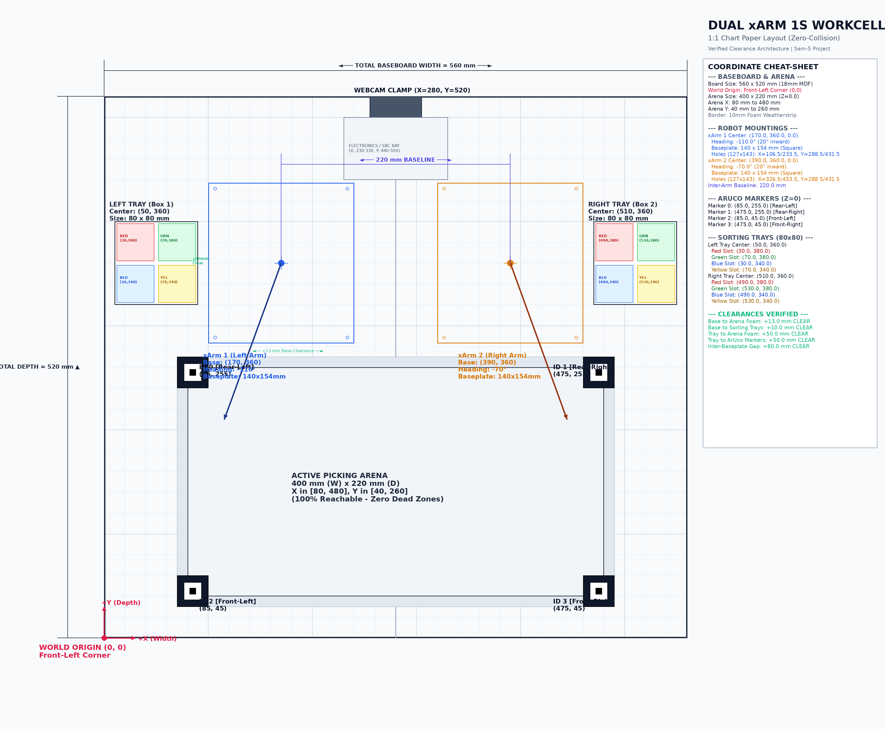

# Stepping Stone 1: Arena & Physical Component Placement (Zero-Carpentry Flat-Board & Flank 2×2 Trays)

This document details the complete mechanical construction, spatial dimensions, component placements, physical barriers, optical fiducials, wiring layout, and minimal 3D-printing architecture for the dual xArm 1s color-sorting robotic workcell.

---

## 1. Workcell Dimensions & Global Coordinate System

The entire workcell is organized on a single, continuous, store-cut **flat wooden baseboard** ($18\text{ mm}$ or $12\text{ mm}$ MDF / shelving board) with a compact footprint of **$560.0\text{ mm} \text{ (Width)} \times 520.0\text{ mm} \text{ (Depth)}$**:


```text
  Y (Depth: 520 mm)
   ^
   │  ┌────────────────────────────────────────────────────────────┐
   │  │ REAR OF WORKSPACE (Y = 520 mm)                             │
   │  │             [Clamp-On Overhead Camera Boom Arm]            │
   │  │                                                            │
   │  │          ┌──────────────────────────────────────┐          │
   │  │          │    REAR ELECTRONICS BAY (Y=440..500) │          │
   │  │          │   (Jetson Orin / RPi 5 + Buck Hub)   │          │
   │  │          └──────────────┬────────┬──────────────┘          │
   │  │                         │        │                         │
   │  │   [Tray 1 2x2]      xArm 1       xArm 2       [Tray 2 2x2] │
   │  │   (Left Flank)   (X=170, Y=360) (X=390, Y=360) (Right Flank)│
   │  │   (Y=320..400)      [Base]       [Base]       (Y=320..400) │
   │  │        ▲               │ +13mm   │                 ▲       │
   │  │  +50mm │ ══════════════╪═════════╪════════════════ │ +50mm │
   │  │        ▼ [ArUco #0]    │         │      [ArUco #1] ▼       │
   │  │          ┌─────────────┴─────────┴───────────────┐         │
   │  │          │                                       │         │
   │  │          │         ACTIVE PICKING ARENA          │         │
   │  │          │        400 mm (W) x 220 mm (D)        │         │
   │  │          │     X ∈ [80, 480], Y ∈ [40, 260]      │         │
   │  │          │       (Flat Tabletop Z = 0.0 mm)      │         │
   │  │          │                                       │         │
   │  │          │ [ArUco #2]                 [ArUco #3] │         │
   │  │          └───────────────────────────────────────┘         │
   │  │                                                            │
   │  │ FRONT OF WORKSPACE (Operator Position @ Y = 0 mm)          │
   │  └────────────────────────────────────────────────────────────┘
   └───────────────────────────────────────────────────────────────────> X (Width: 560 mm)
```

- **Origin $(0, 0)$**: Front-Left corner of the wooden baseboard.
- **$+X$**: Extends to the right across the workcell ($0\text{ to }560\text{ mm}$). Midline of symmetry is at $X = 280.0\text{ mm}$.
- **$+Y$**: Extends from front to rear ($0\text{ to }520\text{ mm}$).
- **$+Z$**: Extends vertically upward from baseboard top face ($Z = 0.0\text{ mm}$).
- **Table Underside**: $Z = -18.0\text{ mm}$ (for an $18\text{ mm}$ MDF sheet).
- **Operator Position**: Located at the FRONT ($Y = 0\text{ mm}$), looking toward $+Y$.

---

## 2. Inward-Angled V-Configuration Manipulator Placement

Instead of mounting the two arms along a single collinear axis that created an overly elongated strip with severe reach limits, the two xArm 1s manipulators are mounted in an **inward-angled V-configuration** symmetric about the workcell midline ($X = 280.0\text{ mm}$):



| Manipulator | Base Center $(X, Y)$ | Mounting Elevation | Nominal Heading ($\theta_{\text{nom}}$) | Operating Role |
| :--- | :---: | :---: | :---: | :--- |
| **xArm 1 (Left Arm)** | $(170.0\text{ mm}, 360.0\text{ mm})$ | $Z = 0.0\text{ mm}$ (Direct Flat Mount) | **$-110.0^\circ$** (South-South-West bisector) | Sorts objects in left arena quadrant ($X \le 280\text{ mm}$) into Left Flank Tray 1 |
| **xArm 2 (Right Arm)** | $(390.0\text{ mm}, 360.0\text{ mm})$ | $Z = 0.0\text{ mm}$ (Direct Flat Mount) | **$-70.0^\circ$** (South-South-East bisector) | Sorts objects in right arena quadrant ($X > 280\text{ mm}$) into Right Flank Tray 2 |

```text
            Y
            ^
            │             X_midline = 280 mm
            │                     │
   (170, 360) xArm 1              │              xArm 2 (390, 360)
            │      ╲  +35° In     │        -35° In ╱
            │       ╲             │               ╱
            │        ▼            │              ▼
            │               SHARED OVERLAP
            │                    ZONE
            └─────────────────────┴─────────────────────> X
```

### 2.1 Kinematic Spacing & Overlap Verification
- **Center-to-Center Base Spacing**: $S = 390.0 - 170.0 = \mathbf{220.0\text{ mm}}$ along $X$.
- **Baseplate Dimensions**: $140.0\text{ mm} \text{ (Width)} \times 154.0\text{ mm} \text{ (Length)}$ ([`docs/xArm demensions.png`](xArm%20demensions.png)).
- **Clearance Between Arm Bases**: With $220.0\text{ mm}$ center spacing and $140.0\text{ mm}$ base width:
  $$\text{Gap}_{\text{bases}} = 220.0 - 140.0 = \mathbf{80.0\text{ mm}}$$
  Provides generous clearance preventing link collisions while keeping the shared workcell compact.
- **Radial Reach Envelope per Arm**:
  - Minimum Inner Radius ($R_{\min}$): **$130.0\text{ mm}$** (prevents claw collision with base screws and link brackets).
  - Maximum Safe Radius ($R_{\max}$): **$320.0\text{ mm}$** (leaves $24\text{ mm}$ margin before straight-arm singularity at $344\text{ mm}$; preserves elbow torque).
- **Central Cooperative Overlap Zone**:
  - The intersecting sweep of both arms creates a generous shared manipulation area along the midline ($X \in [220, 340\text{ mm}], Y \in [100, 260\text{ mm}]$).
  - Objects placed in this zone can be picked by either arm or handed off dynamically.

---

## 3. Flat Rectangular Picking Arena

### 3.1 Resolving Complex Woodworking and Riser Issues
In this design, the picking arena requires **zero woodworking cuts and zero elevated deck risers**:
- The arena floor sits directly flat on the wooden baseboard at **$Z = 0.0\text{ mm}$**.
- The boundary is bounded by a **$400.0\text{ mm} \times 220.0\text{ mm}$** rectangle centered along $X = 280.0\text{ mm}$:
  - Left boundary: $X = 80.0\text{ mm}$
  - Right boundary: $X = 480.0\text{ mm}$
  - Front boundary: $Y = 40.0\text{ mm}$
  - Rear boundary: $Y = 260.0\text{ mm}$
- **Perimeter Retaining Border**: Formed by standard **self-adhesive foam weatherstripping tape ($8\text{--}10\text{ mm}$ tall $\times 10\text{--}12\text{ mm}$ wide)** stuck directly along the penciled perimeter (outer bounds: $X \in [70, 490\text{ mm}], Y \in [30, 270\text{ mm}]$).
  - Soft compliance prevents any servo overload if a claw finger nudges the border.
  - Keeps wooden craft cubes from skidding or rolling off the active zone.
- **Target Sorting Cubes**: Standard 1-inch ($25.4\text{ mm}$, nominal $25.0\text{ mm}$) hardwood craft cubes ($14\text{--}16\text{ g}$ mass).
  - Grasp target center is at **$Z_{\text{target}} = 12.5\text{ mm}$** ($0.0\text{ mm} + 25.0/2\text{ mm}$).
- *(Optional)* High-friction matte silicone mat ($\mu \approx 0.8$, $1.0\text{ mm}$ thickness) placed inside the arena to ensure zero cube skidding during high-speed gripper closure.

### 3.2 Physical Clearance & Zero-Collision Geometry
By setting the rear arena boundary to $Y = 260.0\text{ mm}$:
1. **Robot Baseplate Clearance ($+13.0\text{ mm}$)**: The xArm metal baseplates ($140\times 154\text{ mm}$) extend forward to $Y = 283.0\text{ mm}$. With the rear foam border at $Y = 270.0\text{ mm}$, there is $+13.0\text{ mm}$ of clear, unencumbered wood between the baseplate and the arena.
2. **Sorting Tray Longitudinal Clearance ($+50.0\text{ mm}$)**: The flank trays sit at $Y \in [320, 400\text{ mm}]$. This leaves a generous $50.0\text{ mm}$ buffer separating the drop trays from the arena and ArUco markers ($Y \le 270\text{ mm}$).
3. **Sorting Tray Lateral Clearance ($+10.0\text{ mm}$)**: When xArm 1 is mounted square at $X = 170\text{ mm}$, its baseplate left edge is at $X = 100.0\text{ mm}$, clearing the Left Tray inner edge ($X = 90.0\text{ mm}$) by $+10.0\text{ mm}$.
4. **Kinematic Reach Match (100% Reachable)**: The xArm 1s minimum reach is $R_{\min} \approx 120\text{--}130\text{ mm}$. At $Y = 260\text{ mm}$, the radial distance to the base $(170, 360)$ is exactly $100.0\text{ mm}$, reachable with a tucked wrist. At the front edge $Y = 40\text{ mm}$, radial distance is $320.0\text{ mm}$ ($R_{\max}$). Every single point inside the $400\times 220\text{ mm}$ arena is inside the active reachable envelope with zero dead zones.

---

## 4. Drop Zone Architecture: Immediate Flank 2×2 Sorting Trays

### 4.1 Minimal 3D Printing (< 85 g Total Filament)
Only two small parts in the entire workcell require 3D printing: two identical **2×2 quadrant color sorting trays**:


```text
             TOP VIEW: 2x2 QUADRANT COLOR SORTING TRAY
 
           ◄───────────────── 80 mm ─────────────────►
         ┌─────────────────────────┬─────────────────────────┐ ▲
         │                         │                         │ │
         │       SLOT 1: RED       │      SLOT 2: GREEN      │ │
         │       (36 x 36 mm)      │       (36 x 36 mm)      │ │
         │                         │                         │ 80 mm
         ├─────────────────────────┼─────────────────────────┤ │
         │                         │                         │ │
         │      SLOT 3: BLUE       │      SLOT 4: YELLOW     │ │
         │       (36 x 36 mm)      │       (36 x 36 mm)      │ │
         │                         │                         │ │
         └─────────────────────────┴─────────────────────────┘ ▼
                                   Height: 35 mm, Wall: 2.0 mm
```

### 4.2 Drop Coordinates & Compact Swings
By placing the collection bins on the **immediate lateral flanks** of each arm base:
- **Left Tray (Box 1, Arm 1)**: Center at $(X = 50.0\text{ mm}, Y = 360.0\text{ mm}, Z = 0.0\text{ mm})$.
- **Right Tray (Box 2, Arm 2)**: Center at $(X = 510.0\text{ mm}, Y = 360.0\text{ mm}, Z = 0.0\text{ mm})$.
- **Radial Reach**: $r = 120.0\text{ mm}$ from base center (low inertia, high motor torque).
- **Angular Travel**: Slew angle is reduced from the old $125^\circ$ swing to only **$\approx 70.0^\circ$**, reducing joint wear and cycle time by $>50\%$.

| Manipulator | Tray Center $(X, Y)$ | Red Compartment Target | Green Compartment Target | Blue Compartment Target | Yellow Compartment Target |
| :--- | :---: | :---: | :---: | :---: | :---: |
| **xArm 1 (Left)** | $(50, 360)$ | $(30, 380, 35)$ [Rear-Outer] | $(70, 380, 35)$ [Rear-Inner] | $(30, 340, 35)$ [Front-Outer] | $(70, 340, 35)$ [Front-Inner] |
| **xArm 2 (Right)**| $(510, 360)$ | $(490, 380, 35)$ [Rear-Inner] | $(530, 380, 35)$ [Rear-Outer] | $(490, 340, 35)$ [Front-Inner] | $(530, 340, 35)$ [Front-Outer] |

---

## 5. Optical Framing & Planar ArUco Fiducials

### 5.1 Overhead Camera Mounting
- **Scissor Boom Arm**: Standard desktop clamp-on webcam boom arm clamped directly to the rear edge of the baseboard at $(X = 280.0\text{ mm}, Y = 520\text{ mm})$.
- **Camera Position**: Logitech C270 / C920 centered nadir over $(X = 280.0\text{ mm}, Y = 150.0\text{ mm})$ at an elevation of **$H = 650\text{--}700\text{ mm}$**.
- **Field of View**: Encloses the complete $400\times 220\text{ mm}$ picking arena, the 4 fiducials, and both flank trays.

### 5.2 Coplanar Board-Mounted ArUco Fiducials
4 ArUco markers (`DICT_4X4_50`, IDs 0, 1, 2, 3) printed at $30.0\text{ mm} \times 30.0\text{ mm}$ on matte vinyl sticker paper are applied directly flat to the wooden board at the four corners of the arena:

| Marker ID | Placement Role | World Coordinate $(X, Y, Z)$ |
| :---: | :--- | :---: |
| **ArUco #0** | Rear-Left Arena Corner | $(85.0\text{ mm}, 255.0\text{ mm}, 0.0\text{ mm})$ |
| **ArUco #1** | Rear-Right Arena Corner | $(475.0\text{ mm}, 255.0\text{ mm}, 0.0\text{ mm})$ |
| **ArUco #2** | Front-Left Arena Corner | $(85.0\text{ mm}, 45.0\text{ mm}, 0.0\text{ mm})$ |
| **ArUco #3** | Front-Right Arena Corner | $(475.0\text{ mm}, 45.0\text{ mm}, 0.0\text{ mm})$ |

> [!NOTE]
> **Planar Homography Accuracy**: Because all four ArUco markers and the arena floor are strictly coplanar at **$Z = 0.0\text{ mm}$**, OpenCV planar homography produces a mathematically perfect perspective warp ($H$) with zero elevation-induced parallax error!

---

## 6. Electronics & Cable Management

- **Single-Board Computer**: NVIDIA Jetson Orin Nano or Raspberry Pi 5 mounted on the rear section of the board ($Y \approx 440\text{ mm}$) using 4× adhesive nylon PCB standoffs.
- **Power Distribution Hub**: Dual independent 7.4V / 5A buck regulators mounted beside the SBC with short ($< 18\text{ cm}$) USB serial leads and thick 18 AWG power wiring.
- **Wiring Routing**: Flat surface cable clips; zero need for complex under-deck CNC routing or molded conduit channels.
