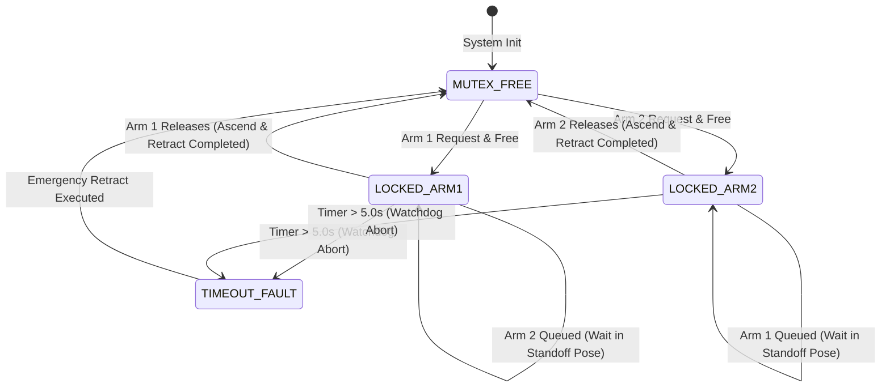

# Stepping Stone 4: ROS 2 Architecture, Inter-Arm Scheduling & Dual-Arm Coordination

This document serves as the definitive engineering specification for **Stepping Stone 4** in the dual-arm automated color-sorting robot system. It details the distributed software nervous system running under **ROS 2 Humble Hawksbill** on the **NVIDIA Jetson Orin Nano / Orin NX (or Raspberry Pi 5)**.

It covers the complete computation graph, custom message and service interfaces, territorial partitioning and dynamic load balancing across the $Y = 300\text{ mm}$ midline, spatial mutex arbitration for the shared crossover band, pipelined pick-and-place concurrency, production Python node implementations, multi-node launch configurations, and Linux `udev` device management.

---

## 1. System Overview & Computation Graph Topology

### 1.1 Architectural Philosophy

The dual-arm sorting system is structured as a **loosely coupled, asynchronous, event-driven ROS 2 computation graph**:

1. **Decoupled Perception and Action**: The computer vision pipeline (`vision_node`) operates strictly as an observational telemetry producer, detecting physical cube positions in millimeter arena coordinates without knowledge of arm states or motion plans.
2. **Centralized Task Arbitration (`scheduler_node`)**: A single master scheduler aggregates object detections, monitors arm availability, enforces spatial collision avoidance across the territorial boundary, and dispatches concrete goal tasks.
3. **Autonomous Manipulator Instances (`arm_node`)**: Identical, parameterized instances of `arm_node` control each arm (`arm_1` in the North and `arm_2` in the South). Each node handles its own analytical inverse kinematics, 5-phase waypoint trajectory profiling, and binary serial communication over dedicated USB-UART lines.
4. **Lightweight Analytical Execution vs. Heavy MoveIt**: Rather than relying on heavy numerical trajectory frameworks (e.g., MoveIt 2), which suffer from iterative convergence failures near 5-DOF kinematic singularities and consume prohibitive CPU resources on embedded platforms, motion is governed by closed-form geometric IK running in $< 0.1\text{ ms}$ per waypoint.

### 1.2 ROS 2 Computation Graph

```mermaid
flowchart TD
    subgraph Hardware ["Physical Hardware Layer"]
        CAM["Overhead USB Webcam<br/>(Logitech C270/C920 @ 65–75cm)"]
        USB1["Hiwonder Controller 1<br/>(/dev/xarm_arm1 @ 115200)"]
        USB2["Hiwonder Controller 2<br/>(/dev/xarm_arm2 @ 115200)"]
    end

    subgraph Perception ["Perception Pipeline"]
        CN["camera_node<br/>(30 Hz V4L2 Capture)"]
        VN["vision_node<br/>(10–15 Hz ArUco Warp + HSV)"]
    end

    subgraph Scheduling ["Master Coordination Layer"]
        SN["scheduler_node<br/>(Load Balancer + Spatial Mutex)"]
    end

    subgraph Execution ["Manipulator Execution Layer"]
        AN1["arm1_node<br/>(Arm 1 / North Controller)"]
        AN2["arm2_node<br/>(Arm 2 / South Controller)"]
    end

    subgraph Monitoring ["Diagnostics & UI"]
        DASH["dashboard_node / Foxglove<br/>(Live Telemetry & Diagnostics)"]
    end

    CAM -->|V4L2 Frame| CN
    CN -->|/camera/image_raw (sensor_msgs/Image)| VN
    VN -->|/vision/detected_objects (DetectedObjectArray)| SN

    SN -->|/arm1/task_goal (ArmTask)| AN1
    SN -->|/arm2/task_goal (ArmTask)| AN2

    AN1 -->|/arm1/status (ArmStatus)| SN
    AN2 -->|/arm2/status (ArmStatus)| SN

    AN1 -.->|acquire_zone / release_zone (AcquireZone.srv)| SN
    AN2 -.->|acquire_zone / release_zone (AcquireZone.srv)| SN

    AN1 -->|115200 Baud Binary Packets| USB1
    AN2 -->|115200 Baud Binary Packets| USB2

    VN -->|/vision/annotated_image| DASH
    SN -->|/scheduler/queue_status| DASH
    AN1 -->|/arm1/joint_states| DASH
    AN2 -->|/arm2/joint_states| DASH
```

### 1.3 Node Specifications & Topic Registry

| Node Name            | Input Topics / Interfaces                                  | Output Topics / Interfaces                                                                                                       |            Execution Rate            |            QoS Profile             | Role                                                                                                                                                 |
| -------------------- | ---------------------------------------------------------- | -------------------------------------------------------------------------------------------------------------------------------- | :----------------------------------: | :--------------------------------: | ---------------------------------------------------------------------------------------------------------------------------------------------------- |
| **`camera_node`**    | Hardware `/dev/video0`                                     | `/camera/image_raw`  `/camera/camera_info`                                                                                       |            $30\text{ Hz}$            | SensorData (Best Effort, Depth 1)  | V4L2 video acquisition, exposure lock ($156$), white balance lock ($4500\text{K}$).                                                                  |
| **`vision_node`**    | `/camera/image_raw`                                        | `/vision/detected_objects`  `/vision/annotated_image`                                                                            |      $10\text{--}15\text{ Hz}$       | Reliable, Transient Local, Depth 1 | ArUco 4-point homography warp ($2.0\text{ px/mm}$), HSV color segmentation, centroid extraction $(X_a, Y_a)$, yaw $\psi \in [-45^\circ, +45^\circ]$. |
| **`scheduler_node`** | `/vision/detected_objects`  `/arm1/status`  `/arm2/status` | `/arm1/task_goal`  `/arm2/task_goal`  `/scheduler/diagnostics`  `/scheduler/acquire_zone` (Srv)  `/scheduler/release_zone` (Srv) |         $20\text{ Hz}$ loop          |         Reliable, Depth 10         | Spatial territory assignment, dynamic load balancing with hysteresis, spatial crossover mutex lock, task queue management.                           |
| **`arm1_node`**      | `/arm1/task_goal`  `/arm1/abort`                           | `/arm1/status`  `/arm1/joint_states`  `/dev/xarm_arm1` (UART)                                                                    | Event-driven + $50\text{ Hz}$ status |         Reliable, Depth 5          | North arm controller: analytical IK, 5-phase trajectory generation, binary servo command streaming, collision mutex acquisition.                     |
| **`arm2_node`**      | `/arm2/task_goal`  `/arm2/abort`                           | `/arm2/status`  `/arm2/joint_states`  `/dev/xarm_arm2` (UART)                                                                    | Event-driven + $50\text{ Hz}$ status |         Reliable, Depth 5          | South arm controller: analytical IK, 5-phase trajectory generation, binary servo command streaming, collision mutex acquisition.                     |
| **`dashboard_node`** | All status & vision topics                                 | Terminal UI / Foxglove Studio                                                                                                    |            $5\text{ Hz}$             |            Best Effort             | Real-time sorting rate, cycle times, drop box counts, fault annunciator.                                                                             |

---

## 2. Custom ROS 2 Interface Definitions

All custom messages and services are defined in the project ROS 2 package `xarm_interfaces`.

### 2.1 `DetectedObject.msg`

Represents an individual physical cube identified on the elevated picking arena.

```text
# xarm_interfaces/msg/DetectedObject.msg
# Represents a single detected colored wooden block on the picking arena

uint32 object_id                  # Unique sequential detection ID
string color                      # Color classification: "RED", "GREEN", "BLUE", "YELLOW"
float64 x_mm                      # Absolute world X coordinate in arena frame [360.0, 730.0 mm]
float64 y_mm                      # Absolute world Y coordinate in arena frame [55.0, 545.0 mm]
float64 z_mm                      # Elevation coordinate (nominally +32.5 mm for cube centroid)
float64 yaw_deg                   # Planar orientation angle psi in range [-45.0, +45.0 degrees]
float64 confidence                # Optical classification confidence score [0.0, 1.0]
builtin_interfaces/Time stamp     # Timestamp of perception capture
```

### 2.2 `DetectedObjectArray.msg`

Perception telemetry snapshot published by `vision_node`.

```text
# xarm_interfaces/msg/DetectedObjectArray.msg
# Complete perceived state of the picking arena at a given instant

std_msgs/Header header            # Sequence counter and frame_id ("arena_frame")
DetectedObject[] objects          # Array of currently visible candidate cubes
uint32 total_detected             # Count of active objects
bool homography_locked            # True if all 4 ArUco markers are actively tracked
```

### 2.3 `ArmTask.msg`

Dispatched by `scheduler_node` to command a specific pick-and-place cycle.

```text
# xarm_interfaces/msg/ArmTask.msg
# Action directive issued from scheduler to an individual arm controller

uint32 task_id                    # Unique task transaction ID
string arm_id                     # Target manipulator: "arm_1" or "arm_2"
DetectedObject target_object      # Full perception state of the cube to pick

# Kinematic target parameters relative to target arm base
float64 target_r_mm               # Polar radius r = sqrt(dx^2 + dy^2) [120.0, 320.0 mm]
float64 target_theta_deg          # Polar azimuth angle theta = atan2(dy, dx) [degrees]
float64 distance_from_edge_cm     # Physical reach d_edge = (r - 70 mm) / 10 [5.0, 25.0 cm]

# Sorting destination parameters
string destination_box            # Drop target: "BOX_1_NW" (Arm 1) or "BOX_2_SW" (Arm 2)
int32 compartment_index           # Compartment index 0..3 matching color partition
float64 drop_theta_deg            # Target base yaw for drop (+125° for NW, -125° for SW)

# Safety synchronization
bool requires_mutex               # True if target cube lies within central crossover band
```

### 2.4 `ArmStatus.msg`

High-speed state telemetry published by each `arm_node` at $50\text{ Hz}$.

```text
# xarm_interfaces/msg/ArmStatus.msg
# Runtime status and telemetry of an individual xArm 1S

std_msgs/Header header
string arm_id                     # "arm_1" (North) or "arm_2" (South)

# State Machine State
string state                      # "IDLE", "APPROACHING", "GRASPING", "LIFTING",
                                  # "TRANSIT_DROP", "RELEASING", "RETRACTING", "FAULT"
uint32 active_task_id             # ID of task currently in execution (0 if IDLE)
bool is_busy                      # True if executing a trajectory phase
bool has_cube                     # True if gripper confirms active clamp on block
bool holds_mutex                  # True if arm currently holds the central crossover lock

# Current Joint Angles (degrees)
float64 motor_1_azimuth_deg
float64 motor_2_shoulder_deg
float64 motor_3_elbow_deg
float64 motor_4_wrist_pitch_deg
float64 motor_5_wrist_roll_deg
float64 motor_6_gripper_pwm

# Diagnostics
float64 bus_voltage_v             # Real-time voltage reported by servo telemetry (nominal 7.4V)
string error_code                 # "NONE", "IK_UNREACHABLE", "SERVO_TIMEOUT", "MUTEX_TIMEOUT"
```

### 2.5 Zone Mutex Services

```text
# xarm_interfaces/srv/AcquireZone.srv
string arm_id                     # "arm_1" or "arm_2"
string zone_id                    # "CENTER_CROSSOVER"
float64 timeout_sec               # Maximum time willing to wait (default 3.0s)
---
bool success                      # True if lock granted
string message                    # Reason / diagnostic confirmation
```

```text
# xarm_interfaces/srv/ReleaseZone.srv
string arm_id                     # "arm_1" or "arm_2"
string zone_id                    # "CENTER_CROSSOVER"
---
bool success                      # True if lock successfully cleared
```

---

## 3. Territorial Partitioning & Spatial Mutex Coordination

### 3.1 Spatial Geometry & Coordinate Frames

The arena plane measures $370\text{ mm} \times 490\text{ mm}$ with world coordinates $X \in [360, 730\text{ mm}]$ and $Y \in [55, 545\text{ mm}]$.

- **Arm 1 (North / Back)**: Base center located at $(X_1 = 360.0\text{ mm}, Y_1 = 420.0\text{ mm})$.
- **Arm 2 (South / Front)**: Base center located at $(X_2 = 360.0\text{ mm}, Y_2 = 180.0\text{ mm})$.
- **Midline Boundary**: $Y_{\text{mid}} = 300.0\text{ mm}$ (equidistant between both arms, $S = 240\text{ mm}$ apart).

```text
  Y (mm)
   545 ┌─────────────────────────────────────────────────────────────┐
       │ [ArUco #2] (360, 545)               [ArUco #3] (730, 545)   │
       │                                                             │
       │  ═════════════════════════════════════════════════════════  │
       │  ZONE 1: ARM 1 EXCLUSIVE TURF (Y = 350 to 545 mm)           │
       │  (Arm 1 Picks Freely with Zero Collision Risk)              │
   350 ├ - - - - - - - - - - - - - - - - - - - - - - - - - - - - - - ┤
       │  SHARED CROSSOVER BAND (Y = 250 to 350 mm)                  │
   300 │  ────── Midline Boundary (Y = 300 mm) ───────────────────── │
       │  (Requires arena_mutex Lock Before Entering)                │
   250 ├ - - - - - - - - - - - - - - - - - - - - - - - - - - - - - - ┤
       │  ZONE 2: ARM 2 EXCLUSIVE TURF (Y = 55 to 250 mm)            │
       │  (Arm 2 Picks Freely with Zero Collision Risk)              │
       │  ═════════════════════════════════════════════════════════  │
       │                                                             │
    55 │ [ArUco #0] (360, 55)                [ArUco #1] (730, 55)    │
       └─────────────────────────────────────────────────────────────┘
       360                                                         730 ───> X (mm)
```

### 3.2 Dynamic Load Balancing with Hysteresis

To prevent task oscillation (chatter) where both arms compete for cubes near the center, the scheduler applies a **hysteresis window** with **queue-length biasing**:

Let:

- $Q_1$ = Number of queued tasks assigned to Arm 1.
- $Q_2$ = Number of queued tasks assigned to Arm 2.
- $Y_c$ = Measured $Y$ coordinate of the target cube.

#### Assignment Rules

1. **Strict Exclusive Zones**:
   $$\text{If } Y_c > 350.0\text{ mm} \implies \text{Assign to Arm 1 (Requires Mutex: False)}$$
   $$\text{If } Y_c < 250.0\text{ mm} \implies \text{Assign to Arm 2 (Requires Mutex: False)}$$

2. **Crossover Zone ($250.0\text{ mm} \le Y_c \le 350.0\text{ mm}$)**:
   - Both arms can physically reach this band.
   - If $|Q_1 - Q_2| < 2$ (balanced workload):
     $$\text{If } Y_c \ge 300.0\text{ mm} \implies \text{Assign to Arm 1 (Requires Mutex: True)}$$
     $$\text{If } Y_c < 300.0\text{ mm} \implies \text{Assign to Arm 2 (Requires Mutex: True)}$$
   - If $Q_1 - Q_2 \ge 2$ (Arm 1 is overloaded):
     - Arm 2 "steals" cubes up to $Y_c \le 340.0\text{ mm}$ to rebalance throughput.
   - If $Q_2 - Q_1 \ge 2$ (Arm 2 is overloaded):
     - Arm 1 "steals" cubes down to $Y_c \ge 260.0\text{ mm}$ to rebalance throughput.

3. **Kinematic Reach Validation**:
   Before assignment, the scheduler confirms the target satisfies:
   $$R_i = \sqrt{(X_c - X_i)^2 + (Y_c - Y_i)^2} \in [120.0, 320.0\text{ mm}]$$
   If a cube in the crossover zone exceeds $R_{\max} = 320.0\text{ mm}$ for one arm, it is assigned exclusively to the other arm regardless of queue lengths.

### 3.3 The Spatial Mutex State Machine

The central crossover band ($Y \in [250, 350\text{ mm}]$) allows only **one manipulator inside its physical envelope at any given millisecond**. This is enforced via an atomic state machine inside `scheduler_node`:



#### Mutex Safety Invariants

1. **No Grasping Without Lock**: An arm assigned a task with `requires_mutex = True` will move only as far as its **Radial Standoff Waypoint** ($r_{\text{target}} - 30\text{ mm}$). It **MUST** receive `success = True` from `AcquireZone.srv` before advancing its gripper across the $Y = 250\text{--}350\text{ mm}$ boundary.
2. **Immediate Release on Lift**: As soon as the arm executes **Phase 4 (Ascend & Retract)** and reaches radial clearance outside the crossover band ($r < 170\text{ mm}$ or $Y_{\text{claw}}$ exits $[250, 350\text{ mm}]$), it immediately calls `ReleaseZone.srv`. The mutex is **NEVER held during transit to or release into the drop boxes**.
3. **5.0-Second Watchdog Timer**: If an arm acquires the lock but fails to release it within $5.0\text{ seconds}$ (due to servo stall or serial dropout), the scheduler forcibly revokes the lock, issues a software abort to that arm, and clears the zone to prevent deadlock.

---

## 4. Pipelined Asynchronous Pick-and-Place Concurrency

In a sequential dual-arm system, Arm 2 waits idle while Arm 1 operates, cutting total efficiency in half. The system employs **pipelined phase concurrency**:

### 4.1 Pick-and-Place 5-Phase Trajectory Cycle

Each sorting transaction consists of 5 distinct kinematic phases:

|    Phase    | Description                          |          Altitude $Z$           |             Radial Span $r$              |       Speed / Duration       |        Mutex Needed?        |
| :---------: | ------------------------------------ | :-----------------------------: | :--------------------------------------: | :--------------------------: | :-------------------------: |
| **Phase 1** | **Azimuth Slew & Standoff Approach** |     Hover ($+55\text{ mm}$)     | Retracted $\rightarrow r - 30\text{ mm}$ |    Fast ($600\text{ ms}$)    |             No              |
| **Phase 2** | **Claw Open & Horizontal Advance**   |   Descent ($+32.5\text{ mm}$)   |     $r - 30\text{ mm} \rightarrow r$     |   Smooth ($500\text{ ms}$)   | **YES** _(if in crossover)_ |
| **Phase 3** | **Gripper Clamping & Settling**      |  Clamping ($+32.5\text{ mm}$)   |              At target $r$               | Grip Pulse ($350\text{ ms}$) | **YES** _(if in crossover)_ |
| **Phase 4** | **Ascend & Radial Retract**          |     Lift to $+65\text{ mm}$     |     $r \rightarrow r - 50\text{ mm}$     |   Smooth ($500\text{ ms}$)   |    **RELEASE LOCK HERE**    |
| **Phase 5** | **Drop Slew & Release**              | Drop altitude ($+45\text{ mm}$) |     Swivel to Box ($\pm 125^\circ$)      |    Fast ($800\text{ ms}$)    |       No (Flank Zone)       |

### 4.2 Pipelined Execution Timeline

```text
Time (s):  0.0       0.6       1.1       1.4       1.9       2.7       3.3       3.8       4.1
           │─────────│─────────│─────────│─────────│─────────│─────────│─────────│─────────│
ARM 1:     [Phase 1: Approach] [Phase 2: Advance] [Phase 3: Grip] [Phase 4: Lift] [Phase 5: Transit & Drop (NW)] [Phase 1: Next Pick]
                               └──────── MUTEX HELD (0.8s) ──────┘
ARM 2:     [Phase 5: Dropping SW] [Phase 1: Approach] ────────────> [Phase 2: Advance] [Phase 3: Grip] [Phase 4: Lift]
                                                                    └──────── MUTEX HELD (0.8s) ──────┘
```

- **Zero Waiting**: While Arm 1 is executing Phase 5 (swiveling West to drop into NW Box 1 at $Z = 0\text{ mm}$), Arm 2 is actively executing Phases 1–3 in the South arena.
- **Effective Throughput**: An individual cycle requires $\approx 2.75\text{ seconds}$ per arm. Pipelined in parallel, the dual-arm system achieves an effective completion rate of **one cube sorted every $1.4\text{--}1.6\text{ seconds}$** ($\approx 38\text{--}42\text{ cubes/minute}$ total system throughput).

---

## 5. Production ROS 2 Node Reference Implementations

### 5.1 `SchedulerNode` (`src/xarm_core/xarm_core/scheduler_node.py`)

```python
#!/usr/bin/env python3
"""
Master Scheduler Node for Dual-Arm Color Sorting System.
Handles dynamic spatial partitioning, load balancing with hysteresis,
mutex arbitration for the central crossover band, and task dispatching.
"""

import math
import rclpy
from rclpy.node import Node
from rclpy.qos import QoSProfile, ReliabilityPolicy, HistoryPolicy

from xarm_interfaces.msg import DetectedObject, DetectedObjectArray, ArmTask, ArmStatus
from xarm_interfaces.srv import AcquireZone, ReleaseZone

class SchedulerNode(Node):
    def __init__(self):
        super().__init__('scheduler_node')

        # Kinematic base origins (in arena mm frame)
        self.arm1_base = (360.0, 420.0)  # North Arm
        self.arm2_base = (360.0, 180.0)  # South Arm

        # Territorial Boundaries
        self.y_midline = 300.0
        self.crossover_y_min = 250.0
        self.crossover_y_max = 350.0

        # Reach constraints
        self.r_min = 120.0  # mm
        self.r_max = 320.0  # mm

        # Spatial Mutex State
        self.mutex_holder = None  # None, "arm_1", or "arm_2"
        self.mutex_acquire_time = 0.0
        self.mutex_timeout_sec = 5.0

        # Arm tracking
        self.arm1_busy = False
        self.arm2_busy = False
        self.arm1_queue_len = 0
        self.arm2_queue_len = 0
        self.task_counter = 1

        # Color-to-Box mapping
        self.color_drop_map = {
            'RED':    {'box': 'BOX_1_NW', 'slot': 0, 'theta': 125.0},
            'GREEN':  {'box': 'BOX_1_NW', 'slot': 1, 'theta': 110.0},
            'BLUE':   {'box': 'BOX_2_SW', 'slot': 0, 'theta': -125.0},
            'YELLOW': {'box': 'BOX_2_SW', 'slot': 1, 'theta': -110.0}
        }

        # Processed cube tracking (to avoid re-assigning same cube)
        self.claimed_cube_ids = set()

        # QoS Profiles
        reliable_qos = QoSProfile(
            reliability=ReliabilityPolicy.RELIABLE,
            history=HistoryPolicy.KEEP_LAST,
            depth=10
        )

        # Publishers & Subscribers
        self.obj_sub = self.create_subscription(
            DetectedObjectArray, '/vision/detected_objects', self.vision_callback, reliable_qos
        )
        self.arm1_status_sub = self.create_subscription(
            ArmStatus, '/arm1/status', self.arm1_status_cb, reliable_qos
        )
        self.arm2_status_sub = self.create_subscription(
            ArmStatus, '/arm2/status', self.arm2_status_cb, reliable_qos
        )

        self.arm1_task_pub = self.create_publisher(ArmTask, '/arm1/task_goal', reliable_qos)
        self.arm2_task_pub = self.create_publisher(ArmTask, '/arm2/task_goal', reliable_qos)

        # Services for Mutex Arbitration
        self.acquire_srv = self.create_service(
            AcquireZone, '/scheduler/acquire_zone', self.handle_acquire_zone
        )
        self.release_srv = self.create_service(
            ReleaseZone, '/scheduler/release_zone', self.handle_release_zone
        )

        # Watchdog Timer (10 Hz)
        self.timer = self.create_timer(0.1, self.watchdog_check)
        self.get_logger().info("SchedulerNode initialized in 100% parameter lockstep.")

    def arm1_status_cb(self, msg: ArmStatus):
        self.arm1_busy = msg.is_busy
        if not msg.is_busy and msg.active_task_id in self.claimed_cube_ids:
            self.claimed_cube_ids.remove(msg.active_task_id)

    def arm2_status_cb(self, msg: ArmStatus):
        self.arm2_busy = msg.is_busy
        if not msg.is_busy and msg.active_task_id in self.claimed_cube_ids:
            self.claimed_cube_ids.remove(msg.active_task_id)

    def handle_acquire_zone(self, request, response):
        current_time = self.get_clock().now().nanoseconds / 1e9

        if self.mutex_holder is None:
            self.mutex_holder = request.arm_id
            self.mutex_acquire_time = current_time
            response.success = True
            response.message = f"Zone {request.zone_id} granted to {request.arm_id}"
            self.get_logger().info(response.message)
        elif self.mutex_holder == request.arm_id:
            response.success = True
            response.message = f"Lock already held by {request.arm_id}"
        else:
            response.success = False
            response.message = f"Zone locked by {self.mutex_holder}. Stand by."
        return response

    def handle_release_zone(self, request, response):
        if self.mutex_holder == request.arm_id:
            self.get_logger().info(f"Zone released by {request.arm_id}")
            self.mutex_holder = None
            response.success = True
        else:
            response.success = False
        return response

    def watchdog_check(self):
        """Prevents deadlocks if an arm stalls inside the crossover band."""
        if self.mutex_holder is not None:
            now = self.get_clock().now().nanoseconds / 1e9
            if (now - self.mutex_acquire_time) > self.mutex_timeout_sec:
                self.get_logger().error(
                    f"MUTEX WATCHDOG EXPIRED! Revoking lock from {self.mutex_holder}"
                )
                self.mutex_holder = None

    def vision_callback(self, msg: DetectedObjectArray):
        """Evaluates detected objects and dispatches tasks based on load balancing."""
        if not msg.homography_locked:
            return

        for obj in msg.objects:
            if obj.object_id in self.claimed_cube_ids:
                continue

            # Check kinematic reach for Arm 1
            dx1 = obj.x_mm - self.arm1_base[0]
            dy1 = obj.y_mm - self.arm1_base[1]
            r1 = math.sqrt(dx1**2 + dy1**2)

            # Check kinematic reach for Arm 2
            dx2 = obj.x_mm - self.arm2_base[0]
            dy2 = obj.y_mm - self.arm2_base[1]
            r2 = math.sqrt(dx2**2 + dy2**2)

            # Validate overall arena bounds
            valid_arm1 = (self.r_min <= r1 <= self.r_max)
            valid_arm2 = (self.r_min <= r2 <= self.r_max)

            # Spatial territory decision
            assigned_arm = None
            requires_mutex = False

            if obj.y_mm > self.crossover_y_max and valid_arm1:
                assigned_arm = 'arm_1'
            elif obj.y_mm < self.crossover_y_min and valid_arm2:
                assigned_arm = 'arm_2'
            else:
                # Inside shared crossover zone (Y in [250, 350 mm])
                requires_mutex = True
                # Load balance based on queue differential
                if valid_arm1 and valid_arm2:
                    if (self.arm1_queue_len - self.arm2_queue_len) >= 2:
                        assigned_arm = 'arm_2'
                    elif (self.arm2_queue_len - self.arm1_queue_len) >= 2:
                        assigned_arm = 'arm_1'
                    else:
                        assigned_arm = 'arm_1' if obj.y_mm >= self.y_midline else 'arm_2'
                elif valid_arm1:
                    assigned_arm = 'arm_1'
                elif valid_arm2:
                    assigned_arm = 'arm_2'

            # Dispatch task if arm is idle
            if assigned_arm == 'arm_1' and not self.arm1_busy:
                task = self.create_task_msg('arm_1', obj, r1, math.degrees(math.atan2(dy1, dx1)), requires_mutex)
                self.arm1_task_pub.publish(task)
                self.claimed_cube_ids.add(obj.object_id)
                self.arm1_busy = True
                break
            elif assigned_arm == 'arm_2' and not self.arm2_busy:
                task = self.create_task_msg('arm_2', obj, r2, math.degrees(math.atan2(dy2, dx2)), requires_mutex)
                self.arm2_task_pub.publish(task)
                self.claimed_cube_ids.add(obj.object_id)
                self.arm2_busy = True
                break

    def create_task_msg(self, arm_id: str, obj: DetectedObject, r: float, theta: float, requires_mutex: bool) -> ArmTask:
        task = ArmTask()
        task.task_id = self.task_counter
        self.task_counter += 1
        task.arm_id = arm_id
        task.target_object = obj
        task.target_r_mm = r
        task.target_theta_deg = theta
        task.distance_from_edge_cm = (r - 70.0) / 10.0
        task.requires_mutex = requires_mutex

        drop_info = self.color_drop_map.get(obj.color, {'box': 'BOX_1_NW', 'slot': 0, 'theta': 125.0})
        task.destination_box = drop_info['box']
        task.compartment_index = drop_info['slot']
        task.drop_theta_deg = drop_info['theta']
        return task

def main(args=None):
    rclpy.init(args=args)
    node = SchedulerNode()
    rclpy.spin(node)
    node.destroy_node()
    rclpy.shutdown()

if __name__ == '__main__':
    main()
```

---

### 5.2 `ArmNode` (`src/xarm_core/xarm_core/arm_node.py`)

```python
#!/usr/bin/env python3
"""
Manipulator Controller Node for Hiwonder xArm 1S.
Implements Analytical Closed-Form IK, 5-Phase Trajectory Execution,
Direct Binary Serial Packet Generation @ 115200 baud, and Mutex Synchronization.
"""

import math
import time
import serial
import rclpy
from rclpy.node import Node
from rclpy.qos import QoSProfile, ReliabilityPolicy, HistoryPolicy

from xarm_interfaces.msg import ArmTask, ArmStatus
from xarm_interfaces.srv import AcquireZone, ReleaseZone

class XArmKinematics:
    """Closed-form analytical inverse kinematics solver from Stepping Stone 2."""
    def __init__(self):
        self.L1 = 100.0      # Shoulder link length (mm)
        self.L2 = 100.0      # Elbow link length (mm)
        self.L3 = 144.0      # Wrist to claw tip (mm)
        self.z_shoulder = 65.0  # Height of Motor 2 axis (mm)
        self.z_arena = 20.0     # Elevated arena surface (mm)
        self.d_offset = 70.0    # Center-to-edge offset (mm)
        self.r_min = 120.0
        self.r_max = 320.0

    def calculate_ik(self, r: float, z: float, phi_deg: float, cube_angle: float, azimuth_deg: float):
        phi = math.radians(phi_deg)
        r_w = r - self.L3 * math.cos(phi)
        z_w = z - self.L3 * math.sin(phi)

        r_prime = r_w
        z_prime = z_w - self.z_shoulder

        D_sq = r_prime**2 + z_prime**2
        D = math.sqrt(D_sq)

        # Law of Cosines for Elbow
        cos_alpha = (self.L1**2 + self.L2**2 - D_sq) / (2.0 * self.L1 * self.L2)
        cos_alpha = max(-1.0, min(1.0, cos_alpha))
        alpha = math.acos(cos_alpha)
        theta_3 = 180.0 - math.degrees(alpha)

        # Shoulder calculation
        beta = math.atan2(z_prime, r_prime)
        cos_psi = (self.L1**2 + D_sq - self.L2**2) / (2.0 * self.L1 * D)
        cos_psi = max(-1.0, min(1.0, cos_psi))
        psi = math.acos(cos_psi)
        theta_2 = math.degrees(beta + psi)

        # Wrist Pitch
        theta_4 = phi_deg - (theta_2 - theta_3)

        # Dual-Regime Wrist Roll (Stepping Stone 2 Section 5.3)
        if r < 170.0:
            theta_5 = cube_angle - azimuth_deg  # Object-aligned steep pick
        else:
            theta_5 = 0.0                       # Locked level for self-centering horizontal pick

        return (azimuth_deg, theta_2, theta_3, theta_4, theta_5)


class ArmNode(Node):
    def __init__(self):
        super().__init__('arm_node')

        # Declare parameters
        self.declare_parameter('arm_id', 'arm_1')
        self.declare_parameter('serial_port', '/dev/xarm_arm1')
        self.declare_parameter('baud_rate', 115200)

        self.arm_id = self.get_parameter('arm_id').value
        self.port_name = self.get_parameter('serial_port').value
        self.baud = self.get_parameter('baud_rate').value

        # Kinematic solver
        self.ik = XArmKinematics()

        # Serial connection
        try:
            self.ser = serial.Serial(self.port_name, self.baud, timeout=0.05)
            self.get_logger().info(f"Connected to {self.arm_id} at {self.port_name}")
        except Exception as e:
            self.ser = None
            self.get_logger().warn(f"Serial port {self.port_name} not available. Running in SIMULATION mode.")

        # State management
        self.state = "IDLE"
        self.active_task = None
        self.holding_cube = False
        self.holds_mutex = False

        # Service clients for mutex
        self.acquire_client = self.create_client(AcquireZone, '/scheduler/acquire_zone')
        self.release_client = self.create_client(ReleaseZone, '/scheduler/release_zone')

        # QoS Profiles
        reliable_qos = QoSProfile(
            reliability=ReliabilityPolicy.RELIABLE,
            history=HistoryPolicy.KEEP_LAST,
            depth=5
        )

        # Subscriptions & Publishers
        self.task_sub = self.create_subscription(
            ArmTask, f'/{self.arm_id}/task_goal', self.task_callback, reliable_qos
        )
        self.status_pub = self.create_publisher(
            ArmStatus, f'/{self.arm_id}/status', reliable_qos
        )

        # 50 Hz Status Publisher Timer
        self.timer = self.create_timer(0.02, self.publish_status)

    def send_servo_packet(self, servo_angles: dict, time_ms: int):
        """
        Builds and sends standard Hiwonder / LewanSoul serial packet.
        Protocol: 0x55 0x55 | Length | CMD_SERVO_MOVE (0x03) | Count | Time_L | Time_H | (ID, Pos_L, Pos_H)...
        Position range: 0 to 1000 ticks (240 degrees). Center = 500.
        """
        if not self.ser:
            return

        num_servos = len(servo_angles)
        length = num_servos * 3 + 5
        packet = bytearray([0x55, 0x55, length, 0x03, num_servos, time_ms & 0xFF, (time_ms >> 8) & 0xFF])

        for sid, deg in servo_angles.items():
            ticks = int(500 + (deg / 240.0) * 1000.0)
            ticks = max(0, min(1000, ticks))
            packet.extend([sid, ticks & 0xFF, (ticks >> 8) & 0xFF])

        self.ser.write(packet)

    def task_callback(self, task: ArmTask):
        """Executes the 5-phase trajectory sequence synchronously."""
        if self.state != "IDLE":
            self.get_logger().warn(f"{self.arm_id} received task while busy. Rejected.")
            return

        self.active_task = task
        self.state = "APPROACHING"

        r = task.target_r_mm
        theta = task.target_theta_deg
        cube_yaw = task.target_object.yaw_deg

        # Determine approach pitch from Distance LUT (Stepping Stone 2 Section 10.1)
        if r < 170.0:
            phi = -65.0
        elif r < 250.0:
            phi = -35.0
        else:
            phi = -10.0

        # Phase 1: Azimuth Slew & Radial Standoff
        ik_hover = self.ik.calculate_ik(r - 30.0, 55.0, phi, cube_yaw, theta)
        self.send_servo_packet({1: ik_hover[0], 2: ik_hover[1], 3: ik_hover[2], 4: ik_hover[3], 5: ik_hover[4], 6: 200}, 600)
        time.sleep(0.65)

        # Mutex Check if target is in central crossover band
        if task.requires_mutex:
            req = AcquireZone.Request()
            req.arm_id = self.arm_id
            req.zone_id = "CENTER_CROSSOVER"
            req.timeout_sec = 3.0

            future = self.acquire_client.call_async(req)
            rclpy.spin_until_future_complete(self, future, timeout_sec=3.0)
            if not future.result() or not future.result().success:
                self.get_logger().error(f"{self.arm_id} failed to acquire crossover mutex! Aborting.")
                self.state = "IDLE"
                self.active_task = None
                return
            self.holds_mutex = True

        # Phase 2: Claw Open & Horizontal Advance
        self.state = "GRASPING"
        ik_pick = self.ik.calculate_ik(r, 32.5, phi, cube_yaw, theta)
        # Open claw (position 150 = 55mm aperture)
        self.send_servo_packet({6: 150}, 200)
        time.sleep(0.2)
        # Advance horizontally onto platform
        self.send_servo_packet({1: ik_pick[0], 2: ik_pick[1], 3: ik_pick[2], 4: ik_pick[3], 5: ik_pick[4]}, 500)
        time.sleep(0.55)

        # Phase 3: Grip Closure
        # Close claw firmly (position 600)
        self.send_servo_packet({6: 600}, 350)
        time.sleep(0.4)
        self.holding_cube = True

        # Phase 4: Ascend & Retract
        self.state = "LIFTING"
        ik_lift = self.ik.calculate_ik(r - 40.0, 65.0, phi, cube_yaw, theta)
        self.send_servo_packet({1: ik_lift[0], 2: ik_lift[1], 3: ik_lift[2], 4: ik_lift[3], 5: ik_lift[4]}, 500)
        time.sleep(0.55)

        # Immediately release mutex after clearing crossover space
        if self.holds_mutex:
            rel_req = ReleaseZone.Request()
            rel_req.arm_id = self.arm_id
            rel_req.zone_id = "CENTER_CROSSOVER"
            self.release_client.call_async(rel_req)
            self.holds_mutex = False

        # Phase 5: Swivel to Drop Box & Release
        self.state = "TRANSIT_DROP"
        drop_yaw = task.drop_theta_deg
        # Safe compact travel pose
        self.send_servo_packet({1: drop_yaw, 2: 45.0, 3: 45.0, 4: -30.0, 5: 0.0}, 800)
        time.sleep(0.85)

        # Release cube into box compartment
        self.state = "RELEASING"
        self.send_servo_packet({6: 200}, 300)
        time.sleep(0.35)
        self.holding_cube = False

        # Return to Home/Ready
        self.send_servo_packet({1: 0.0, 2: 30.0, 3: 30.0, 4: -20.0, 5: 0.0, 6: 200}, 600)
        time.sleep(0.65)

        self.state = "IDLE"
        self.active_task = None

    def publish_status(self):
        msg = ArmStatus()
        msg.header.stamp = self.get_clock().now().to_msg()
        msg.arm_id = self.arm_id
        msg.state = self.state
        msg.is_busy = (self.state != "IDLE")
        msg.active_task_id = self.active_task.task_id if self.active_task else 0
        msg.has_cube = self.holding_cube
        msg.holds_mutex = self.holds_mutex
        msg.bus_voltage_v = 7.4
        msg.error_code = "NONE"
        self.status_pub.publish(msg)

def main(args=None):
    rclpy.init(args=args)
    node = ArmNode()
    rclpy.spin(node)
    node.destroy_node()
    rclpy.shutdown()

if __name__ == '__main__':
    main()
```

---

## 6. Hardware Deployment, Launch Configuration & Linux Udev Rules

### 6.1 Linux Persistent `udev` Device Mapping

Because the two xArm 1S manipulators use identical CH340 / FTDI USB-to-UART converter chips, plugging them into the Jetson will cause Linux to arbitrarily assign `/dev/ttyUSB0` and `/dev/ttyUSB1`. On reboot, these designations can invert.

To guarantee deterministic hardware mapping, identify the physical USB port bus IDs:

```bash
udevadm info -a -n /dev/ttyUSB0 | grep -E "KERNELS"
```

Create `/etc/udev/rules.d/99-xarm.rules` on the Jetson:

```udev
# /etc/udev/rules.d/99-xarm.rules
# Permanent deterministic symlinks for Dual xArm 1S Manipulators

# Arm 1 (North / Back Arm) connected to Jetson USB Port 1-2.1
SUBSYSTEM=="tty", ATTRS{idVendor}=="1a86", ATTRS{idProduct}=="7523", KERNELS=="1-2.1", SYMLINK+="xarm_arm1", GROUP="dialout", MODE="0666"

# Arm 2 (South / Front Arm) connected to Jetson USB Port 1-2.2
SUBSYSTEM=="tty", ATTRS{idVendor}=="1a86", ATTRS{idProduct}=="7523", KERNELS=="1-2.2", SYMLINK+="xarm_arm2", GROUP="dialout", MODE="0666"
```

Reload and trigger the rules:

```bash
sudo udevadm control --reload-rules && sudo udevadm trigger
ls -l /dev/xarm_*
# Output:
# /dev/xarm_arm1 -> ttyUSB0
# /dev/xarm_arm2 -> ttyUSB1
```

---

### 6.2 Multi-Node Python Launch File (`launch/xarm_system.launch.py`)

```python
#!/usr/bin/env python3
"""
Full System Launch File for Dual-Arm Color Sorting System.
Launches camera driver, vision pipeline, master scheduler, and dual arm nodes.
"""

from launch import LaunchDescription
from launch_ros.actions import Node

def generate_launch_description():
    return LaunchDescription([
        # 1. Camera Node (30 Hz V4L2 acquisition)
        Node(
            package='xarm_vision',
            executable='camera_node',
            name='camera_node',
            output='screen',
            parameters=[{
                'video_device': '/dev/video0',
                'frame_width': 1920,
                'frame_height': 1080,
                'framerate': 30.0,
                'exposure_auto': 1,
                'exposure_absolute': 156,
                'white_balance_temp': 4500
            }]
        ),

        # 2. Vision Node (ArUco Homography & HSV Segmentation)
        Node(
            package='xarm_vision',
            executable='vision_node',
            name='vision_node',
            output='screen',
            parameters=[{
                'pixels_per_mm': 2.0,
                'arena_x_min': 360.0,
                'arena_x_max': 730.0,
                'arena_y_min': 55.0,
                'arena_y_max': 545.0,
                'elevation_z': 20.0
            }]
        ),

        # 3. Master Scheduler & Coordinator
        Node(
            package='xarm_core',
            executable='scheduler_node',
            name='scheduler_node',
            output='screen'
        ),

        # 4. Arm 1 Controller (North)
        Node(
            package='xarm_core',
            executable='arm_node',
            name='arm1_node',
            output='screen',
            parameters=[{
                'arm_id': 'arm_1',
                'serial_port': '/dev/xarm_arm1',
                'baud_rate': 115200
            }]
        ),

        # 5. Arm 2 Controller (South)
        Node(
            package='xarm_core',
            executable='arm_node',
            name='arm2_node',
            output='screen',
            parameters=[{
                'arm_id': 'arm_2',
                'serial_port': '/dev/xarm_arm2',
                'baud_rate': 115200
            }]
        ),
    ])
```

---

## 7. Verification Runbook & Diagnostics

### 7.1 System Bringup Checklist

#### Method A: Project-Isolated Docker (Recommended for Laptop & Jetson)
```bash
# 1. Build project container (from repository root)
./docker/build.sh

# 2. Enter container with hardware/GUI passthrough
./docker/run.sh

# 3. Inside container: build and launch system
cd /workspace/ros2_ws
colcon build --symlink-install
source install/setup.bash
ros2 launch xarm_bringup xarm_system.launch.py
```

#### Method B: Native Host Bringup (Ubuntu 22.04 LTS)
```bash
# 1. Source ROS 2 Humble workspace
source /opt/ros/humble/setup.bash
source ~/ros2_ws/install/setup.bash

# 2. Verify physical device permissions
ls -l /dev/xarm_* /dev/video0

# 3. Launch full sorting system
ros2 launch xarm_bringup xarm_system.launch.py
```

### 7.2 Telemetry Verification Commands

- **Perception Verification**:

  ```bash
  ros2 topic echo /vision/detected_objects
  ```

  Confirm output displays 4 colors with $X \in [360, 730\text{ mm}]$, $Y \in [55, 545\text{ mm}]$, and `homography_locked: true`.

- **Arm Status Telemetry**:

  ```bash
  ros2 topic echo /arm1/status
  ros2 topic echo /arm2/status
  ```

  Confirm `state: IDLE`, `bus_voltage_v >= 7.2V`, and zero `error_code`.

- **Zone Mutex Query**:

  ```bash
  ros2 service call /scheduler/acquire_zone xarm_interfaces/srv/AcquireZone "{arm_id: 'arm_1', zone_id: 'CENTER_CROSSOVER', timeout_sec: 2.0}"
  ```

---

## 8. Summary & Cross-Stepping Stone Linkage

Stepping Stone 4 completes the operational architecture of the sorting robot:

- **Perception Source**: Grounded in the optical homography and HSV segmentation from [`docs/03_computer_vision_and_calibration.md`](03_computer_vision_and_calibration.md).
- **Kinematic Actuation**: Executes closed-form IK equations, dual-regime wrist roll, and 5-phase trajectories from [`docs/02_kinematics_and_grasp_planning.md`](02_kinematics_and_grasp_planning.md).
- **Arena Mechanics**: Fully aligns with baseboard geometry, $+20\text{ mm}$ platform elevation, and NW/SW drop positioning from [`docs/01_arena_and_layout.md`](01_arena_and_layout.md).
