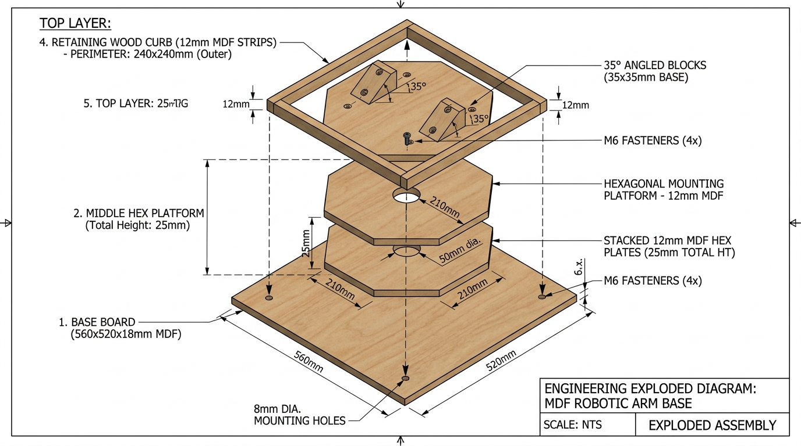
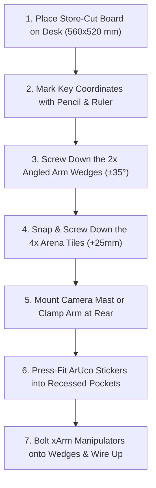

# Stepping Stone 7: Zero-Carpentry Hybrid Workcell Fabrication Guide (Store-Cut Board + Modular 3D Prints)

This document is the definitive, practical fabrication guide for the **Dual xArm 1s Color-Sorting Robotic Workcell**.

It eliminates complex carpentry (no saws, no routers, zero wood-shaping tools at home) and avoids risky, 70-hour mega-prints. Instead, it pairs **ONE store-cut flat wooden board** with **small, fast 3D-printed modular components** that print safely on any standard consumer 3D printer ($\ge 220 \times 220\text{ mm}$ bed).

All spatial coordinates and dimensions directly fulfill the kinematic, optical, and operational standards established in:
- [`docs/01_arena_and_layout.md`](01_arena_and_layout.md) (Workcell topology, V-configuration, coordinates)
- [`docs/02_kinematics_and_grasp_planning.md`](02_kinematics_and_grasp_planning.md) (Arm reach envelopes and grasp heights)
- [`docs/03_computer_vision_and_calibration.md`](03_computer_vision_and_calibration.md) (Camera framing and ArUco fiducials)

---

## 1. Visual Architecture Overview

### 1.1 Complete 3D CAD Render
Below is the full 3D CAD visualization of the assembled robotic workcell:


### 1.2 Modular Exploded Architecture
The base uses a flat wooden board as the foundation, onto which small, modular 3D-printed parts screw directly:



---

## 2. Global Spatial Layout & Coordinates

The global origin $(0, 0)$ is located at the **Front-Left corner** of the flat wooden baseboard.

```text
  Y (Depth: 520 mm)
   ^
   │  ┌────────────────────────────────────────────────────────────┐
   │  │ REAR OF WORKSPACE (Y = 520 mm)                             │
   │  │             [Overhead Camera Mount / Desk Clamp]           │
   │  │                    (X = 280, Y = 510)                      │
   │  │          ┌──────────────────────────────────────┐          │
   │  │          │      CENTRAL ELECTRONICS WEDGE       │          │
   │  │          │   (Jetson Orin / RPi 5 + Buck Hub)   │          │
   │  │          └──────────────┬────────┬──────────────┘          │
   │  │                         │        │                         │
   │  │   [Box 1 Nest]     xArm 1        xArm 2     [Box 2 Nest]   │
   │  │   (Left Flank)  (Angled +35°) (Angled -35°) (Right Flank)  │
   │  │   (50, 360)      (170, 360)    (390, 360)    (510, 360)    │
   │  │   [ArUco #0]   \                /   [ArUco #1]             │
   │  │   (80, 420)     \              /    (480, 420)             │
   │  │                  \  CHAMFERED /                            │
   │  │                   │ HEXAGONAL │                            │
   │  │                   │   ARENA   │ (Elevated +25 mm)          │
   │  │                   │ (Overlap) │                            │
   │  │                   /           \                            │
   │  │                  /             \                           │
   │  │   [ArUco #2] ───┴───────────────┴─── [ArUco #3]            │
   │  │   (105, 40)                          (455, 40)             │
   │  │                                                            │
   │  │ FRONT OF WORKSPACE (Operator Position @ Y = 0 mm)          │
   │  └────────────────────────────────────────────────────────────┘
   └───────────────────────────────────────────────────────────────────> X (Width: 560 mm)
```

### Elevation Levels (Z-Axis)
```text
 Elevation (Z)
   │
 720 mm ─── [Logitech Webcam & Cantilever Boom Center]
   │
   │        (650 mm Vertical Steel/Aluminum Mast or Clamp Arm)
   │
  60 mm ─── [Top Rim of Removable Drop Boxes]
  37 mm ─── [Top of Retaining Curb & ArUco Pockets] (Z = 25 mm deck + 12 mm curb)
  25 mm ─── [Elevated Picking Arena Floor + Silicone Mat]
  10 mm ─── [xArm 1s Angled Mounting Wedges]
   0 mm ─── [Main Wood Baseboard Surface (Top Face)]
 -18 mm ─── [Table Surface / Baseboard Bottom] (18 mm MDF Sheet)
```

---

## 3. The "Zero-Carpentry" Strategy

### 3.1 The Wood Component (One Simple Store-Cut Board)
* **What you need**: A single rectangular board of **$18\text{ mm}$ (or $12\text{ mm}$) MDF**.
* **How to get it**: Most hardware/lumber stores (e.g., Home Depot, local timber merchant) make straight cuts for free or nominal cost.
* **Exact Dimensions to Request**: **$560\text{ mm} \times 520\text{ mm}$** (or $600\text{ mm} \times 500\text{ mm}$).
* **What you do at home**: **Zero cutting, zero sawing, zero sanding.** It sits on your table as a heavy, rigid, flat foundation that naturally dampens servo vibrations.

### 3.2 The 3D-Printed Components (All Small & Bed-Friendly)
Instead of printing a massive 3 kg base that takes 70+ hours and risks warping, the 3D printer only makes **small, lightweight modules**:

```text
┌────────────────────────────────────────────────────────────────────────┐
│               SMALL MODULAR 3D-PRINTED PARTS BREAKDOWN                 │
├──────────────────────────┬─────┬────────────┬─────────────┬────────────┤
│ Part Name                │ Qty │ Dimensions │ Print Time  │ Filament   │
├──────────────────────────┼─────┼────────────┼─────────────┼────────────┤
│ 1. Angled Arm Wedges     │  2  │ 140×154×10 │ 1h 15m each │  ~85 g ea  │
│ 2. Arena Snap-Tiles      │  4  │ 180×160×37 │ 1h 45m each │ ~110 g ea  │
│ 3. Drop Boxes (Bins)     │  2  │ 90×110×60  │ 45 min each │  ~70 g ea  │
│ 4. Camera Mast Socket    │  1  │ 70×70×50   │   40 min    │   ~65 g    │
├──────────────────────────┴─────┴────────────┴─────────────┴────────────┤
│ TOTAL 3D PRINTING: ~7.5 Hours Total | ~595 g Filament (< 1 Spool!)     │
└────────────────────────────────────────────────────────────────────────┘
```

---

## 4. Component Details & Slicing Specifications

### 4.1 Part 1: Angled Arm Mounting Wedges (2×)
* **Dimensions**: $140.0\text{ mm} \times 154.0\text{ mm} \times 10.0\text{ mm}$.
* **Function**: Pre-angles the xArm 1s manipulators at $\pm 35.0^\circ$ inward toward the arena midline ($X = 280\text{ mm}$).
* **Mounting Holes**:
  - 4× corner countersunk holes to screw the wedge down into the wooden board with #8 $\times$ 3/4" wood screws.
  - 4× holes ($118\text{ mm} \times 120\text{ mm}$ pattern) with captive M4 nut slots on the bottom to bolt down the metal xArm 1s base.
* **Print Settings**: 4 perimeters, 25% Gyroid infill (Matte PLA+ or PETG).

### 4.2 Part 2: 4-Tile Modular Interlocking Arena (4×)
To make the elevated arena easy to print on any $220\times 220\text{ mm}$ bed (Ender 3, Bambu A1/P1, Prusa MK3/MK4), the tapered hexagon is segmented into **4 interlocking quadrant tiles**:

```text
 0 mm                     280 mm (Midline)                 560 mm
 420 mm ┌───────────────────────┬───────────────────────┐ 420 mm
        │     ARENA TILE 1      │     ARENA TILE 2      │
        │ • Rear-Left Quadrant  │ • Rear-Right Quadrant │
        │ • ArUco #0 Pad (+37mm)│ • ArUco #1 Pad (+37mm)│
        │ • Built-in 12mm Curb  │ • Built-in 12mm Curb  │
 230 mm ├───────────────────────┼───────────────────────┤ 230 mm
        │     ARENA TILE 3      │     ARENA TILE 4      │
        │ • Front-Left Quadrant │ • Front-Right Quadrant│
        │ • ArUco #2 Pad (+37mm)│ • ArUco #3 Pad (+37mm)│
        │ • Tapered Front Curb  │ • Tapered Front Curb  │
  40 mm └───────────────────────┴───────────────────────┘ 40 mm
```

* **Integrated Features in each Tile**:
  1. **$+25\text{ mm}$ Elevated Deck**: Hollow lightweight core with 15% infill.
  2. **$12\text{ mm}$ Retaining Curb**: Surrounds outer edges to prevent cubes from falling off.
  3. **ArUco Sticker Pockets**: Corner tiles include the **$42\text{ mm} \times 42\text{ mm} \times 0.8\text{ mm}$ recessed pocket** at $Z = +37\text{ mm}$ for flush press-fitting of $40\times 40\text{ mm}$ matte vinyl fiducial stickers.
  4. **Snap-Pins / Alignment Tabs**: Edge puzzle tabs ensure the 4 tiles lock together with sub-millimeter precision.
* **Fastening**: Each tile has two screw-down holes to secure directly into the wooden board using standard 1-inch wood screws.

### 4.3 Part 3: Removable Collection Bins (2×)
* **Dimensions**: $90.0\text{ mm} \text{ (W)} \times 110.0\text{ mm} \text{ (D)} \times 60.0\text{ mm} \text{ (H)}$.
* **Placement**: Nested on the lateral flanks at $(X = 50, Y = 360)$ and $(X = 510, Y = 360)$.
* **Features**: Rounded internal bottom corners ($R = 5\text{ mm}$) to make removing cubes easy. Dual finger cutouts on the rim for fast operator removal.
* *(Zero-Print Alternative)*: You can use two standard plastic food/snack containers of similar size from a supermarket!

### 4.4 Part 4: Overhead Camera Stand
Two simple options:
* **Option A (3D-Printed Socket + Conduit Pipe)**:
  - Print a small circular collar ($60\times 60\text{ mm}$) with an inner bore of $\varnothing 25.6\text{ mm}$.
  - Screw it to the rear apex of the wood board at $(X = 280, Y = 510)$.
  - Insert a $650\text{ mm}$ length of standard 1-inch ($\varnothing 25.4\text{ mm}$) aluminum or PVC pipe.
* **Option B (Zero-Print Desk Clamp Arm — Recommended)**:
  - Buy a standard **$12 clamp-on adjustable webcam boom arm** from Amazon.
  - Clamp it directly to the rear edge of the $18\text{ mm}$ MDF board at $(X = 280, Y = 510)$ and center the camera over $(X = 280, Y = 230)$ at $H = 700\text{ mm}$.
  - Instant setup, zero printing, fully adjustable.

---

## 5. Step-by-Step Assembly Walkthrough



### Step 1: Layout Marking
1. Place the clean, flat $560\times 520\text{ mm}$ MDF board on your desk.
2. With a pencil and ruler, draw a centerline along $Y$ at $X = 280\text{ mm}$.
3. Mark the two arm mounting centers:
   - Left Arm: $(X = 170\text{ mm}, Y = 360\text{ mm})$
   - Right Arm: $(X = 390\text{ mm}, Y = 360\text{ mm})$
4. Draw lines from each center angled at $+35.0^\circ$ (Arm 1) and $-35.0^\circ$ (Arm 2).

### Step 2: Mount Arm Wedges
1. Insert four M4 captive hex nuts into the bottom pockets of each 3D-printed wedge.
2. Place the wedges along your pencil lines.
3. Fasten each wedge securely to the MDF board with four 3/4-inch wood screws.

### Step 3: Install the 4-Tile Arena
1. Snap the 4 printed arena tiles together using their interlocking alignment pins.
2. Center the assembled hexagonal arena on the board between $Y = 40\text{ mm}$ (front) and $Y = 420\text{ mm}$ (rear).
3. Drive four 1-inch wood screws through the tile mounting holes into the MDF board.
4. Drop your $1.0\text{ mm}$ silicone friction mat onto the arena floor.

### Step 4: Fiducials & Camera
1. Peel and press-fit the 4 matte vinyl ArUco stickers (DICT_4X4_50, IDs 0–3) into the molded corner pockets ($Z = +37\text{ mm}$).
2. Attach your camera mast (or clamp your boom arm) to the rear edge at $(280, 510)$.
3. Center the webcam lens at $(X = 280\text{ mm}, Y = 230\text{ mm})$ at a height of $H = 700\text{ mm}$.

---

## 6. Sorting Cubes: 1-Inch Wood Craft Blocks

Do **not** waste time 3D-printing hollow plastic cubes that are too light and slide away from the gripper:
* Buy a 20-pack of **1-inch ($25.4\text{ mm}$) unfinished wooden craft cubes** from Amazon or a local craft store (~$4).
* **Mass**: They naturally weigh **$14\text{--}16\text{ g}$**, providing the exact weight needed for the silicone mat friction ($\mu \approx 0.8$) and xArm claw stability.
* **Painting**: Spray paint them in 4 high-contrast matte colors: **Red, Green, Blue, Yellow** using Ultra-Matte acrylic spray paint (never use gloss or enamel).

---

## 7. Complete Shopping & Materials List

| Item Description | Source | Estimated Cost |
| :--- | :---: | :---: |
| 1× $18\text{ mm}$ MDF Board ($560\text{ mm} \times 520\text{ mm}$, store cut) | Hardware Store / Timber Merchant | $12.00 |
| 1× Spool Matte Dark Slate Gray PLA+ ($1\text{ kg}$) | Amazon / 3D Print Shop | $18.00 |
| 1× Pack of 1-inch Wooden Craft Blocks (20 pcs) | Amazon / Craft Store | $4.00 |
| 1× Pack of M4 $\times$ 25 mm bolts & nuts (for arms) | Hardware Store | $3.00 |
| 1× Small box of 3/4" & 1" wood screws | Hardware Store | $3.00 |
| 1× Desktop Clamp-On Webcam Boom Arm (Optional) | Amazon | $12.00 |
| 1× Sheet of Matte Silicone Mat ($1\text{ mm}$) | Amazon / Craft Store | $6.00 |
| **TOTAL ESTIMATED BUILD COST** | — | **$\approx \$46.00\text{--}\$58.00$** |

---

## 8. Summary Checklist

| Phase | Action Item | Verified |
| :--- | :--- | :---: |
| **Board** | Single $560\times 520\text{ mm}$ flat MDF board acquired (pre-cut at store) | [ ] |
| **Printing** | 2× Arm wedges printed ($\pm 35^\circ$ with M4 nut slots) | [ ] |
| **Printing** | 4× Arena quadrant tiles printed (with $+25\text{ mm}$ deck and ArUco pockets) | [ ] |
| **Printing** | 2× Drop boxes printed (or dollar store tubs acquired) | [ ] |
| **Assembly** | Wedges & Arena snapped and screwed into wooden baseboard with hand screwdriver | [ ] |
| **Vision** | 4× Matte ArUco stickers press-fitted into corner pockets ($Z = +37\text{ mm}$) | [ ] |
| **Camera** | Overhead webcam mounted at $(280, 230)$ at $H = 700\text{ mm}$ | [ ] |
| **Cubes** | 1-inch wooden cubes painted in matte Red, Green, Blue, Yellow | [ ] |
