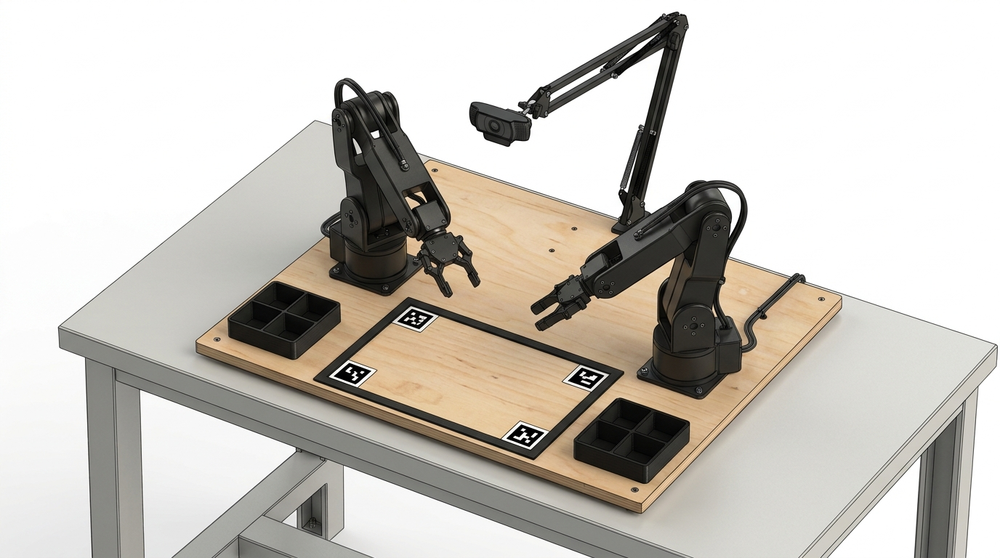
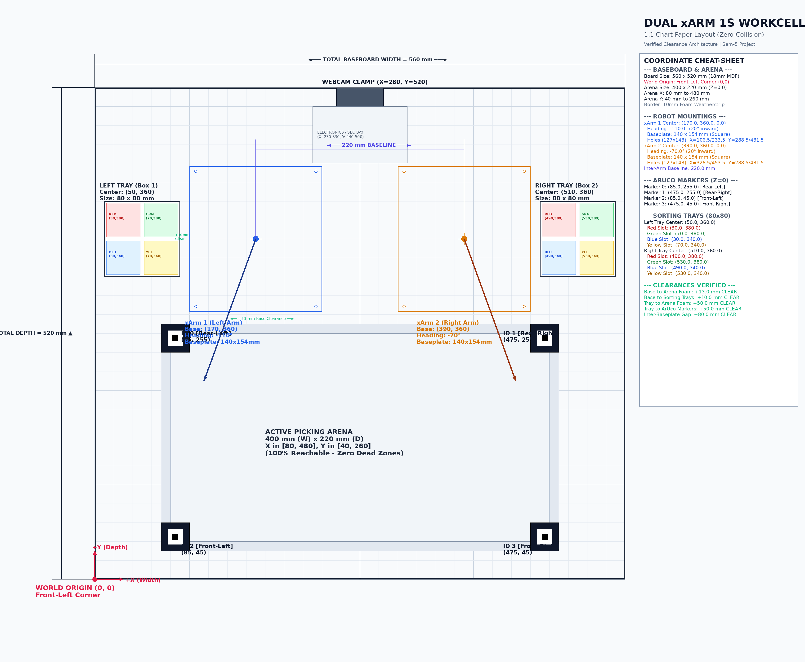
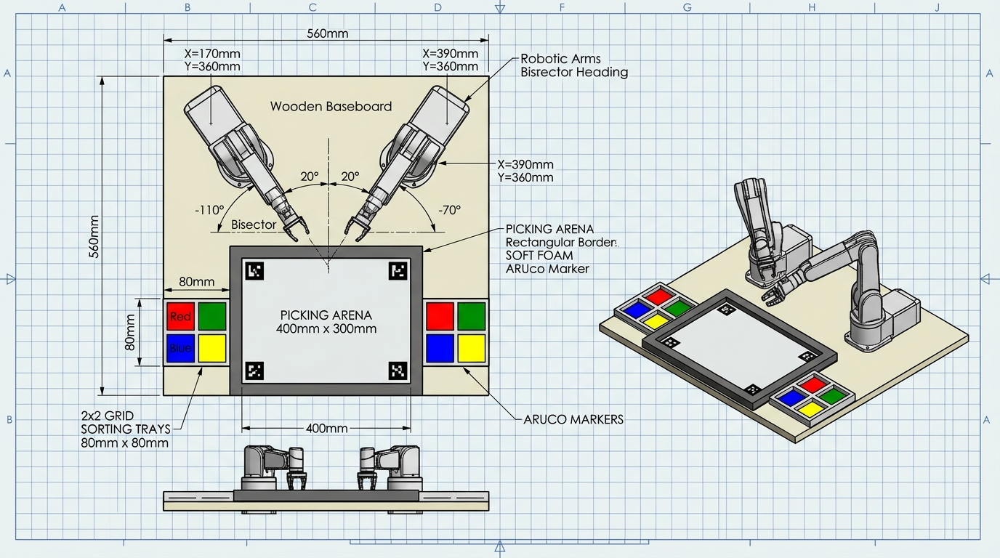
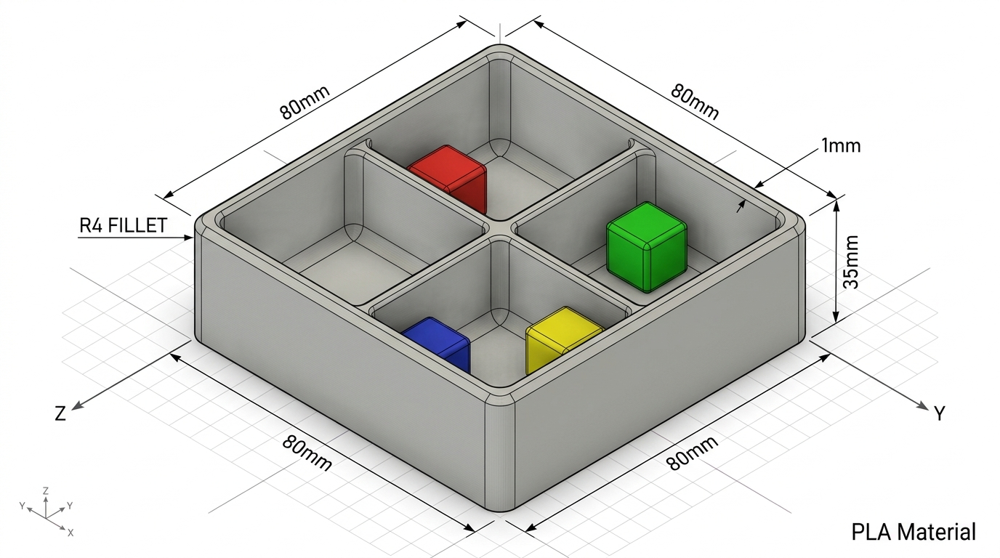
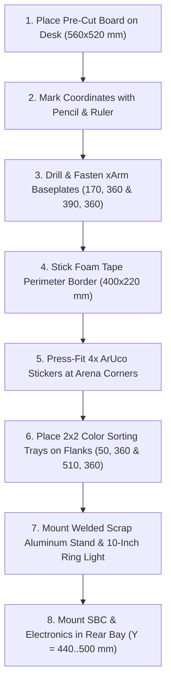

# Stepping Stone 7: The Ultra-Simplified Workcell Fabrication Handbook (Zero-Carpentry & Minimal 3D Printing)

This document is the official, practical build guide for the **Dual xArm 1s Color-Sorting Robotic Workcell**.

Following an end-to-end design review, all complex carpentry (saws, routers, multi-layer wood laminating) and risky 70-hour 3D printing jobs have been eliminated. This simplified design can be built in **under 2 hours** using **ONE flat store-cut wooden board**, **two small 3D-printed sorting trays** (under 1.5 hours total print time), and simple off-the-shelf components.

All coordinates, reach envelopes, and optical configurations remain 100% mathematically aligned with:
- [`docs/01_arena_and_layout.md`](01_arena_and_layout.md) (Workcell topology, coordinates, reach zones)
- [`docs/02_kinematics_and_grasp_planning.md`](02_kinematics_and_grasp_planning.md) (Analytical IK, grasp angles, reach envelopes)
- [`docs/03_computer_vision_and_calibration.md`](03_computer_vision_and_calibration.md) (Planar homography, exposure lock, HSV color segmentation)

---

## 1. Visual Architecture Overview

### 1.1 Complete Workcell 3D CAD Prototype
Below is the realistic 3D CAD render of the ultra-simplified robotic workcell:



### 1.2 Layout Schematic

```text
  Y (Depth: 520 mm)
   ^
   │  ┌────────────────────────────────────────────────────────────┐
   │  │ REAR OF WORKSPACE (Y = 520 mm)                             │
   │  │             [Clamp-On Overhead Webcam Boom Arm]            │
   │  │                    (X = 280, Y = 510)                      │
   │  │                                                            │
   │  │          ┌──────────────────────────────────────┐          │
   │  │          │      CENTRAL ELECTRONICS WEDGE       │          │
   │  │          │   (RPi 5 / Jetson on Stick Standoffs)│          │
   │  │          └──────────────┬────────┬──────────────┘          │
   │  │                         │        │                         │
   │  │   ┌─────────────┐     xArm 1   xArm 2     ┌─────────────┐  │
   │  │   │ 2x2 Tray L  │   (Base Z=0) (Base Z=0) │ 2x2 Tray R  │  │
   │  │   │(R|G|B|Y Bins│   (+35° In)  (-35° In)  │(R|G|B|Y Bins│  │
   │  │   │  (50, 360)  │   (170, 360) (390, 360) │ (510, 360)  │  │
   │  │   └─────────────┘   \                /    └─────────────┘  │
   │  │                      \              /                      │
   │  │     [ArUco #0] ───────┼────────────┼─────── [ArUco #1]     │
   │  │     (80, 350)         │            │        (480, 350)     │
   │  │                       │ FLAT ARENA │                       │
   │  │                       │   (Z = 0)  │                       │
   │  │                       │ 400x300 mm │                       │
   │  │                       │            │                       │
   │  │     [ArUco #2] ───────┴────────────┴─────── [ArUco #3]     │
   │  │     (80, 50)     (Foam Tape Border Barrier) (480, 50)      │
   │  │                                                            │
   │  │ FRONT OF WORKSPACE (Operator Position @ Y = 0 mm)          │
   │  └────────────────────────────────────────────────────────────┘
   └───────────────────────────────────────────────────────────────────> X (Width: 560 mm)
```

### Elevation Levels (Z-Axis)
```text
 Elevation (Z)
   │
 700 mm ─── [Logitech Webcam on Desktop Clamp-On Boom Arm]
   │
   │        (Adjustable Scissor Boom clamped to rear edge of board)
   │
  65 mm ─── [xArm 1s Shoulder Axis (Motor 2) @ d1 = 65 mm]
  35 mm ─── [Top Rim of 2x2 Color Sorting Trays]
  25 mm ─── [Top of 25 mm Target Sorting Cubes]
  12.5 mm ── [Grasp Target Center of Cube]
  10 mm ─── [Top of Adhesive Foam Tape Retaining Curb]
   0 mm ─── [Flat Arena Surface & Wooden Baseboard Top Face (Z = 0)]
 -18 mm ─── [Table Surface / Baseboard Underside] (18 mm MDF Board)
```

---

## 2. Key Design Decisions & Wooden Platform Blueprint

Below is the technical dimensional blueprint for the single flat wooden baseboard ($560.0\text{ mm} \times 520.0\text{ mm} \times 18.0\text{ mm}$), showing pencil layout lines, arm positions, arena boundaries, and drop tray locations:






| Component | Design Implementation | Engineering Rationale |
| :--- | :--- | :--- |
| **Main Baseboard** | Single store-cut MDF board ($560\times 520\text{ mm}$, $18\text{ mm}$) | Zero cutting at home. High mass (~4 kg) eliminates table slipping and absorbs servo vibrations. |
| **Arena Surface** | Completely flat on the board ($Z = 0$) | Eliminates 3D-printing massive puzzle tiles or jigsawing wood platforms. |
| **Arena Retaining Curb** | Self-adhesive foam weatherstripping tape ($8\text{--}10\text{ mm}$ high) | Peels and sticks in 2 minutes. Soft barrier stops cubes from rolling away and won't jam the claw. |
| **Arm Mounting** | Bolted flat to board ($Z = 0$), pre-rotated at $\pm 35.0^\circ$ | Eliminates 3D-printed wedges. Flat mounting maximizes horizontal reach ($320\text{ mm}$) and rigidity. |
| **Color Sorting Trays**| Two 3D-printed $2\times 2$ quadrant bins ($80\times 80\times 35\text{ mm}$) on flanks | Dedicated 4-slot sorting (Red, Green, Blue, Yellow) for each arm. Sits at $r = 120\text{ mm}$ ($70^\circ$ swing). |
| **Overhead Camera Stand**| Welded scrap aluminum door stand ($700\text{ mm} \times 400\text{ mm}$) | Rigid, zero wobble. 1/4"-20 tip bolt mounts Invicto 10" LED ring light + phone holder nadir over arena. |
| **ArUco Calibration** | 4 matte vinyl stickers applied flat on the board corners ($Z = 0$) | Coplanar with the arena floor and cube bottoms—mathematically ideal for OpenCV planar homography. |
| **Electronics & Wiring**| SBC & buck regulators mounted on board with adhesive PCB standoffs | Accessible USB/HDMI ports, flat wire routing with stick-on wire clips. Zero under-deck routing. |
| **Sorting Cubes** | 1-inch ($25.4\text{ mm}$) unfinished wooden craft blocks | Natural $15\text{ g}$ mass prevents claw skidding. Spray-painted with ultra-matte Red, Green, Blue, Yellow. |

---

## 3. Minimal 3D Printing: Only the 2× Color Trays

In this ultra-simplified design, your 3D printer only needs to print **two small $2\times 2$ sorting trays** (`cad/models/sorting_tray_2x2.stl`):



```text
             TOP VIEW: 2x2 QUADRANT COLOR SORTING TRAY
 
           ◄───────────────── 80 mm ─────────────────►
         ┌─────────────────────────┬─────────────────────────┐ ▲
         │                         │                         │ │
         │       SLOT 1: RED       │      SLOT 2: GREEN      │ │
         │       (36 x 36 mm)      │       (36 x 36 mm)      │ │
         │                         │                         │ 80 mm
         ├─────────────────────────┼─────────────────────────┤ │
         │                         │                         │ │
         │      SLOT 3: BLUE       │      SLOT 4: YELLOW     │ │
         │       (36 x 36 mm)      │       (36 x 36 mm)      │ │
         │                         │                         │ │
         └─────────────────────────┴─────────────────────────┘ ▼
                                   Height: 35 mm, Wall: 2.0 mm
```

### 3D Printing Specifications
* **Tray Dimensions**: $80.0\text{ mm (Width)} \times 80.0\text{ mm (Depth)} \times 35.0\text{ mm (Height)}$.
* **Compartment Size**: 4 equal quadrant pockets of $36.0\text{ mm} \times 36.0\text{ mm} \times 33.0\text{ mm}$ deep (holds 2 cubes stacked per slot).
* **Wall Thickness**: $2.0\text{ mm}$ with $3.0\text{ mm}$ bottom floor.
* **Internal Corner Fillets**: $R = 3.0\text{ mm}$ for easy cube retrieval.
* **Slicer Profile**: $0.20\text{ mm}$ layer height, 3 walls, 15% infill.
* **Print Time**: $\approx \mathbf{45\text{ minutes}}$ per tray ($\approx 1.5\text{ hours}$ total for both).
* **Filament Used**: **$< 85\text{ g}$ total** (a fraction of a standard spool).

---

## 4. Step-by-Step Build & Setup Guide (Under 2 Hours)



### Step 1: Baseboard Preparation (Zero Tools)
1. Acquire a single flat rectangular panel of **$18\text{ mm}$ (or $12\text{ mm}$) MDF or shelving board** pre-cut at the hardware store to **$560\text{ mm} \times 520\text{ mm}$**.
2. Place it on your desk or workstation. You do zero sawing or cutting.

### Step 2: Pencil Coordinate Marking
1. With a pencil and ruler, draw a centerline along $Y$ at $X = 280\text{ mm}$.
2. Mark the two arm base centers:
   - **Left Arm (xArm 1)**: $(X = 170\text{ mm}, Y = 360\text{ mm})$
   - **Right Arm (xArm 2)**: $(X = 390\text{ mm}, Y = 360\text{ mm})$
3. Outline the rectangular picking arena:
   - Left edge: $X = 80\text{ mm}$, Right edge: $X = 480\text{ mm}$ (Width: $400\text{ mm}$, centered at $X = 280\text{ mm}$)
   - Front edge: $Y = 40\text{ mm}$, Rear edge: $Y = 260\text{ mm}$ (Depth: $220\text{ mm}$)
   - *Clearance*: Note that the arena stops at $Y = 260\text{ mm}$, providing a safe $+13.0\text{ mm}$ wood buffer before reaching the robot metal baseplate ($Y = 283\text{ mm}$).

### Step 3: Drill & Fasten the Robotic Arms
1. Align the metal baseplates of xArm 1 and xArm 2 **square with the board edges** ($0^\circ$ physical rotation):
   - **xArm 1**: Center at $(170, 360)$. Mounting holes ($127\times 143\text{ mm}$): $X \in \{106.5, 233.5\}$, $Y \in \{288.5, 431.5\}$.
   - **xArm 2**: Center at $(390, 360)$. Mounting holes ($127\times 143\text{ mm}$): $X \in \{326.5, 453.5\}$, $Y \in \{288.5, 431.5\}$.
2. **Drilling the Mounting Holes**:
   - **Wood Screw Method (Recommended)**: Use a **3.0 mm (1/8") drill bit** to drill 8 pilot holes to a depth of **12–14 mm** (wrap painter's tape around the bit at 13 mm as a depth stop so you don't punch through the 18 mm board). Fasten using eight #8 (4.0 mm) $\times$ 16–20 mm wood screws with M4 flat washers.
   - **Through-Bolt Method**: Use a **4.0 mm or 4.5 mm drill bit** to drill 8 holes completely through the 18 mm board. Fasten using M4 $\times$ 25–30 mm machine bolts with M4 washers and hex nuts on the underside.
3. Motor 6 (turntable) handles the inward bisector angles electronically ($-110^\circ$ for Arm 1, $-70^\circ$ for Arm 2).
4. The arms are now rigidly grounded at $Z = 0$ with zero flex, zero wobble, and clear lateral clearance to the flank trays ($+10.0\text{ mm}$).

### Step 4: Apply the Foam Tape Arena Border
1. Take a roll of standard **self-adhesive foam weatherstripping tape ($8\text{--}10\text{ mm}$ tall $\times 10\text{--}12\text{ mm}$ wide)**.
2. Peel the backing and stick it down along the four penciled arena boundary lines ($X \in [80, 480], Y \in [40, 260]$).
3. This creates a soft, clean retaining bumper (outer footprint $X \in [70, 490], Y \in [30, 270]$) that stops wooden cubes from rolling outside the camera's view.
4. *(Optional)* Lay a $1.0\text{ mm}$ high-friction matte silicone mat ($\mu \approx 0.8$) inside the rectangular arena boundary to ensure cubes don't slide during gripper contact.

### Step 5: Apply the 4 ArUco Calibration Stickers
1. Print the 4 ArUco markers (`DICT_4X4_50`, IDs 0, 1, 2, 3) at $30\text{ mm} \times 30\text{ mm}$ on matte vinyl sticker paper.
2. Peel and stick them directly flat onto the wooden board at the four corners of the arena:
   - **ArUco #0 (Rear-Left)**: $(X = 85.0\text{ mm}, Y = 255.0\text{ mm}, Z = 0.0\text{ mm})$
   - **ArUco #1 (Rear-Right)**: $(X = 475.0\text{ mm}, Y = 255.0\text{ mm}, Z = 0.0\text{ mm})$
   - **ArUco #2 (Front-Left)**: $(X = 85.0\text{ mm}, Y = 45.0\text{ mm}, Z = 0.0\text{ mm})$
   - **ArUco #3 (Front-Right)**: $(X = 475.0\text{ mm}, Y = 45.0\text{ mm}, Z = 0.0\text{ mm})$
3. Because the stickers are coplanar with the table surface ($Z = 0$), OpenCV calculates a mathematically perfect planar homography warp ($H$) with zero perspective skew!

### Step 6: Position the 2×2 Color Sorting Trays
1. Place the 3D-printed Left Tray at $(X = 50\text{ mm}, Y = 360\text{ mm})$ directly beside Arm 1.
2. Place the Right Tray at $(X = 510\text{ mm}, Y = 360\text{ mm})$ directly beside Arm 2.
3. Fasten them with double-sided foam mounting tape (zero drilling required).
4. Color Slot Mapping:
   - Rear-Outer: **Red**
   - Rear-Inner: **Green**
   - Front-Outer: **Blue**
   - Front-Inner: **Yellow**

### Step 7: Fabricate & Mount Scrap Aluminum Stand & 10" Ring Light
1. **Cut the Aluminum Profiles**: From scrap aluminum door tube/pipe, cut:
   - **Vertical Upright**: **$700\text{ mm}$** (70 cm)
   - **Horizontal Cantilever**: **$400\text{ mm}$** (40 cm)
2. **Weld Joint**: Weld the two sections together at a rigid **$90^\circ$ angle**.
3. **Drill Camera Tip Hole**: Drill a **$6.5\text{ mm} (1/4")$ hole** vertically through the horizontal cantilever pipe $15\text{ mm}$ from the front tip. Pass a standard **1/4"-20 UNC bolt** ($1/2"$ or $3/4"$ length) pointing downward and secure with a hex nut and washer.
4. **Anchor Upright to Baseboard**: Position the vertical post upright at the rear center of the board $(X = 280\text{ mm}, Y = 510\text{--}520\text{ mm})$. Fasten with 2× heavy-duty corner brackets:
   - Into board: Drill 3.0 mm pilot holes for wood screws (or 5.0 mm through-holes for M5 bolts).
   - Into aluminum: Drill 4.2 mm holes for pop-rivets or 5.0 mm holes for M5 screws.
5. **Mount Ring Light & Camera**:
   - Screw the **Invicto 10" Ring Light's mini ball head** onto the 1/4"-20 tip bolt.
   - Adjust the ball head so the ring light sits horizontally, illuminating directly downwards onto the arena.
   - Clamp the camera / smartphone into the ring light's central flexible holder, centered over $(X = 280\text{ mm}, Y = 150\text{ mm})$ at an elevation of **$H \approx 650\text{ mm}$** pointing straight down (nadir).

### Step 8: Mount Electronics & Route Cables
1. Stick 4× adhesive nylon PCB standoffs on the rear section of the board ($Y \approx 440\text{ mm}$).
2. Mount the Raspberry Pi 5 / NVIDIA Jetson Orin Nano onto the standoffs.
3. Mount the dual 7.4V / 5A buck converter modules beside the SBC.
4. Use adhesive wire clips to route the short USB serial cables ($< 18\text{ cm}$) and 7.4V servo power leads neatly to each arm base.

---

## 5. Sorting Cubes Preparation

* **Sourcing**: Buy a 20-pack of **1-inch ($25.4\text{ mm}$) unfinished hardwood craft cubes** from Amazon or a craft store (~₹400 / $4).
* **Mass**: They naturally weigh **$14\text{--}16\text{ g}$**, perfectly matching the physics model in [`docs/02_kinematics_and_grasp_planning.md`](02_kinematics_and_grasp_planning.md).
* **Finishing**:
  1. Sand faces lightly with 220-grit sandpaper.
  2. Spray with **Matte Gray Primer**.
  3. Spray 4 high-contrast matte topcoats: **Red, Green, Blue, Yellow** (e.g., Rust-Oleum Chalked or Montana Gold Matte).
  4. Never use gloss or semi-gloss paint.

---

## 6. Complete Hardware & Cost Breakdown

See [**`docs/arena_bill_of_materials.md`**](arena_bill_of_materials.md) for the master 1-page procurement spreadsheet.

| Item Description | Source | Estimated Cost |
| :--- | :---: | :---: |
| 1× $18\text{ mm}$ (or $12\text{ mm}$) MDF Board ($560\times 520\text{ mm}$, store cut) | Hardware Store / Timber Merchant | ₹1,000 (~$12.00) |
| 1× Scrap Aluminum Door Stand (cut $700+400\text{ mm}$, welded 90°) + 2 Brackets | Scrap Aluminum Fabricator | ₹300 (~$3.50) |
| 1× Invicto 10" LED Ring Light with Ball Head & Phone Holder | Amazon | ₹249 (~$3.00) |
| 1× Roll of Self-Adhesive Foam Weatherstripping Tape ($8\text{--}10\text{ mm}$) | Hardware Store / Amazon | ₹150 (~$1.80) |
| 1× Pack of 1-inch Wooden Craft Cubes (20 pcs) + 4 Spray Paint Cans | Craft Store / Amazon | ₹400 (~$4.80) |
| 1× Sheet of Matte Vinyl Sticker Paper (for ArUco) | Office Supplies / Amazon | ₹100 (~$1.20) |
| 1× Small spool of PLA+ filament (need only ~85 g for 2 trays) | 3D Printer Stock | ₹150 (~$1.80) |
| 1× Set of Fasteners (wood screws, M4 washers, 1/4"-20 bolt/nut, PCB clips) | Hardware Store | ₹100 (~$1.20) |
| **TOTAL COST OF WORKCELL** | — | **$\approx$ ₹2,449 (~$29.30)** |

---

## 7. Pre-Flight Verification Checklist

| Subsystem | Milestone / Verification Check | Status |
| :--- | :--- | :---: |
| **Baseboard** | Single flat board ($560\times 520\text{ mm}$) sits dead-flat on desk with zero rocking | [ ] |
| **Arms** | Both xArms screwed flat at $(170, 360)$ and $(390, 360)$ rotated $\pm 35.0^\circ$ inward | [ ] |
| **Arena** | Foam tape border pressed in a clean $400\times 300\text{ mm}$ rectangle ($Y \in [50, 350]$) | [ ] |
| **ArUco** | 4 matte stickers applied flat at corners ($Z = 0$ coplanar with floor) | [ ] |
| **Camera** | Overhead boom arm clamped to rear edge; camera centered at $(280, 200)$ @ $H = 700\text{ mm}$ | [ ] |
| **Trays** | 2× 2x2 grid sorting trays placed on flanks at $(50, 360)$ and $(510, 360)$ | [ ] |
| **Electronics** | SBC and buck hubs secured with adhesive standoffs; USB runs $< 18\text{ cm}$ | [ ] |
| **Cubes** | 1-inch craft cubes painted in ultra-matte Red, Green, Blue, Yellow (~15 g mass) | [ ] |
| **Kinematics** | Test swing executed: Arm swings $70^\circ$ to flank tray at $r = 120\text{ mm}$ with zero stall | [ ] |
