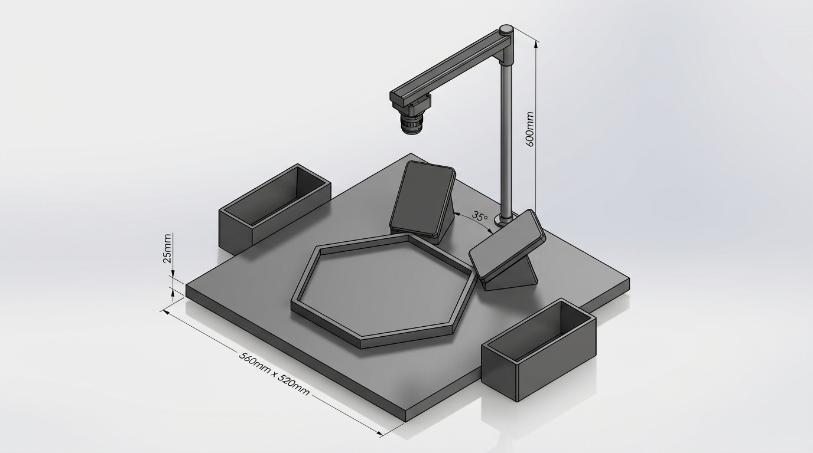
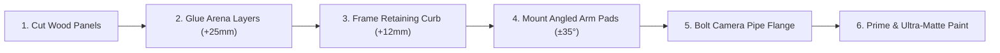

# Stepping Stone 7: Physical Workcell Fabrication & Assembly Guide (Wood & Hybrid Build)

This handbook is the practical, step-by-step construction guide for building the **Dual xArm 1s Color-Sorting Robotic Workcell**. 

Instead of spending 70+ hours 3D-printing a massive plastic base, this guide uses a **Wood (MDF) Layered Build** paired with small 3D-printed precision clips. It can be built in a single afternoon using basic hand tools for less than $30 in materials.

All dimensions directly match the kinematic, arena, and optical specifications established in:
- [`docs/01_arena_and_layout.md`](01_arena_and_layout.md) (Workcell topology, V-configuration, coordinates)
- [`docs/02_kinematics_and_grasp_planning.md`](02_kinematics_and_grasp_planning.md) (Arm reach envelopes and grasp heights)
- [`docs/03_computer_vision_and_calibration.md`](03_computer_vision_and_calibration.md) (Camera framing and ArUco fiducials)

---

## 1. Visual System Architecture

### 1.1 Complete 3D Isometric View
Below is the full 3D CAD render of the assembled robotic workcell:



### 1.2 Exploded Layer Diagram
The base is built by stacking and gluing flat cut panels rather than carving deep pockets:


---

## 2. Global Dimensions & Spatial Layout

### 2.1 Top-Down Layout & Coordinate Map
The origin $(0, 0)$ is at the **Front-Left** corner of the baseboard.

```text
  Y (Depth: 520 mm)
   ^
   │  ┌────────────────────────────────────────────────────────────┐
   │  │ REAR OF WORKSPACE (Y = 520 mm)                             │
   │  │             [Overhead Camera Pipe Flange Anchor]           │
   │  │                    (X = 280, Y = 510)                      │
   │  │          ┌──────────────────────────────────────┐          │
   │  │          │      CENTRAL ELECTRONICS WEDGE       │          │
   │  │          │   (Jetson Orin / RPi 5 + Buck Hub)   │          │
   │  │          └──────────────┬────────┬──────────────┘          │
   │  │                         │        │                         │
   │  │   [Box 1 Nest]     xArm 1        xArm 2     [Box 2 Nest]   │
   │  │   (Left Flank)  (Angled +35°) (Angled -35°) (Right Flank)  │
   │  │   (50, 360)      (170, 360)    (390, 360)    (510, 360)    │
   │  │   [ArUco #0]   \                /   [ArUco #1]             │
   │  │   (80, 420)     \              /    (480, 420)             │
   │  │                  \  CHAMFERED /                            │
   │  │                   │ HEXAGONAL │                            │
   │  │                   │   ARENA   │ (Elevated +25 mm)          │
   │  │                   │ (Overlap) │                            │
   │  │                   /           \                            │
   │  │                  /             \                           │
   │  │   [ArUco #2] ───┴───────────────┴─── [ArUco #3]            │
   │  │   (105, 40)                          (455, 40)             │
   │  │                                                            │
   │  │ FRONT OF WORKSPACE (Operator Position @ Y = 0 mm)          │
   │  └────────────────────────────────────────────────────────────┘
   └───────────────────────────────────────────────────────────────────> X (Width: 560 mm)
```

### 2.2 Side Elevation Profile (Z-Heights)

```text
 Elevation (Z)
   │
 720 mm ─── [Logitech Webcam & Cantilever Boom]
   │
   │        (650 mm Vertical Steel / Aluminum Mast Pipe)
   │
  60 mm ─── [Top Rim of Removable Drop Boxes]
  37 mm ─── [Retaining Curb & ArUco Marker Pads] (Z = 25 + 12 mm)
  25 mm ─── [Elevated Picking Arena Floor + Silicone Mat]
  10 mm ─── [xArm 1s Angled Mounting Pads]
   0 mm ─── [Main Baseboard Surface (Top Face)]
 -18 mm ─── [Table Surface / Baseboard Bottom] (18 mm MDF Sheet)
```

---

## 3. Wood Materials & Cut List (Zero-Waste Plan)

Buy a single standard sheet of **MDF ($1200\text{ mm} \times 600\text{ mm}$ or $4\text{ ft} \times 2\text{ ft}$)**. MDF is strongly recommended over plywood because it has **zero wood grain** (grain patterns can fool OpenCV color detection).

```text
 ┌─────────────────────────────────────────────────────────────────────────────────────────┐
 │                   MDF CUTTING SHEET LAYOUT (1200 mm x 600 mm)                           │
 ├────────────────────────────────────────┬────────────────────────────────────────────────┤
 │                                        │                                                │
 │                                        │    [Part B1: Arena Layer 1]                    │
 │                                        │    (Tapered Hexagon: 450 to 350 mm x 380 mm)   │
 │                                        │                                                │
 │    [Part A: Main Baseboard]            ├────────────────────────────────────────────────┤
 │    560 mm x 520 mm                     │                                                │
 │    (12 mm or 18 mm MDF)                │    [Part B2: Arena Layer 2]                    │
 │                                        │    (Identical Tapered Hexagon)                 │
 │                                        │                                                │
 │                                        ├──────────────────────┬─────────────────────────┤
 │                                        │ [Part D1: Arm Pad 1] │  [Part D2: Arm Pad 2]   │
 │                                        │ 140 mm x 154 mm      │  140 mm x 154 mm        │
 └────────────────────────────────────────┴──────────────────────┴─────────────────────────┘
```

### Exact Cut Dimensions Table

| Part ID | Component Name | Qty | Dimensions ($W \times D \times H$) | Material | Notes |
| :---: | :--- | :---: | :---: | :---: | :--- |
| **A** | **Main Baseboard** | 1 | $560\text{ mm} \times 520\text{ mm} \times 18\text{ mm}$ | 18 mm MDF | Single solid slab. Heavy & stable. |
| **B1** | **Arena Platform (Lower)** | 1 | Tapered Hexagon ($380\text{ mm}$ deep) | 12 mm MDF | Rear: $450\text{ mm}$, Front: $350\text{ mm}$. |
| **B2** | **Arena Platform (Upper)** | 1 | Tapered Hexagon ($380\text{ mm}$ deep) | 12 mm MDF | Glued on top of B1 to reach $+24\text{--}25\text{ mm}$. |
| **C** | **Retaining Curb Strips** | 6 | $12\text{ mm} \times 12\text{ mm} \times \text{Lengths}$ | Pine Dowel / MDF | Miter-cut to frame the 6 arena edges. |
| **D1, D2**| **Arm Mounting Pads** | 2 | $140\text{ mm} \times 154\text{ mm} \times 10\text{ mm}$ | 10 mm Plywood/MDF | Angled at $\pm 35.0^\circ$ on baseboard. |
| **E** | **Drop Box Nesting Borders**| 8 | $5\text{ mm} \times 5\text{ mm} \times 100\text{ mm}$ | Wood strip / dowel | Glued around drop bins to stop sliding. |

---

## 4. Step-by-Step Construction Guide



### Step 1: Cut the Panels
1. Use a circular saw or hand jigsaw with a straightedge guide to cut the main baseboard (**Part A: $560 \times 520\text{ mm}$**).
2. Cut the two matching hexagonal arena panels (**Parts B1 and B2**):
   - Mark the rear width: $450\text{ mm}$.
   - Mark the front width: $350\text{ mm}$ (centered).
   - Set the depth: $380\text{ mm}$.
   - Connect the corners with a ruler and cut along the lines.

### Step 2: Laminate the Arena (+25 mm Elevation)
1. Apply standard PVA wood glue (e.g., Titebond II) evenly across Part B1.
2. Place Part B2 directly on top, align the edges, and clamp firmly for 45 minutes.
3. Once cured, position the combined hexagonal platform onto the main baseboard:
   - Centerline: $X = 280\text{ mm}$.
   - Front boundary: $Y = 40\text{ mm}$.
   - Rear boundary: $Y = 420\text{ mm}$.
4. Secure it from the underside of the baseboard using four 1-inch countersunk wood screws.

### Step 3: Frame the Perimeter Curb
1. Cut $12\text{ mm} \times 12\text{ mm}$ wood dowels or MDF strips to fit the 6 perimeter edges of the arena.
2. Glue and pin-nail them around the rim of the arena platform.
3. This creates a continuous $12\text{ mm}$ wall ($Z = +37\text{ mm}$) that prevents cubes from rolling off.

### Step 4: Mount the Angled Arm Platforms ($\pm 35.0^\circ$)
1. Mark the arm center coordinates on the baseboard:
   - **xArm 1 (Left)**: $(X = 170\text{ mm}, Y = 360\text{ mm})$, rotated **$+35.0^\circ$** (facing South-East).
   - **xArm 2 (Right)**: $(X = 390\text{ mm}, Y = 360\text{ mm})$, rotated **$-35.0^\circ$** (facing South-West).
2. Place the two rectangular wooden pads (Parts D1 & D2) at these angles and screw them down.
3. **Mounting the Robots**:
   - Drill four $\varnothing 5\text{ mm}$ holes in each pad matching the xArm 1s metal base bracket ($118\text{ mm} \times 120\text{ mm}$ pattern).
   - Use **M4 Steel T-Nuts (Pronged Nuts)** inserted from the bottom of the wood, or standard M4 through-bolts with washers and locknuts. This is far stronger than 3D-printed plastic threads.

```text
          ARM MOUNTING WITH STEEL T-NUTS (CROSS-SECTION)
 
      [ xArm 1s Metal Base Plate ]
         │                    │
         ▼ (M4 Bolt)          ▼ (M4 Bolt)
     ┌────────────────────────────┐  <── 10 mm Arm Pad (Wood)
     │   ┌────────────────────┐   │
     └───┴────────────────────┴───┘
     ══════════════════════════════  <── 18 mm Main Baseboard
         ▲                    ▲
      [ M4 Steel Pronged T-Nuts ] (Pounded into wood underside)
```

### Step 5: Install the Camera Mast Pipe Flange
1. Mark the rear apex position: $(X = 280\text{ mm}, Y = 510\text{ mm})$.
2. Place a standard **1-inch ($\varnothing 25.4\text{ mm}$) cast-iron/steel floor flange**.
3. Fasten it firmly with four 1-inch wood screws.
4. Screw in a $650\text{ mm}$ long 1-inch threaded steel pipe or slip-fit aluminum conduit. It will remain rigid with zero wobble.

---

## 5. What Still Needs 3D Printing? (Only Small Clips)

You do **NOT** need to 3D print the base! You only need to print small accessory clips (total print time: **$\approx 2\text{ hours}$**, filament: **$< 200\text{ g}$**):

```text
┌────────────────────────────────────────────────────────────────────────┐
│                   3D-PRINTED ACCESSORY PARTS LIST                      │
├──────────────────────────┬─────┬────────────┬──────────────────────────┤
│ Part Name                │ Qty │ Print Time │ Purpose                  │
├──────────────────────────┼─────┼────────────┼──────────────────────────┤
│ 1. ArUco Corner Clips    │  4  │   30 min   │ Provides 0.8 mm sticker  │
│                          │     │            │ recessed pocket          │
│ 2. Camera Boom Clamp     │  1  │   40 min   │ Clamps camera to pole    │
│ 3. Drop Bins (Boxes)     │  2  │   50 min   │ Smooth filleted cups     │
└──────────────────────────┴─────┴────────────┴──────────────────────────┘
```

### The 4 ArUco Corner Clips
Print 4 small $46\text{ mm} \times 46\text{ mm}$ L-brackets with a molded **$42\text{ mm} \times 42\text{ mm} \times 0.8\text{ mm}$ recessed pocket**. 
- Screw or glue these clips onto the 4 corners of the wooden curb at $(80, 420)$, $(480, 420)$, $(105, 40)$, and $(455, 40)$.
- Press-fit your $40\times 40\text{ mm}$ matte vinyl ArUco stickers (DICT_4X4_50, IDs 0–3) into the pockets.

---

## 6. Surface Finishing & Painting (Critical for OpenCV)

> [!CAUTION]
> **No Glossy Paint or Visible Wood Grain!**
> Wood grain stripes and shiny reflections from room lights will confuse the OpenCV color-tracking algorithm.

Follow this 3-step painting process:

```text
  [ Bare MDF Wood ] 
         │
         ▼  Step 1: Edge Sealing (Diluted PVA wood glue or Sanding Sealer)
  [ Sealed Edges ]
         │
         ▼  Step 2: Sand with 220-grit sandpaper & apply Gray Primer
  [ Uniform Gray Primer Base ]
         │
         ▼  Step 3: Spray with Ultra-Matte Dark Slate Gray (RAL 7016)
  [ Non-Reflective Computer Vision Background ]
```

1. **Seal MDF Edges**: Brush cut edges with a 50/50 mix of PVA glue and water to seal porosity. Let dry 20 minutes.
2. **Primer**: Spray two coats of **Gray Sandable Filler Primer**.
3. **Topcoat**: Spray two light coats of **Ultra-Matte Dark Slate Gray Spray Paint** (e.g., Rust-Oleum Chalked or Montana Gold Matte).
4. **Arena Mat**: Lay a $1.0\text{ mm}$ light gray or muted beige high-friction silicone sheet ($\mu \approx 0.8$) inside the arena deck.

---

## 7. The $25\text{ mm}$ Cubes: Wood Craft Blocks vs. 3D Prints

* **Best Choice: Store-Bought 1-Inch Wooden Cubes**:
  - Buy a pack of standard 1-inch ($25.4\text{ mm}$) unfinished hardwood craft blocks.
  - They naturally weigh **$14\text{--}16\text{ g}$**, have crisp corners, and cost ~$3 for a pack of 20.
* **If 3D Printing Cubes**:
  - You must pause the print at $Z = 16\text{ mm}$ and insert two M8 steel hex nuts ($10.4\text{ g}$) into a hollow core so the cube reaches $\approx 16\text{ g}$. Otherwise, a hollow $7\text{ g}$ cube will skid when touched by the claw.
* **Painting the Cubes**:
  - Spray paint in 4 high-contrast matte colors: **Red, Green, Blue, Yellow** using ultra-matte spray paint. Never use glossy paint.

---

## 8. Complete Hardware Shopping Checklist

| Category | Item Description | Estimated Cost |
| :--- | :--- | :---: |
| **Wood** | 1× Sheet of $12\text{ mm}$ or $18\text{ mm}$ MDF ($1200\text{ mm} \times 600\text{ mm}$) | $15.00 |
| **Wood** | 1× Length of $12\times 12\text{ mm}$ Pine square dowel (for curb) | $3.00 |
| **Hardware** | 1× 1-inch ($\varnothing 25.4\text{ mm}$) Cast-Iron Floor Pipe Flange | $5.00 |
| **Hardware** | 1× 1-inch ($\varnothing 25.4\text{ mm}$) Steel or Aluminum Conduit Pipe ($650\text{ mm}$) | $6.00 |
| **Fasteners** | 8× M4 Steel Pronged T-Nuts & M4 $\times$ 25 mm bolts (for robot arms) | $4.00 |
| **Fasteners** | Box of 1-inch drywall/wood screws & PVA wood glue | $5.00 |
| **Paint** | 1× Can Gray Primer + 1× Can Ultra-Matte Dark Slate Gray Spray Paint | $12.00 |
| **Vision Mat** | 1× Sheet of High-Friction Silicone Mat ($1.0\text{ mm}$ thickness) | $8.00 |
| **Cubes** | Pack of 1-inch ($25\text{ mm}$) wooden craft cubes (20 pcs) | $4.00 |
| **TOTAL** | **Complete Workcell Physical Build** | **$\approx \$62.00$** |
