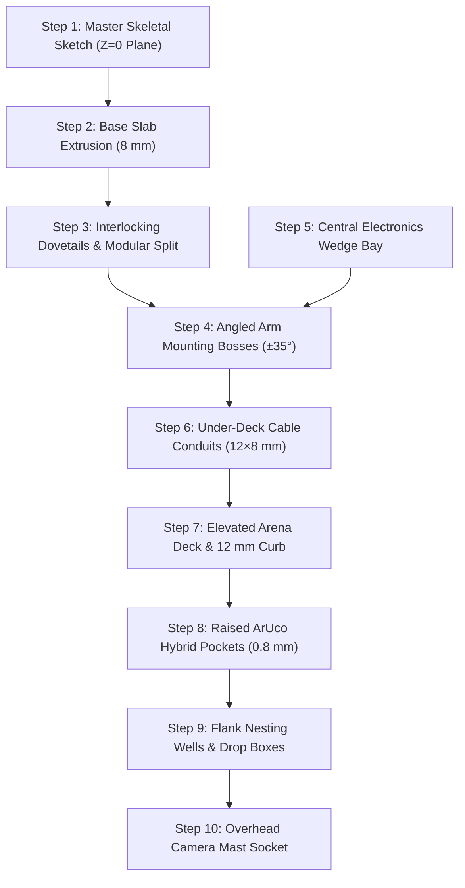

# Stepping Stone 7: Autodesk Fusion 360 CAD Modeling, Wood Prototyping & 3D Fabrication Handbook

This document is the authoritative engineering and manufacturing specification for the **Dual xArm 1s Color-Sorting Robotic Workcell**. It provides a comprehensive Autodesk Fusion 360 CAD modeling workflow, parametric dimension tables, 3D printing slicing configurations, an **alternative rapid wood/MDF layered fabrication route**, cube ballasting/finishing procedures, and quality-assurance verification checklists.

All dimensions, coordinate offsets, and spatial constraints directly implement the kinematic and optical foundations established in:
- [`docs/01_arena_and_layout.md`](01_arena_and_layout.md) (Workcell topology, V-configuration, 4-tile modular base)
- [`docs/02_kinematics_and_grasp_planning.md`](02_kinematics_and_grasp_planning.md) (Analytical IK, reach envelopes, grasp physics)
- [`docs/03_computer_vision_and_calibration.md`](03_computer_vision_and_calibration.md) (Optical coverage, camera boom, ArUco fiducials)

---

## 1. Global Coordinate System & Spatial Layout

The CAD model is constructed about a single world coordinate origin $(0, 0, 0)$ positioned at the **Front-Left corner** of the unified modular base assembly.

```text
  Y (Depth: 520 mm)
   ^
   │  ┌────────────────────────────────────────────────────────────┐
   │  │ REAR OF WORKSPACE (Y = 520 mm)                             │
   │  │             [Overhead Camera Boom Mast Anchor]             │
   │  │                    (X = 280, Y = 510)                      │
   │  │          ┌──────────────────────────────────────┐          │
   │  │          │      CENTRAL ELECTRONICS WEDGE       │          │
   │  │          │   (Jetson Orin / RPi 5 + Buck Hub)   │          │
   │  │          └──────────────┬────────┬──────────────┘          │
   │  │                         │        │                         │
   │  │   [Box 1 Nest]     xArm 1        xArm 2     [Box 2 Nest]   │
   │  │   (Left Flank)  (Angled +35°) (Angled -35°) (Right Flank)  │
   │  │   (50, 360)      (170, 360)    (390, 360)    (510, 360)    │
   │  │   [ArUco #0]   \                /   [ArUco #1]             │
   │  │   (80, 420)     \              /    (480, 420)             │
   │  │                  \  CHAMFERED /                            │
   │  │                   │ HEXAGONAL │                            │
   │  │                   │   ARENA   │ (Elevated +25 mm)          │
   │  │                   │ (Overlap) │                            │
   │  │                   /           \                            │
   │  │                  /             \                           │
   │  │   [ArUco #2] ───┴───────────────┴─── [ArUco #3]            │
   │  │   (105, 40)                          (455, 40)             │
   │  │                                                            │
   │  │ FRONT OF WORKSPACE (Operator Position @ Y = 0 mm)          │
   │  └────────────────────────────────────────────────────────────┘
   └───────────────────────────────────────────────────────────────────> X (Width: 560 mm)
```

- **Origin $(0, 0, 0)$**: Front-Left corner at the baseplate mounting plane ($Z = 0\text{ mm}$).
- **$+X$ Axis**: Lateral width extending from $0\text{ mm}$ (left) to $560\text{ mm}$ (right). Workcell symmetry midline is at $X = 280\text{ mm}$.
- **$+Y$ Axis**: Longitudinal depth extending from $0\text{ mm}$ (operator front) to $520\text{ mm}$ (rear electronics/mast).
- **$+Z$ Axis**: Vertical elevation normal to the baseplate mounting plane.

---

## 2. Parametric User Parameters Table (Fusion 360 Setup)

Before sketching any geometry in Autodesk Fusion 360, navigate to **Modify > Change Parameters** and enter the following parametric variables. This guarantees that all downstream features (tolerances, curb heights, arm spacings, and offsets) can be updated parametrically without breaking the timeline.

| Parameter Name | Expression | Unit | Engineering Rationale / Design Constraint |
| :--- | :---: | :---: | :--- |
| `Base_Width` | `560.0` | mm | Total lateral envelope of unified workcell assembly. |
| `Base_Depth` | `520.0` | mm | Total longitudinal depth from operator front to rear mast. |
| `Base_Thickness` | `8.0` | mm | Base deck web thickness (provides rigidity under arm torque). |
| `Midline_X` | `Base_Width / 2` | mm | Central plane of symmetry ($280.0\text{ mm}$). |
| `Tile_Length_X` | `Base_Width / 2` | mm | Tile split width along X ($280.0\text{ mm}$). |
| `Tile_Length_Y` | `Base_Depth / 2` | mm | Tile split depth along Y ($260.0\text{ mm}$). |
| `Arm_Spacing_X` | `220.0` | mm | Center-to-center distance between xArm 1 and xArm 2 along X. |
| `Arm_Pos_Y` | `360.0` | mm | Centerline Y-position of both arm baseplates. |
| `Arm_Angle_Deg` | `35.0` | deg | Inward toe-in angle toward workspace midline ($+35^\circ$ Arm 1, $-35^\circ$ Arm 2). |
| `Arm_Base_W` | `140.0` | mm | Official LewanSoul xArm 1s metal baseplate width. |
| `Arm_Base_L` | `154.0` | mm | Official LewanSoul xArm 1s metal baseplate length. |
| `Arm_Boss_H` | `10.0` | mm | Raised mounting boss height to isolate screws and embed heat-set inserts. |
| `Arena_Elev_Z` | `25.0` | mm | Elevated deck height; optimizes kinematic reach ($Z_{\text{drop}} = 40\text{ mm}$ vs $65\text{ mm}$). |
| `Arena_Curb_H` | `12.0` | mm | Retaining curb wall height to prevent cube run-off. |
| `Arena_Curb_T` | `4.0` | mm | Wall thickness of perimeter retaining curb. |
| `Arena_Rear_W` | `450.0` | mm | Width of picking arena at rear boundary ($Y \approx 320\text{ mm}$). |
| `Arena_Front_W` | `350.0` | mm | Width of picking arena at front boundary ($Y \approx 50\text{ mm}$). |
| `DropBox_X_L` | `50.0` | mm | Center X-position of Left Flank Box 1. |
| `DropBox_X_R` | `Base_Width - DropBox_X_L` | mm | Center X-position of Right Flank Box 2 ($510.0\text{ mm}$). |
| `DropBox_Nest_Depth` | `5.0` | mm | Recessed nesting well depth for drop boxes. |
| `ArUco_Pad_Size` | `42.0` | mm | Outer perimeter pad dimension molded into curb corners. |
| `ArUco_Pocket_Depth` | `0.8` | mm | Recessed pocket depth for flush $40\times 40\text{ mm}$ matte vinyl sticker. |
| `RPi_Mount_X` | `58.0` | mm | Raspberry Pi 5 / Jetson Orin Nano mounting hole spacing (long axis). |
| `RPi_Mount_Y` | `49.0` | mm | Raspberry Pi 5 mounting hole spacing (short axis). |
| `RPi_Standoff_H` | `6.0` | mm | Elevation of SBC standoffs for under-board component clearance and airflow. |
| `Wire_Trunk_W` | `12.0` | mm | Under-deck cable routing channel width. |
| `Wire_Trunk_D` | `8.0` | mm | Under-deck cable routing channel depth. |
| `Mast_Socket_OD` | `36.0` | mm | Outer diameter of rear camera mast anchor socket. |
| `Mast_Socket_ID` | `25.4` | mm | Inner diameter (nominal 1-inch or 25.4 mm aluminum/carbon tube). |
| `Mast_Socket_H` | `50.0` | mm | Vertical depth of mast anchor socket for torsional stability. |
| `Camera_Height_Z` | `700.0` | mm | Optical center elevation of overhead USB webcam. |
| `Tol_Dovetail` | `0.20` | mm | Radial clearance for interlocking tile seams (FDM tuned). |
| `Tol_Nesting_Box` | `0.40` | mm | Drop box clearance per side for smooth drop-in and removal. |
| `Insert_Hole_M4` | `5.6` | mm | Pilot hole diameter for standard M4 heat-set brass threaded inserts. |
| `Insert_Hole_M3` | `4.2` | mm | Pilot hole diameter for standard M3 heat-set brass threaded inserts. |
| `Insert_Hole_M2p5` | `3.6` | mm | Pilot hole diameter for Raspberry Pi M2.5 brass standoffs. |

---

## 3. Assembly Architecture & Fusion 360 Browser Hierarchy

To keep the CAD assembly clean, avoid monolithic multibody files. Create a dedicated **Top-Level Assembly (`Dual_xArm_Sorting_Workcell`)** and organize external sub-components as follows:

```text
Dual_xArm_Sorting_Workcell (Root)
├── Document Settings (Units: mm)
├── Named Views (Top, Front, ISO_FrontRight, Vision_TopDown)
├── User Parameters (All variables defined above)
├── Sketches (Master_Layout_Skeleton, Wire_Trunking_Routing)
├── Construction (Planes: Midline_XZ, Arena_Deck_Plane_Z25, Camera_Plane_Z700)
├── Components:
│   ├── SubAssy_Modular_Base:
│   │   ├── Base_Tile_1_RearLeft (Body, M4 clamping pockets, Left Arm Boss)
│   │   ├── Base_Tile_2_RearRight (Body, M4 clamping pockets, Right Arm Boss, Mast Socket)
│   │   ├── Base_Tile_3_FrontLeft (Body, Left Arena Deck, ArUco #0/#2 Pads)
│   │   └── Base_Tile_4_FrontRight (Body, Right Arena Deck, ArUco #1/#3 Pads)
│   ├── SubAssy_Collection_Bins:
│   │   ├── Drop_Bin_Left (Removable Box 1, West Flank)
│   │   └── Drop_Bin_Right (Removable Box 2, East Flank)
│   ├── SubAssy_Electronics_Bay:
│   │   ├── SBC_Mount_Plate (Raspberry Pi 5 / Jetson carrier)
│   │   └── Dual_Buck_Hub_Mount (7.4V / 10A regulator bracket)
│   ├── SubAssy_Camera_Gantry:
│   │   ├── Mast_Base_Collar (Bolts to Tile 2 socket)
│   │   ├── Vertical_Riser_Pole (Ø25.4 mm tube, H = 650 mm)
│   │   ├── Cantilever_Boom_Arm (L = 280 mm)
│   │   └── Camera_Articulated_Mount (Logitech C270/C920 or 1/4"-20 adapter)
│   └── SubAssy_Standard_Hardware:
│       ├── Fasteners (M4×12 SHCS, M4 captive hex nuts, M2.5 screws)
│       └── Brass_Inserts (M4, M3, M2.5 heat-set inserts)
```

> [!TIP]
> **Grounding Rule**: Always right-click `Base_Tile_1_RearLeft` and select **Ground** immediately upon creation. All other tiles connect via Rigid Assembly Joints to maintain coordinate truth.

---

## 4. Step-by-Step Base Modeling Workflow in Fusion 360

Follow this exact feature progression in Autodesk Fusion 360.



---

### Step 1: Create the Master Skeletal Sketch
1. Create a new Component: `Modular_Base`.
2. Select the **XY Ground Plane ($Z = 0$)**.
3. Create a **Two-Point Center Rectangle** centered on $(X = \text{Base\_Width}/2, Y = \text{Base\_Depth}/2)$ with dimensions `Base_Width` ($560\text{ mm}$) and `Base_Depth` ($520\text{ mm}$).
4. Draw a vertical construction centerline at $X = \text{Midline\_X}$ ($280\text{ mm}$) and a horizontal construction line at $Y = \text{Tile\_Length\_Y}$ ($260\text{ mm}$).
5. Place two construction points for the arm base centers:
   - Left Arm: $(X = 170.0, Y = 360.0)$
   - Right Arm: $(X = 390.0, Y = 360.0)$
6. Draw construction lines radiating from each center:
   - From Left Center: vector at an angle of $+35.0^\circ$ relative to $+Y$ (pointing South-East).
   - From Right Center: vector at an angle of $-35.0^\circ$ relative to $+Y$ (pointing South-West).
7. Draw the boundary of the **Chamfered Hexagonal Arena**:
   - Rear line: horizontal line at $Y = 320\text{ mm}$, centered on midline, length `Arena_Rear_W` ($450\text{ mm}$).
   - Front line: horizontal line at $Y = 40\text{ mm}$, centered on midline, length `Arena_Front_W` ($350\text{ mm}$).
   - Connect the ends with chamfered angled lines to form the tapered polygon.
8. Finish Sketch and name it `SK_Master_Layout`.

---

### Step 2: Extrude Base Slab & Construct the 4-Tile Dovetail Seams
1. **Extrude Base Slab**: Select the outer $560\times 520\text{ mm}$ profile and extrude downward by $-\text{Base\_Thickness}$ ($-8.0\text{ mm}$) to establish $Z = 0$ as the top surface of the base plate.
2. **Design Dovetail Interlocking Joints**:
   - The base must be segmented into 4 quadrants to fit standard 3D printer beds:
     - `Tile 1 (Rear-Left)`: $X \in [0, 280], Y \in [260, 520]$
     - `Tile 2 (Rear-Right)`: $X \in [280, 560], Y \in [260, 520]$
     - `Tile 3 (Front-Left)`: $X \in [0, 280], Y \in [0, 260]$
     - `Tile 4 (Front-Right)`: $X \in [280, 560], Y \in [0, 260]$
   - Along each interior joint line ($X = 280\text{ mm}$ and $Y = 260\text{ mm}$), sketch alternating trapezoidal dovetails:
     - Dovetail Width: $24.0\text{ mm}$ at neck, expanding to $32.0\text{ mm}$ at tip.
     - Depth / Engagement: $15.0\text{ mm}$.
     - Corner fillets: $R = 1.0\text{ mm}$ to eliminate stress risers.
     - **Clearance Offset**: Apply an `Offset` constraint of $-\text{Tol\_Dovetail}$ ($-0.20\text{ mm}$) to the female pocket geometry.
3. **Split Body Operation**: Use the **Split Body** tool with the dovetail profile cutting planes to divide the monolithic base slab into four distinct solid bodies: `Body_Tile_1` through `Body_Tile_4`.
4. **Under-Deck Clamping Pockets**:
   - On the bottom face ($Z = -8\text{ mm}$), sketch recessed joining plate pockets across each seam ($50\text{ mm} \times 20\text{ mm} \times 3.5\text{ mm}$ deep).
   - Extrude M4 through-holes ($\varnothing 4.5\text{ mm}$) with captive hexagonal nut recesses ($7.0\text{ mm}$ across flats $\times 3.2\text{ mm}$ deep).
   - This allows under-deck rigid clamping using M4 $\times$ 12 mm socket head cap screws and steel nuts, locking the four tiles into a monolithic plate.

---

### Step 3: Model Angled xArm 1s Mounting Platforms
1. Create a sketch on the top face ($Z = 0$) of `Tile 1` and `Tile 2`.
2. Construct a **Rotated Rectangle** centered on $(170, 360)$ angled at $+35.0^\circ$:
   - Width: `Arm_Base_W` ($140.0\text{ mm}$), Length: `Arm_Base_L` ($154.0\text{ mm}$).
3. Construct a symmetric Rotated Rectangle on `Tile 2` centered on $(390, 360)$ angled at $-35.0^\circ$.
4. **Extrude Arm Bosses**: Extrude both rectangular platforms upward by $+\text{Arm\_Boss\_H}$ ($+10.0\text{ mm}$) to $Z = +10\text{ mm}$.
5. **Fastener Hole Pattern**:
   - On each boss surface, place 4 mounting holes matching the LewanSoul xArm 1s bottom bracket:
     - Hole pattern: $118.0\text{ mm} \times 120.0\text{ mm}$ rectangle centered on arm origin.
     - Hole Diameter: `Insert_Hole_M4` ($5.6\text{ mm}$) with a depth of $9.0\text{ mm}$ (sized for M4 $\times$ 8 mm brass heat-set threaded inserts).
   - Add a central circular pass-through pocket ($\varnothing 28.0\text{ mm} \times 6.0\text{ mm}$ deep) directly beneath the base axis for motor wire strain relief.

---

### Step 4: Model the Central Rear Wedge Electronics Bay
The triangular space between and behind the arms ($X \in [180, 380\text{ mm}], Y \in [380, 510\text{ mm}]$) forms the protected electronics bay.

```text
  Y = 510 mm ┌──────────────────────────────────────────────┐
             │       [Overhead Camera Mast Anchor Socket]   │
             ├──────────────────────────────────────────────┤
             │           RASPBERRY PI 5 / JETSON            │
             │       4x M2.5 Standoffs (58 mm x 49 mm)      │
             ├──────────────────────────────────────────────┤
             │           DUAL BUCK REGULATOR HUB            │
             │           (2x 7.4V @ 5A Power Modules)       │
  Y = 380 mm └──────────────┬────────────────┬──────────────┘
             ◄── X = 180 ──►│   X = 280 mm   │◄── X = 380 ──►
```

1. **Recessed Electronics Deck**:
   - Create a sketch on the rear region of Tile 1 & Tile 2 ($X \in [180, 380]$, $Y \in [380, 500]$).
   - Extrude a shallow tray $4.0\text{ mm}$ into the base deck to lower the center of gravity and provide lateral wire containment walls.
2. **Raspberry Pi 5 / Jetson Standoff Bosses**:
   - Sketch 4 cylindrical mounting bosses ($\varnothing 7.0\text{ mm}$) centered symmetrically at $X = \text{Midline\_X}$ ($280.0\text{ mm}$), $Y = 445.0\text{ mm}$.
   - Standoff spacing: $58.0\text{ mm}$ along X, $49.0\text{ mm}$ along Y.
   - Extrude bosses upward by `RPi_Standoff_H` ($6.0\text{ mm}$) above the tray floor.
   - Hole tool: Create $\varnothing 3.6\text{ mm} \times 6.0\text{ mm}$ deep blind holes for M2.5 brass heat-set inserts.
3. **Dual Buck Converter Retainers**:
   - In the forward section of the wedge ($Y \in [385, 415\text{ mm}]$), model two pairs of side-clip rails spaced at $65.0\text{ mm} \times 38.0\text{ mm}$ to friction-fit dual LM2596 / XL4015 7.4V/5A step-down modules.

---

### Step 5: Route Under-Deck Cable Conduits
To prevent servo power and USB wires from snagging on the rotating base brackets, model dedicated under-deck trunking channels:

1. Flip the model to inspect the **underside ($Z = -8.0\text{ mm}$)**.
2. Sketch two symmetrical wiring channels ($12.0\text{ mm}$ wide) branching from the Central Electronics Wedge:
   - **Branch 1 (To Left Arm)**: Curves from $(X = 260, Y = 400)$ to beneath the Left Arm wire pocket $(X = 170, Y = 360)$.
   - **Branch 2 (To Right Arm)**: Curves from $(X = 300, Y = 400)$ to beneath the Right Arm wire pocket $(X = 390, Y = 360)$.
   - **Branch 3 (To Camera Mast)**: Straight longitudinal channel running along the midline from $Y = 460\text{ mm}$ to the rear mast socket at $Y = 510\text{ mm}$.
3. **Cut Extrusion**: Extrude channels into the base underside to a depth of `Wire_Trunk_D` ($5.0\text{ mm}$ into the $8.0\text{ mm}$ slab, maintaining a rigid $3.0\text{ mm}$ top deck ceiling).
4. **Wire Retainer Tabs**: Add $1.5\text{ mm}$ snap-fit lip overhangs every $60\text{ mm}$ along the channel walls so wires remain captive without requiring adhesive tape or zip ties.

---

### Step 6: Model the Elevated Chamfered Hexagonal Arena
The picking arena is elevated $+25\text{ mm}$ above the baseplate to optimize arm kinematics (preventing Motor 5 shoulder pitch collisions during low grasps).

1. Create a sketch on the top plane ($Z = 0$).
2. Project the chamfered hexagonal boundary from `SK_Master_Layout`:
   - Rear line: $450\text{ mm}$ wide at $Y = 320\text{ mm}$.
   - Front line: $350\text{ mm}$ wide at $Y = 40\text{ mm}$.
   - Side chamfers angled to enclose the reach envelope.
3. **Extrude Arena Platform**: Extrude the inner arena body upward by `Arena_Elev_Z` ($+25.0\text{ mm}$) to $Z = +25.0\text{ mm}$.
4. **Retaining Perimeter Curb**:
   - Create a sketch on the top face of the arena deck ($Z = +25.0\text{ mm}$).
   - Offset the perimeter edge outward by `Arena_Curb_T` ($4.0\text{ mm}$).
   - Extrude the $4.0\text{ mm}$ perimeter profile upward by `Arena_Curb_H` ($+12.0\text{ mm}$) to $Z = +37.0\text{ mm}$.
   - Add a $1.5\text{ mm}$ internal chamfer to the bottom corner of the curb to prevent cubes from jamming against the edge.
5. **Silicone Mat Recess**:
   - Offset the interior arena floor downward by a $1.0\text{ mm}$ pocket extrusion across the picking deck to allow a $1.0\text{ mm}$ thick high-friction silicone mat ($\mu \approx 0.8$) to sit flush with the base deck.

---

### Step 7: Model Raised ArUco Hybrid Marker Pockets
To ensure 100% calibration repeatability and eliminate specular LED reflection on 3D printed surfaces, fiducials are mounted in **recessed pockets molded directly into the curb vertices**:

```text
               Cross-Section of Curb Fiducial Pad (Z = +37 mm)
      ┌──────────────────────────────────────────────────────────────┐
 Curb │   ┌──────────────────────────────────────────────────────┐   │ Curb
 Wall │   │  42.0 mm x 42.0 mm x 0.8 mm Recessed Pocket          │   │ Wall
      │   │  (Houses 40 mm x 40 mm Matte Vinyl ArUco Sticker)    │   │
      └───┴──────────────────────────────────────────────────────┴───┘
```

1. On the 4 corners of the elevated retaining curb, model enlarged rectangular fiducial pads ($46.0\text{ mm} \times 46.0\text{ mm}$) planar with the curb top at $Z = +37.0\text{ mm}$:
   - **Pad #0 (Rear-Left)**: Centered at $(X = 80.0, Y = 420.0, Z = +37.0)$
   - **Pad #1 (Rear-Right)**: Centered at $(X = 480.0, Y = 420.0, Z = +37.0)$
   - **Pad #2 (Front-Left)**: Centered at $(X = 105.0, Y = 40.0, Z = +37.0)$
   - **Pad #3 (Front-Right)**: Centered at $(X = 455.0, Y = 40.0, Z = +37.0)$
2. **Cut Recessed Pocket**:
   - On the top face ($Z = +37.0\text{ mm}$) of each pad, sketch a $42.0\text{ mm} \times 42.0\text{ mm}$ square centered on the pad.
   - Extrude a cut downward by `ArUco_Pocket_Depth` ($-0.8\text{ mm}$) to $Z = +36.2\text{ mm}$.
   - Add $0.5\text{ mm}$ lead-in chamfers along the top edge for smooth sticker alignment.

---

### Step 8: Model Removable Drop Boxes & Flank Nesting Wells
Placing collection boxes on the immediate flanks slashes the drop travel from $125^\circ$ to $\approx 65^\circ\text{--}75^\circ$, halving cycle times.

1. **Nesting Wells in Base Plate**:
   - On `Tile 1` (Left Flank), sketch a rectangle centered at $(X = 50.0\text{ mm}, Y = 360.0\text{ mm})$:
     - Dimensions: $92.0\text{ mm} \text{ (Width)} \times 112.0\text{ mm} \text{ (Depth)}$.
   - On `Tile 2` (Right Flank), sketch an identical rectangle centered at $(X = 510.0\text{ mm}, Y = 360.0\text{ mm})$.
   - Cut extrude both wells downward into the base slab by `DropBox_Nest_Depth` ($-5.0\text{ mm}$).
   - Apply a $45^\circ \times 2.0\text{ mm}$ chamfer around the top perimeter of the pocket to guide the box into place.
2. **Semi-Circular Finger Extraction Relief**:
   - On the outer edge of each well, sketch two semi-circular cutouts ($\varnothing 25.0\text{ mm}$) through the full wall depth.
   - This allows the operator to grasp the drop box with two fingers and lift it vertically without prying or using tools.
3. **Model the Removable Drop Box Body**:
   - Create a new Component: `Drop_Bin_Left`.
   - Sketch an outer footprint of $91.2\text{ mm} \times 111.2\text{ mm}$ (accounting for $0.40\text{ mm}$ clearance per side via `Tol_Nesting_Box`).
   - Extrude upward by $60.0\text{ mm}$.
   - **Shell Tool**: Shell the top face with a wall thickness of $2.4\text{ mm}$.
   - Apply $5.0\text{ mm}$ fillets to the four internal bottom corners so dropped cubes settle smoothly without wedging into sharp edges.
   - Mirror or duplicate component for `Drop_Bin_Right`.

---

### Step 9: Overhead Camera Mast Anchor Socket & Cantilever Stand
The camera must remain rigidly centered above the picking arena at $H = 700\text{ mm}$ without wobbling during high-speed robot pick-and-place motions.

```text
                        OVERHEAD CAMERA BOOM SCHEMATIC
   Z = 700 mm
      ┌──────────────────────────────────────────────[ Logitech C270/C920 ]
      │                                                Centered at (280, 230)
      │◄──────── Cantilever Boom: L = 280 mm ────────►
      │
      │  (Vertical Pole: Ø25.4 mm Aluminum or PETG Riser)
      │  Height: 650 mm
      │
   Z = 50 mm
     ┌┴─────────────────────────────────────────┐
     │ Rigid Mast Base Socket (Tile 2 Apex)    │
     │ 4x M4 Heat-Set Inserts, Gusset Braces   │
   Z = 0 mm ────────────────────────────────────┴─────────── (X = 280, Y = 510)
```

1. **Integrated Mast Base Socket**:
   - Located at the rear apex of the modular base: $(X = 280.0\text{ mm}, Y = 510.0\text{ mm})$ split evenly between Tile 1 and Tile 2.
   - Sketch an outer cylinder $\varnothing 38.0\text{ mm}$ with four $45^\circ$ triangular stiffening gussets ($8.0\text{ mm}$ thick) tied into the base deck.
   - Extrude upward to $Z = +50.0\text{ mm}$.
   - Ream/Hole: Bore a central vertical hole of $\varnothing 25.6\text{ mm}$ to a depth of $45.0\text{ mm}$ to receive a standard 1-inch ($\varnothing 25.4\text{ mm}$) carbon fiber or aluminum tube.
   - Add two horizontal clamping slits ($2.0\text{ mm}$ wide) and two transverse M4 clamping screw bosses to pinch-collar the mast tube securely.
2. **Overhead Cantilever Arm & Camera Bracket**:
   - Create a sliding/clamping collar that fits the $\varnothing 25.4\text{ mm}$ vertical tube at $Z = 650\text{ mm}$.
   - Model a horizontal cantilever boom extending forward by $280.0\text{ mm}$ along the midline to $(X = 280.0\text{ mm}, Y = 230.0\text{ mm})$.
   - Add an articulated camera gimbal plate with:
     - Standard 1/4"-20 threaded tripod mounting hole.
     - Custom snap-fit bracket for Logitech C270 / C920 faceplates.
     - Built-in bubble level recess ($\varnothing 10.0\text{ mm} \times 3.0\text{ mm}$) to verify true optical nadir orientation.

---

## 5. 3D Printing 1-Inch ($25\text{ mm}$) Cubes vs. Wooden Cubes

In the system design specifications ([`docs/02_kinematics_and_grasp_planning.md`](02_kinematics_and_grasp_planning.md)), the target object is a **$25.0\text{ mm}$ cube with a target mass of $m \approx 15.0\text{ g}$**.

### 5.1 The Lightweight FDM Problem
A standard 3D printed cube ($25\text{ mm} \times 25\text{ mm} \times 25\text{ mm} = 15.625\text{ cm}^3$) printed in standard PLA with default 15% infill weighs only **$\approx 6.5\text{--}7.5\text{ g}$**.
- **The Failure Mode**: A $7\text{ g}$ cube has insufficient normal force on the silicone mat ($F_N \approx 0.07\text{ N}$). When the xArm gripper fingers make high-speed contact, the cube squirts or skids away instead of camming flat into the jaws.
- **The Solution**: 3D printed cubes must be **internally ballasted** to achieve the target mass of $15.0\text{ g} \pm 1.0\text{ g}$.

### 5.2 CAD Modeling for Ballasted 3D Printed Cubes
To fabricate perfect $15\text{ g}$ cubes on an FDM printer:

1. **Parametric Internal Cavity**:
   - Model a $25.0\text{ mm} \times 25.0\text{ mm} \times 25.0\text{ mm}$ solid cube.
   - Cut an internal hexagonal or cylindrical pocket inside the core (e.g., $\varnothing 14.0\text{ mm} \times 12.0\text{ mm}$ deep) positioned $3.0\text{ mm}$ above the bottom face.
   - Sized to house **two standard M8 steel hex nuts** ($2 \times 5.2\text{ g} = 10.4\text{ g}$) or lead/steel BBs.
2. **Slicer Pause-at-Height Technique**:
   - In PrusaSlicer / Bambu Studio / Cura, insert a **Pause at Layer Height** command right before the ceiling of the internal cavity is closed (e.g., at $Z = 16.0\text{ mm}$).
   - When the printer pauses, drop the two M8 steel hex nuts (or $8.0\text{ g}$ of steel shot with a drop of glue to prevent rattling) into the hollow core.
   - Resume print. The top layers bridge over the nuts, permanently sealing the ballast inside a monolithic plastic cube.
   - **Result**: Final mass = $6.0\text{ g (plastic)} + 10.4\text{ g (steel)} = \mathbf{16.4\text{ g}}$, perfectly matching natural dense hardwood.

```text
               Ballasted 25 mm FDM Cube Cross-Section
         ┌──────────────────────────────────────────────┐ 25.0 mm
         │            Solid Top Shell (1.2 mm)          │
         ├──────┬────────────────────────────────┬──────┤
         │      │     Internal Cavity (Air)      │      │
         │      ├────────────────────────────────┤      │
         │ Wall │   2x M8 Steel Hex Nuts (10.4g) │ Wall │
         │ (1.6)│   Ballast Inserted at Z=16 mm  │ (1.6)│
         ├──────┴────────────────────────────────┴──────┤
         │           Solid Base Shell (1.2 mm)          │
         └──────────────────────────────────────────────┘ 0.0 mm
         ◄────────────────── 25.0 mm ──────────────────►
```

---

### 5.3 Surface Finishing & Painting Protocol (Vision-Optimized)

> [!CAUTION]
> **Specular Glare Warning**: Never use gloss or semi-gloss paint! Specular reflection from overhead room lights creates white glare patches on the cube surfaces. In OpenCV, these glare spots cause holes in the binary threshold mask, corrupting contour centroid calculations and leading to failed grasps.

Follow this 4-step preparation and painting protocol:

1. **Step 1: Mechanical Deburring & Sanding**:
   - Remove elephant's foot or bed brim with a deburring blade.
   - Dry sand all 6 faces with **220-grit wet/dry sandpaper** on a flat granite block to remove FDM layer lines.
   - Finish with a light pass of **400-grit sandpaper** to create a uniformly diffuse micro-texture.
2. **Step 2: Plastic Adhesion Primer**:
   - Clean cubes with 90% Isopropyl Alcohol (IPA) to remove plastic dust and finger oils.
   - Apply two light mist coats of **Matte Gray Automotive Filler Primer** (e.g., Rust-Oleum 2-in-1 Filler Primer or Tamiya Gray Fine Surface Primer).
   - Allow 30 minutes to cure. The neutral gray base neutralizes underlying filament color.
3. **Step 3: High-Contrast Ultra-Matte Color Topcoat**:
   - Use high-pigment, ultra-matte acrylic lacquer spray paint (e.g., **Montana Gold Matte** or **Rust-Oleum Chalked / Painter's Touch Ultra Matte**):
     - **Red**: Pure Crimson / Carmine (Hue target in OpenCV: $[0, 10] \cup [165, 180]$)
     - **Green**: Forest / Emerald Green (Hue target: $[45, 80]$)
     - **Blue**: Cobalt / True Blue (Hue target: $[100, 130]$)
     - **Yellow**: Canary Yellow (Hue target: $[20, 38]$)
   - Apply two ultra-thin coats from a distance of $25\text{ cm}$. Avoid heavy coats that round the crisp $90^\circ$ corners.
4. **Step 4: Matte Clear Protective Seal**:
   - Seal with one light pass of **Matte Acrylic Clear Coat** (e.g., Testors Dullcote or Liquitex Matte Varnish).
   - This prevents paint transfer to the silicone arena mat and metal gripper jaws during repeated sorting cycles.

---

## 6. Filament Selection & 3D Slicing Parameters

### 6.1 Filament Material Evaluation

| Material | Rigidity / Modulus | Bed Adhesion & Warping | Glare / Optical Quality | Verdict for Workcell Base |
| :--- | :---: | :---: | :---: | :--- |
| **Matte PLA+** | High ($3.1\text{ GPa}$) | **Zero warp** on large $280\text{ mm}$ tiles | **Best**: Zero specular reflection | **Recommended First Choice** for base, bins, and arena curb. |
| **PETG** | Moderate-High ($2.1\text{ GPa}$) | Very low warp; high toughness | Slight sheen unless textured | **Recommended** for Camera Mast Socket and RPi Standoffs. |
| **ABS / ASA** | High ($2.3\text{ GPa}$) | **Severe warping** without heated chamber | Moderate | **Not recommended** due to large footprint tile curling. |

### 6.2 Filament Color Selection for Computer Vision
- **Base Plate & Retaining Curb**: **Matte Dark Charcoal or Slate Gray** (RAL 7016 / 7024).
  - *Why not pure black?* Pure black absorbs all shadow information and clips OpenCV edge gradients.
  - *Why not bright white?* Bright white reflects ambient fluorescent lab light and causes sensor blooming.
  - *Charcoal/Slate Gray* provides a neutral background with a distinct HSV Value ($V \approx 60\text{--}90$) that easily segments out from Red, Green, Blue, and Yellow cubes.
- **Arena Floor Mat**: **Matte Light Gray or Muted Beige Silicone Sheet** ($\mu \approx 0.8$, $1.0\text{ mm}$ thickness).
- **Camera Boom & Drop Bins**: Matte Black or Dark Gray.

---

### 6.3 Comprehensive Slicer Configuration Profile

Apply these parameters in Bambu Studio, PrusaSlicer, or OrcaSlicer:

| Parameter Category | Setting / Value | Engineering Justification |
| :--- | :---: | :--- |
| **Nozzle Diameter** | $0.4\text{ mm}$ (or $0.6\text{ mm}$) | $0.4\text{ mm}$ preserves crisp ArUco pocket corners; $0.6\text{ mm}$ cuts print time by 35%. |
| **Layer Height** | $0.20\text{ mm}$ (First Layer: $0.28\text{ mm}$) | Optimal balance between structural Z-strength and printing speed. |
| **Wall Loops (Perimeters)** | **5 Perimeters** ($2.0\text{ mm}$ solid wall) | Essential for M4 heat-set insert retention and dovetail rigidity under load. |
| **Top Shell Layers** | **5 Layers** ($1.0\text{ mm}$) | Prevents infill pillowing on large flat arena surfaces. |
| **Bottom Shell Layers** | **4 Layers** ($0.8\text{ mm}$) | Guarantees watertight bottom for under-deck screw countersinks. |
| **Infill Density - Rear (Tiles 1 & 2)** | **35% Infill** | Dampens dynamic vibrations from rotating bus servos. |
| **Infill Density - Front (Tiles 3 & 4)** | **20% Infill** | Sufficient for static picking arena load. |
| **Infill Pattern** | **Gyroid** | Isotropic mechanical strength; prevents directional twisting and warping. |
| **Print Bed Adhesion** | Smooth PEI or Satin Sheet | Textured sheets can cause corner lift on long $280\text{ mm}$ parts; use a $5\text{ mm}$ outer brim. |
| **Print Speed** | Outer Wall: $50\text{ mm/s}$, Infill: $120\text{ mm/s}$ | Slow outer perimeters maximize dimensional accuracy for dovetail joints. |

---

### 6.4 Heat-Set Brass Insert Hole Specifications
When preparing Fusion 360 models for brass threaded inserts inserted with a soldering iron, use these exact tapered hole dimensions:

```text
               Tapered Heat-Set Insert Hole Profile
              ┌────────────────────────────────┐ Top Surface
              │ \                            / │ Top Chamfer: 0.5 mm x 45°
              │  \                          /  │
              │   │                        │   │ Upper Bore: Ø_Top
              │   │                        │   │
              │   │                        │   │ Hole Depth (H + 1.5 mm)
              │    \                      /    │
              │     └────────────────────┘     │ Lower Relief: Ø_Bottom
```

| Thread Size | Insert Length ($L$) | Hole Top Diameter ($\varnothing_{\text{top}}$) | Hole Bottom Diameter ($\varnothing_{\text{bot}}$) | Minimum Hole Depth | Minimum Wall Thickness |
| :---: | :---: | :---: | :---: | :---: | :---: |
| **M2.5 (RPi 5 Standoffs)** | $4.0\text{ mm}$ | $3.6\text{ mm}$ | $3.4\text{ mm}$ | $5.5\text{ mm}$ | $1.8\text{ mm}$ |
| **M3 (Electronics / Clips)** | $5.0\text{ mm}$ | $4.2\text{ mm}$ | $4.0\text{ mm}$ | $6.5\text{ mm}$ | $2.0\text{ mm}$ |
| **M4 (xArm Bases & Clamps)** | $8.0\text{ mm}$ | $5.6\text{ mm}$ | $5.4\text{ mm}$ | $9.5\text{ mm}$ | $2.5\text{ mm}$ |

---

## 7. Quality Assurance, Interference Detection & Verification

Before executing 20+ hour print jobs on the modular base tiles, execute this multi-step verification protocol.

### 7.1 Fusion 360 Digital Clearance & Collision Check
1. **Interference Detection Tool**:
   - In Fusion 360, navigate to **Inspect > Interference**.
   - Select all components (`Tile_1`, `Tile_2`, `Tile_3`, `Tile_4`, `Drop_Bin_L`, `Drop_Bin_R`).
   - Check the **Include Coincident Faces** checkbox and click **Compute**.
   - **Pass Criteria**: Zero solid intersections detected. Dovetails should show exactly $0.20\text{ mm}$ clearance gaps; drop bins should show $0.40\text{ mm}$ perimeter gaps.
2. **Kinematic Swept Volume Verification**:
   - Activate the Arm Assembly models.
   - Rotate Arm 1 and Arm 2 to their maximum inward limit ($0^\circ$) and maximum outward drop limit ($\pm 75^\circ$).
   - Verify that the claw end-effector maintains at least **$15\text{ mm}$ mechanical clearance** above the baseplate and clears the Drop Box rim during full descent.
3. **Under-Deck Cable Clearance**:
   - Create a **Section Analysis** through the plane $Y = 380\text{ mm}$ and inspect the cable trunking cross-sections.
   - Confirm that the internal cross-sectional area ($\ge 60\text{ mm}^2$) accommodates two 18 AWG silicone power cables and a double-shielded USB cable without pinching.

---

### 7.2 Pre-Flight Physical Test Coupons (Saves Filament)
Do **not** print complete base tiles to test tolerances! Model and print small test coupons first:

1. **Dovetail Fit Coupon (`test_dovetail_gauge.stl`)**:
   - A $40\text{ mm} \times 30\text{ mm} \times 8\text{ mm}$ male tab and matching female pocket.
   - Print both with your chosen matte filament and layer height.
   - **Verification**: The joint should press together firmly by hand without hammering, yet exhibit zero perceptible wobble or play.
2. **Heat-Set Insert Hole Coupon (`test_insert_boss.stl`)**:
   - A small block containing test holes from $\varnothing 5.4\text{ mm}$ to $\varnothing 5.8\text{ mm}$ in $0.1\text{ mm}$ steps.
   - Insert M4 brass inserts with your soldering iron set to $260^\circ\text{C}$.
   - Thread in an M4 screw and test torque resistance with a hand screwdriver (target: $> 2.5\text{ N}\cdot\text{m}$ before spinning).
3. **ArUco Sticker Fit Coupon (`test_aruco_pad.stl`)**:
   - A $46\text{ mm} \times 46\text{ mm} \times 5\text{ mm}$ pad with a $42.0\text{ mm} \times 42.0\text{ mm} \times 0.8\text{ mm}$ pocket.
   - Test peel-and-stick application of printed $40\times 40\text{ mm}$ vinyl stickers. Ensure the sticker sits strictly sub-flush relative to the pad rim.

---

### 7.3 Optical Coverage & Field-of-View Verification
Verify the camera height ($H = 700\text{ mm}$) against your specific webcam lens before printing the mast:

$$\text{FOV}_{\text{Horizontal}} = 2 \cdot H \cdot \tan\left(\frac{\theta_H}{2}\right)$$

For a standard 1080p webcam with $\theta_H \approx 70.4^\circ$:
$$\text{Width Coverage} = 2 \cdot 700 \cdot \tan(35.2^\circ) \approx 2 \cdot 700 \cdot 0.705 = \mathbf{987\text{ mm}}$$
$$\text{Height Coverage} = 987 \cdot \left(\frac{1080}{1920}\right) = \mathbf{555\text{ mm}}$$

- **Arena Envelope**:
  - Arena Maximum Width: $450\text{ mm}$ (fits with $537\text{ mm}$ margin)
  - Arena Depth + Fiducials: $420 - 40 = 380\text{ mm}$ (fits with $175\text{ mm}$ margin)
- **Conclusion**: At $H = 700\text{ mm}$, all four ArUco fiducials and the entire picking area fit inside the sensor frame with an optimal $25\text{--}35\text{ mm}$ border margin, completely excluding operator hands and side electronics from the camera image.

---

## 8. Alternative Manufacturing Route: Wood / MDF Layered Fabrication & Hybrid Build

While full 3D printing provides an integrated solution, printing $3.15\text{ kg}$ of plastic requires **60–80+ hours of printer runtime** and carries warping risks on large $280\text{ mm}$ tiles. 

In robotics prototyping, building the primary base from **wood sheet goods (MDF / Birch Plywood)** is a proven, time-tested alternative.

```text
                  LAYERED WOOD CONSTRUCTION PROFILE
 
 Z = +37 mm ──┐   [12 mm Wood Curb Strip]        [ArUco Corner Block]
              │   ┌──┐                           ┌────────┐
 Z = +25 mm ──┴───┘  └───────────────────────────┴────────┴───┐ (Elevated Arena)
                  ┌───────────────────────────────────────────┤ [12 mm MDF Sheet]
                  │ 12 mm MDF Arena Platform (Stacked)        │ [12 mm MDF Sheet]
 Z = 0 mm ────────┴───────────────────────────────────────────┴─────────────────
                  │                                                            │
                  │ MAIN BASEBOARD: 12 mm or 18 mm Solid MDF Sheet             │
                  │ (Single 560 mm x 520 mm piece — No seams or dovetails!)    │
 Z = -12/-18 mm ──┴────────────────────────────────────────────────────────────┴
```

### 8.1 Wood vs. 3D Printing: Engineering Trade-Off Analysis

| Engineering Metric | 4-Tile 3D-Printed Base | Layered Wood / MDF Base |
| :--- | :--- | :--- |
| **Fabrication Time** | 60–80 hours (4 long prints) | **2–4 hours** (cutting, gluing, drilling) |
| **Material Cost** | $70–$90 (4 spools of PLA+) | **$15–$25** (half-sheet of 12 mm MDF) |
| **Bed Size Limitations** | Forces a 4-tile dovetail split | **None** — Single monolithic $560\times 520\text{ mm}$ board |
| **Joint Flex & Deflection** | Dovetail seams can flex under torque | **Zero joint flex**; solid isotropic board |
| **Dynamic Vibration Damping** | Plastic infill can resonate | **High internal damping**; absorbs servo chatter |
| **Baseplate Mass (Stability)** | $\approx 2.5\text{ kg}$ bare base | **$\approx 3.8\text{--}4.8\text{ kg}$**; stays firmly planted |
| **Tool Requirements** | 3D printer ($\ge 250\times 250\text{ mm}$) | Jigsaw / circular saw, drill, PVA glue |

---

### 8.2 Layer-by-Layer Wood Fabrication Plan

Instead of carving deep recesses out of a solid wood block, use **Laminated (Layered) Construction**:

#### 1. Main Baseboard Slab ($560.0\text{ mm} \times 520.0\text{ mm}$)
* **Material**: **$12\text{ mm}$ or $18\text{ mm}$ MDF (Medium Density Fiberboard)**.
  * *Why MDF over standard Plywood?* MDF has **zero natural wood grain**, perfectly uniform density, cuts with razor-sharp edges, won't splinter, and takes spray paint identically to smooth plastic (essential for computer vision).
* **Fabrication**: Cut a single rectangular panel $560\text{ mm}$ wide by $520\text{ mm}$ deep using a circular saw with a straightedge guide or table saw.
* **Advantage**: Eliminates all dovetail keys, under-deck M4 joining plates, and split seams.

#### 2. Elevated Arena Platform ($+25.0\text{ mm}$)
* **Material**: Two stacked layers of **$12.0\text{ mm}$ MDF** (total thickness = $24.0\text{ mm} \approx 25\text{ mm}$).
* **Geometry**: Tapered hexagon matching [`docs/01_arena_and_layout.md`](01_arena_and_layout.md):
  - Rear Width: $450.0\text{ mm}$ (at $Y = 320\text{ mm}$)
  - Front Width: $350.0\text{ mm}$ (at $Y = 40\text{ mm}$)
  - Working Depth: $380.0\text{ mm}$ ($Y \in [40, 420\text{ mm}]$)
* **Assembly**:
  1. Cut both $12\text{ mm}$ panels with a jigsaw.
  2. Laminate them together using standard PVA wood glue (Titebond II) and clamp for 1 hour.
  3. Center the laminated stack on the main baseboard midline ($X = 280\text{ mm}$) and secure from the underside using countersunk 1-inch wood screws.

#### 3. Perimeter Retaining Curb ($12.0\text{ mm}$ Height)
* **Material**: $12.0\text{ mm} \times 12.0\text{ mm}$ square pine/basswood dowel strips, or $6.0\text{ mm} \times 12.0\text{ mm}$ MDF strips.
* **Assembly**: Miter cut strips to frame the perimeter edges of the elevated hexagonal deck. Glue and pin-nail in place.

#### 4. Angled Arm Mounting Platforms ($+10.0\text{ mm}$ at $\pm 35.0^\circ$)
* **Material**: Two blocks of $10\text{ mm}$ MDF or plywood ($140.0\text{ mm} \times 154.0\text{ mm}$).
* **Positioning**: Align centers at $(170.0, 360.0)$ and $(390.0, 360.0)$ rotated $\pm 35.0^\circ$.
* **Fastener Hardware Transition**:
  - Replace brass heat-set inserts with **M4 Steel T-Nuts (Pronged Tee Nuts)** installed into the bottom of the $10\text{ mm}$ block, OR **M4 E-Z LOK Threaded Inserts for Wood**, OR through-bolts with washers and nylon locking nuts.
  - Drill a $\varnothing 25\text{ mm}$ central hole through the block for servo wire passthrough.

#### 5. Flank Drop Box Nesting Wells
* Rather than routing or chiseling a $5.0\text{ mm}$ recessed pocket into the base:
  - Glue four $5.0\text{ mm}$ square wood battens or border strips around the box footprint ($92\times 112\text{ mm}$) at $(50, 360)$ and $(510, 360)$ to create a positive mechanical drop-in border.

#### 6. Overhead Camera Mast Anchor
* In plastic, the mast socket requires heavy internal infill and thick gussets. In wood:
  - Purchase a standard **1-inch ($\varnothing 25.4\text{ mm}$) Cast-Iron / Steel Floor Flange** from any hardware store.
  - Screw the flange directly to the MDF baseboard at the rear apex $(X = 280, Y = 510)$ using four #8 $\times$ 3/4" wood screws.
  - Thread or insert a 1-inch steel or aluminum conduit pipe ($H = 650\text{ mm}$). This results in a mount with virtually zero flex or vibration.

---

### 8.3 The Recommended "Hybrid" Build Architecture

The optimal balance between fabrication speed, precision, and cost is the **Hybrid Build**:

```text
┌────────────────────────────────────────────────────────────────────────┐
│                   RECOMMENDED HYBRID FABRICATION MATRIX                │
├──────────────────────────┬──────────────┬──────────────────────────────┤
│ Component Subsystem      │ Construction │ Engineering Justification    │
├──────────────────────────┼──────────────┼──────────────────────────────┤
│ Main Baseboard           │ 12/18 mm MDF │ Fast, monolithic, zero seams │
│ Elevated Arena Platform  │ 2x 12 mm MDF │ Rigid, cheap, cuts in 15 min │
│ Retaining Curb Perimeter │ Wood Strips  │ Glues easily to MDF arena    │
│ Camera Mast Base Flange  │ Metal Flange │ 10x stiffer than 3D plastic  │
│ ArUco Corner Pockets (4x)│ 3D Printed   │ Exact 0.8 mm sticker recess  │
│ Drop Bins / Boxes (2x)   │ 3D Printed   │ Smooth curved inside corners │
│ Camera Cantilever Clamp  │ 3D Printed   │ Precise tube collar & swivel │
│ 25 mm Test Cubes (12x)   │ Craft Blocks │ Natural 15g mass, pre-cut    │
└──────────────────────────┴──────────────┴──────────────────────────────┘
```

* **3D Printing Burden in Hybrid Build**: Slashes total printing time from **~70 hours down to ~2.5 hours**, consuming under **$250\text{ g}$ of filament** (only for the ArUco brackets, drop bins, and camera clamp).

---

### 8.4 Critical Wood Finishing Protocols for Computer Vision

> [!WARNING]
> **OpenCV Grain & Glare Rule**: Natural wood grain patterns (especially in plywood or pine) create high-contrast dark and light stripes that OpenCV's HSV thresholding can mistakenly detect as object boundaries or edge noise. Follow these finishing steps strictly:

1. **Edge Sealing**:
   - MDF edges are porous and absorb paint unevenly. Seal all cut edges with a 50/50 mix of PVA wood glue and water, or spray a dedicated Sanding Sealer. Allow to dry for 20 minutes.
2. **Surface Sanding**:
   - Sand the entire assembly with **220-grit sandpaper** on an orbital or hand sanding block to knock down fiber raise.
3. **Primer Base**:
   - Apply two light coats of **Gray Automotive Filler Primer** or Rust-Oleum Sandable Wood Primer.
   - Lightly scuff with 400-grit sandpaper after drying.
4. **Non-Reflective Topcoat**:
   - Spray with **Ultra-Matte Dark Slate Gray (RAL 7016) Acrylic Spray Paint**.
   - **Never apply polyurethane, gloss lacquer, or shiny enamel**, as specular glare spots under overhead lab lighting will degrade OpenCV ArUco homography and color contour detection.

---

## 9. Summary Checklist for CAD & Fabrication

| Phase | Milestone / Action Item | Done |
| :--- | :--- | :---: |
| **Parameters** | All 35+ User Parameters entered in Fusion 360 table with units | [ ] |
| **Assembly** | Component tree created; Base Tile / Board Grounded; Skeleton sketch projected | [ ] |
| **Fabrication Choice**| Decided between 4-Tile 3D Print vs. Layered Wood/MDF Hybrid Route | [ ] |
| **Base Structure** | 4-tile dovetail clearances checked OR 12/18 mm MDF baseboard cut ($560\times 520\text{ mm}$) | [ ] |
| **Arm Bosses** | Left (+35°) and Right (-35°) platforms mounted with M4 inserts or T-Nuts | [ ] |
| **Electronics** | RPi 5 standoffs (58×49 mm) and buck hub clips positioned in rear wedge | [ ] |
| **Wiring** | Under-deck trunking channels routed OR top-deck surface conduits secured | [ ] |
| **Arena & Curb** | +25 mm deck mounted, 12 mm perimeter curb, and 4 ArUco 0.8 mm pockets | [ ] |
| **Drop Boxes** | Flank nesting wells framed with finger reliefs and removable bins fitted | [ ] |
| **Mast Socket** | Rear apex Ø25.4 mm clamping socket printed OR 1-inch pipe flange bolted | [ ] |
| **Finishing** | Surface primed and painted with Ultra-Matte Dark Slate Gray (zero specular glare) | [ ] |
| **Cube Prep** | 25 mm cubes ballasted/checked to ~15 g mass and matte painted (R, G, B, Y) | [ ] |

